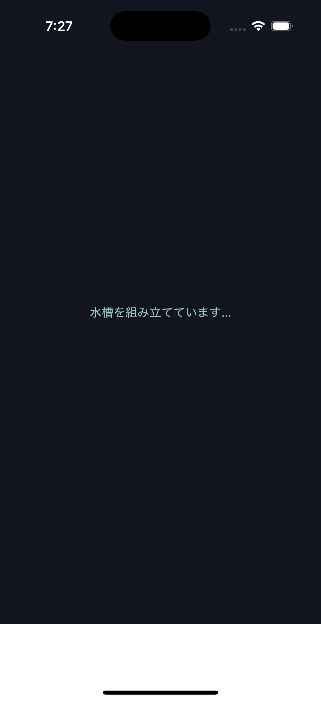
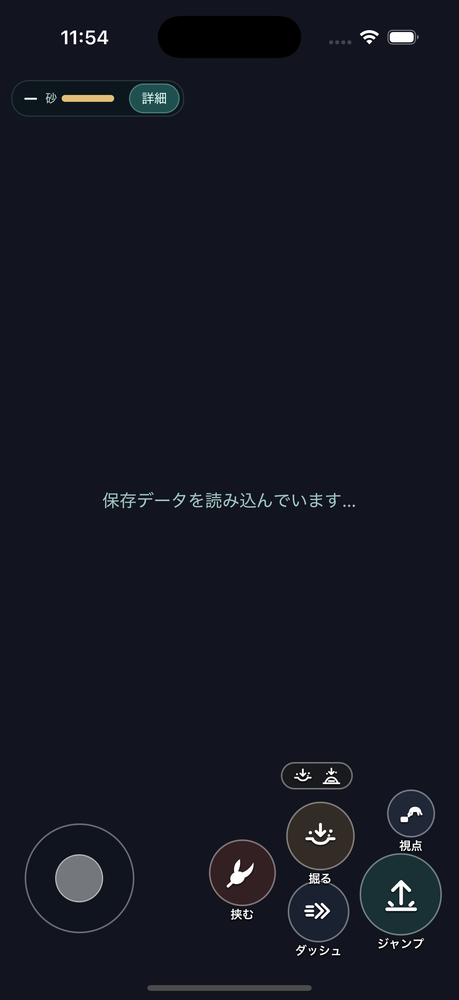
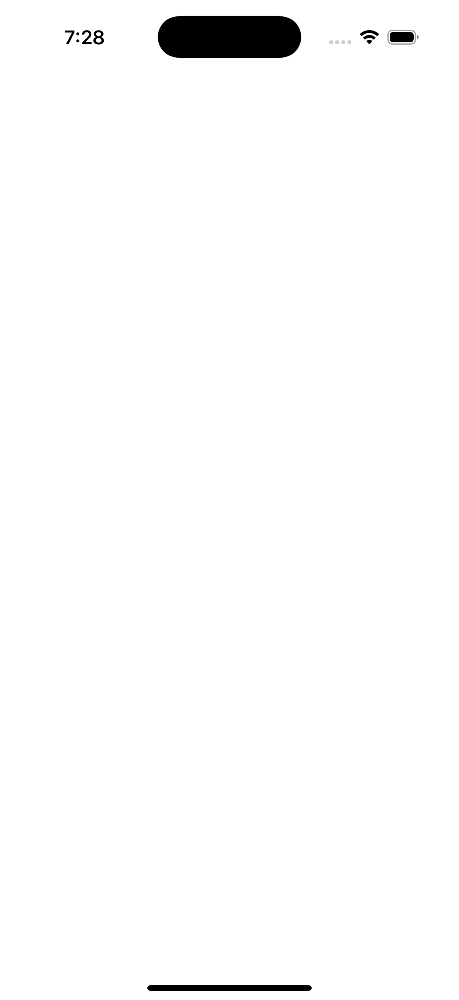
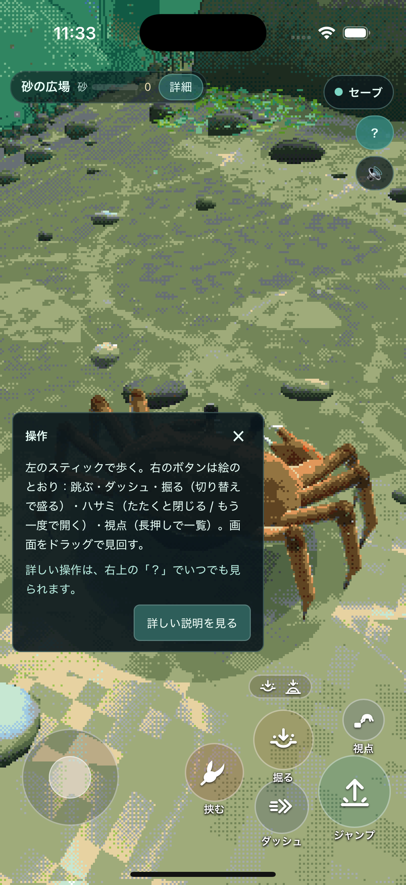
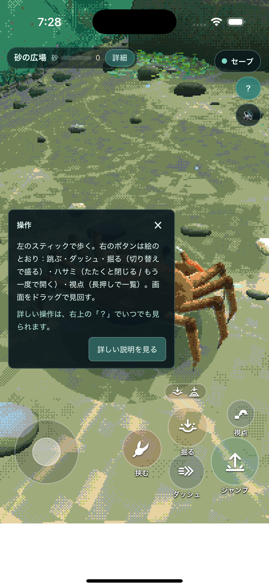
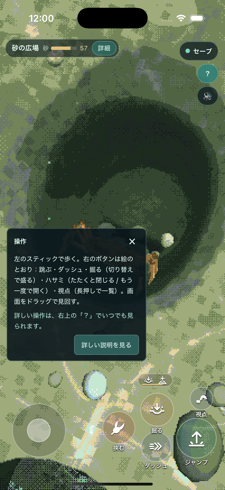

# アプリ化の実証試験（Windows・Android・iOS）— Tauri 2

日付：2026-11-27　ブランチ：`feat/app-packaging-poc`（main `ad88fa9` から）　対象：水槽探検（`aquarium.html`）

## 0. 結論（区分）

| 対象 | 区分 | 根拠（要約） |
| --- | --- | --- |
| Windows（NSIS .exe） | **1. 実機インストール・動作確認済み** | 開発機（Windows 11・RTX 2060 SUPER）へ黙ってインストール（/S）・上書き更新・起動。掘る / 盛る / 壁 / 天井 / 崖 / 水草 / 生き物 / 音 / 保存→再起動→復元 / ファイルの書き出し・読み込み（OS のダイアログ）まで、アプリの中で確認 |
| Windows（.msi） | **2. ビルド成功・実機未検証** | 生成できた（3.8 MB）。管理者権限の要るインストールは試していない |
| Android（APK） | **2. ビルド成功・実機未検証**（エミュレーターでは全項目確認） | 4 ABI の universal release APK（19.8 MB）をビルドし、試験用の鍵で署名してエミュレーター（Android 15・x86_64）へインストール・起動・タッチで歩く / 掘るを確認。全項目の試験は debug APK（同じコード）で、本物のタッチのイベントで実施。**実機の Android 端末では未確認** |
| iOS（シミュレーター用 .app） | **2. ビルド成功・実機未検証** | GitHub Actions の macOS で Xcode プロジェクトを生成し、署名なしでシミュレーター用にビルド・起動・描画を確認（画面写真）。第 2 段の初回起動で WebKit の GPU 処理が「応答なし」で止められ白い画面になった → 第 3 段で対処し、消去したシミュレーターでの初回起動 6 / 6・再起動など 8 / 8・GPU 処理を止めた後の復旧を確認（11 章。白い画面は第 3 段では再現せず、原因は断定できない） |
| iOS（実機用 .ipa） | **5. 環境不足で検証不能**（ビルドは署名で失敗・原因判明） | `Signing for "app_iOS" requires a development team`。Apple Developer Program（有料）の Team・証明書・プロビジョニングが要る。契約・登録はしていない |

ゲーム本体の作り直しは **不要**。アプリ側の設定と、小さな修正（セーブの書き出し・読み込みの入口を OS のダイアログへ / IndexedDB の打ち切りの数え方）で動いた。
第 3 段で、描画（WebGL）の喪失からの復旧・シェーダーの事前の準備・iOS の安全領域の設定を足した（11 章）。
Electron・Capacitor への切り替えが要るほどの互換性の問題は見つからなかった（6 章）。

## 1. 現行構成の調査

| 項目 | 実装 | アプリ内 WebView での注意 |
| --- | --- | --- |
| ビルド | Vite 8、`base: './'`、2 ページ（`index.html` = 描画方式の比較・`aquarium.html` = ゲーム） | アプリには `aquarium.html` だけを入れる（`vite build --mode app` → `dist-app/`、1.0 MB。比較ページの Spark 2.8 MB は入れない） |
| 描画 | Three.js 0.187・WebGL2・独自シェーダー（26 個）。約 59 万三角形 | Android の WebView・iOS の WKWebView・WebView2 とも WebGL2 が動いた。第 2 段の時点では **WebGL のコンテキストが失われたときの処理が無かった**（5.3 節。第 3 段で追加：11 章） |
| 音 | Web Audio（`AquaAudio`）。最初の利用者の操作で AudioContext を作る | 3 つとも、本物のクリック / タッチの後で `running`・時間が進む・効果音が例外なく鳴る。iOS は未確認 |
| 保存 | IndexedDB（`ppp-aquarium`）→ localStorage → メモリ。隠れる・閉じる直前は localStorage へ同期の控え。BroadcastChannel でタブ間の競合 | 保存先の起点（origin）がブラウザ版と別（Windows・Android = `http://tauri.localhost`、iOS = `tauri://localhost`）。**ブラウザ版の進捗はアプリへ自動では移らない**（ファイルの書き出し・読み込みで移す） |
| 書き出し・読み込み | `<a download>`（Blob の URL）・`<input type="file">` | **Android・iOS の WebView は Blob のダウンロードを受け付けない**。→ アプリ版では OS の保存 / 開くダイアログ + Tauri の fs で行う（`AquaPlatform.ts`） |
| 入力 | キーボード・マウス・タッチ（仮想スティック・ボタン）・Gamepad API・`navigator.vibrate` | タッチ・キーは 3 つとも動いた。Gamepad / vibrate は API があることだけ確認（実機のパッド・振動は未確認） |
| その他 | `navigator.storage.persist`、`navigator.clipboard`、`location.reload()`、`?nosave` などの URL の引数、`visibilitychange` / `pagehide` | Android は裏へ回すと `visibilitychange: hidden` が出る（確認済み）。Windows は窓を閉じると `beforeunload → visibilitychange → pagehide` が出て、控えから復元された（確認済み） |
| 外部への通信 | 無し（すべて同じ起点の資源） | 起動から読み込んだ資源の起点は `http://tauri.localhost` だけ（Windows・Android とも）。ネット無しで動く |

## 2. 作ったもの（試作の構成）

- `src-tauri/`：Tauri 2.12 のプロジェクト。起動ページ `aquarium.html`、識別子 `io.github.kitamiya1.aquariumexplore`（**仮**。公開前に決める）、
  プラグイン dialog / fs（権限は保存・開くダイアログとテキストの読み書きだけ：`capabilities/default.json`）。
  Windows は NSIS / MSI、WebView2 は「ブートストラッパーを同梱」（入っていない PC でも入る）。
- `src-tauri/gen/android/`：Android の Gradle プロジェクト（`tauri android init`）。minSdk 24・targetSdk 37。
- `src-tauri/gen/apple/`：Xcode プロジェクト（CI の macOS で `tauri ios init` して取り込んだ。Team は空）。
- `.github/workflows/app-ios.yml`：macOS で Xcode プロジェクトを作り、シミュレーター用にビルド → 起動 → 画面を撮る（署名なし）。
- ゲームのコードの変更（3 か所）：
  1. `src/aquarium/AquaPlatform.ts`（新規）：アプリ版かどうかの判定と、ファイルの保存・開く（アプリ版は OS のダイアログ。Tauri の JS はアプリ版のときだけ動的に読み込む）。
  2. `AquaSaveUi.ts`：書き出し・読み込みを AquaPlatform 経由に。保存先の表示「ブラウザ / アプリ内」。
  3. `AquaSave.ts`：IndexedDB を開く打ち切り（4 秒）を主スレッドが空いていた時間で数える（5.1 節）。
  4. （第 3 段）`AquaGpuGuard.ts`（新規）・`AquariumRenderer.prepare`・`main.ts`：描画の喪失と復旧、シェーダーの事前の準備、起動の記録（`AquaPlatform.diag`）。11 章。
- （第 3 段）ネイティブ側：`src-tauri/src/lib.rs` に起動の記録（`diag_log` → 標準エラーとアプリの記録のフォルダの `diag.log`）と、iOS の WebView の余白の設定。
  `tauri.conf.json` にウィンドウの地の色 `#12151f`。
- ブラウザ版はそのまま：`npm run build`（`dist/`、2 ページ）と GitHub Pages の流れは変えていない。

ビルドの手順：`npm run app:win`（= `tauri build`）、`npm run app:android`（= `tauri android build --apk`）、`npm run app:ios`（macOS だけ）。

## 3. 生成できたアプリのファイル

リポジトリには入れていない（大きい・署名の扱い）。開発機の `app-builds-poc/`（.gitignore 済み）にある。iOS は Actions の Artifacts。

| ファイル | 大きさ | SHA-256（先頭） | 区分 |
| --- | ---: | --- | --- |
| `AquariumExplore_0.1.0_x64-setup.exe`（NSIS） | 3.1 MB | `82B4939ACC3DB32D` | インストール・動作確認済み |
| `AquariumExplore_0.1.0_x64_en-US.msi` | 3.8 MB | `21BE3AF281585091` | ビルドのみ |
| `AquariumExplore_0.1.0_universal-release-unsigned.apk`（arm64-v8a / armeabi-v7a / x86 / x86_64） | 19.8 MB | `5A9DD1852F54842A` | ビルド成功 |
| `AquariumExplore_0.1.0_universal-release-TESTSIGNED.apk`（上を試験用の自己署名の鍵で署名） | 19.9 MB | `03AC09037ACC448A` | エミュレーターで起動・操作確認。**配布には使わない** |
| `AquariumExplore_0.1.0_x86_64-debug.apk`（DevTools を使う試験用） | 137.9 MB | `8AEEE0A79B3896E6` | エミュレーターで全項目 |
| iOS シミュレーター用 `Aquarium Explore.app`（7.7 MB、zip 2.3 MB） | — | — | [Actions run 45957746240](https://github.com/kitamiya1/ParticlePixelPlayground/actions/runs/45957746240) の Artifacts `ios-poc-3` |
| （第 3 段）`Aquarium Explore_0.1.0_x64-setup.exe`（NSIS） | 3.1 MB | `AAEAB73235BF702B` | インストール・動作確認済み（`app-builds-poc/stage3/`） |
| （第 3 段）`Aquarium Explore_0.1.0_x64_en-US.msi` | 3.8 MB | `9A4A57E0694317E5` | ビルドのみ |
| （第 3 段）Android debug APK（x86_64） | — | — | エミュレーターで全項目（`src-tauri/gen/android/app/build/outputs/apk/universal/debug/`） |
| （第 3 段）iOS シミュレーター用 .app | 7.7 MB | — | [Actions run 45989742560](https://github.com/kitamiya1/ParticlePixelPlayground/actions/runs/45989742560) の Artifacts `ios-poc-6` |

ビルドの時間（開発機・初回）：Windows 4 分 43 秒（2 回目以降 3 分）、Android release 4 ABI 17 分 52 秒（2 回目 6 分）、debug x86_64 4 分 31 秒、iOS（CI）約 11 分。
ログ：`docs/app-packaging/logs/`。

## 4. 動作検証

### 4.1 方法

- **アプリの中で検証する**：Windows は WebView2 の DevTools（`WEBVIEW2_ADDITIONAL_BROWSER_ARGUMENTS=--remote-debugging-port`）、
  Android は debug ビルドの WebView の DevTools（`adb forward … webview_devtools_remote_<pid>`）へ CDP でつなぎ（`tools/cdp.mjs`。Node の組み込みだけ）、
  `tools/smoke.mjs` が既存の試験道具（`docs/aquarium/tools` の `climb_helpers.js`・`sand_fill_test.js`・`ceiling_test.js`・`ledge_test.js`・
  `plant_part_test.js`・`catch_test.js` など）をそのまま読み込んで動かす。
- **本物の入力**：Windows は CDP のキー / マウスのイベント（W で歩く・F で掘る）、Android は CDP のタッチのイベント（仮想スティック・掘るボタン）、
  release APK は `adb shell input`（OS のタッチ）。
- **OS のダイアログ**：Windows は UI Automation + キー入力（`tools/win-file-dialog.ps1`）、Android は uiautomator（`tools/android-ui.ps1`）で操作。
- **比較の基準**：同じ試験を Edge（ブラウザ、`dist-app` を `vite preview`）でも実行（`results/browser-edge/`）。

### 4.2 結果

凡例：✅ 確認 / ⚠ 一部・条件付き / ― 未確認。「エミュ」= Android エミュレーター、「シミュ」= iOS シミュレーター（CI）。

| 項目 | Windows（実機・インストール版） | Android（エミュ・debug APK） | Android（エミュ・release APK） | iOS（シミュ・CI） | ブラウザ（Edge） |
| --- | --- | --- | --- | --- | --- |
| 起動 | ✅ | ✅ | ✅ | ⚠ 第 2 段：2 回目は描画、初回は 40 秒で白画面（5.3）→ 第 3 段：✅ 16 / 16（11 章） | ✅ |
| WebGL2 の描画 | ✅ ANGLE / D3D11、色 395・明るさのばらつき 42.6 | ✅ エミュの GL 変換（`adb screencap` で確認） | ✅ 画面写真 | ✅（2 回目の起動の画面写真） | ✅ |
| カニの操作（本物の入力） | ✅ キー W で 1.71 歩く・F で 3 個掘る | ✅ タッチで 2.24 歩く・3 個掘る | ✅ OS のタッチで歩く・掘る（砂 0→25、穴が見える） | ― | ✅ |
| 掘る | ✅ 12.5 の砂・穴の体積 −12.5 | ✅ 同じ | ✅（上） | ― | ✅ |
| 盛り土 | ✅ 砂山 41 個・砂 4.6 使用 | ✅ 54 個・4.4 | ― | ― | ✅ |
| 壁 | ✅ 岩の垂直面に張り付き（grabs 2） | ✅（grabs 1） | ― | ― | ✅（grabs 1） |
| 天井 | ✅ 1.6 秒で洞窟の天井へ・前後左右に移動・跳んで離れる | ✅ | ― | ― | ✅ |
| 崖 | ✅ 高い崖（9.83 → 6.87）を接地主導で降りる・落下 0 | ✅（9.83 → 6.74） | ― | ― | ✅ |
| 水草 | ✅ 森で 23 本をかき分け・葉を挟んで張力 6.87 | ✅ 同じ | ― | ― | ✅ |
| 生き物 | ✅ エビを 2 回中 2 回挟む | ✅ 同じ | ― | ― | ✅ |
| 音 | ✅ クリック後 `running`・3 音・0.42 秒進む | ✅ タップ後 `running`・3 音 | ― | ― | ✅ |
| 保存 → 再起動 → 復元 | ✅（修正後）穴 67・砂山 41・砂・位置が一致、`loaded: ok` | ✅ force-stop → 起動で穴 80・砂山 54・位置が一致 | ― | ― | ― |
| 閉じる・裏へ回したときの控え | ✅ 窓を閉じる → 次の起動で控えから復元（`fromJournal: true`） | ✅ ホームで `visibilitychange: hidden`・戻ると `visible` | ― | ― | ― |
| ファイルへ書き出す | ✅ OS の「名前を付けて保存」→ 935 B の JSON | ✅ システムのファイル選択（Downloads）→ 7.5 KB | ― | ― | （既存の動作） |
| ファイルから読み込む | ✅ 「開く」→ 穴 8 → 4・位置が書き出した時へ | ✅ 位置が書き出した時へ・`loaded: ok` | ― | ― | （既存の動作） |
| ネット無し | ⚠ 資源は `http://tauri.localhost` だけ（exe に同梱）。回線を切っての起動は未実施 | ✅ 機内モード（ping 不通）で冷えた起動 → 復元・描画 | ― | ― | ― |
| FPS | 75（画面の更新に一致。平均 13.3 ms・95% 13.4 ms） | 60（16.7 ms） | gfxinfo：50% 16 ms・90% 23 ms・99% 44 ms | ― | 68 |
| メモリ | JS 66 MB。プロセス合計 作業セット 581 MB・プライベート 448 MB（WebView2 の 8 プロセス） | JS 58 MB・PSS 157 MB（debug） | PSS 96 MB | ― | JS 47 MB |
| 起動の時間 | 起動 → ゲーム開始 10.4 秒（初回。WebView2 の準備込み）・2 回目 6.2 秒。生成 4.8 秒 | 12.7 秒（初回）・10.9 秒。生成 8.7 秒 | 画面が出るまで 0.8 秒 | 初回は 20 秒で読み込み中 | 9.1 秒（新しいプロファイル） |
| ページの例外 | 0 | 0 | logcat の重大なエラー 0 | 第 2 段：GPU 処理が「応答なし」で再起動（5.3）。第 3 段：GPU 処理を止めてもその場で復旧（11 章） | 0 |

注意：
- 性能の数字は、別の Rust のビルドが走っている間に測ったものがある（CPU を取り合っている）。エミュレーターは x86_64 で GPU は PC の GPU の変換なので、スマホの性能の目安にはならない。
- Android の CDP の画面写真は WebGL の層が写らず黒い（`results/android-emulator/0*.png`）。実際の画面は `adb screencap`（`adb-screencap-debug.png`）で確認した。描画の判定は canvas の画素で行っている。
- 結果の生データ：`docs/app-packaging/results/`（`first.json`・`restore.json`・画面写真）。

## 5. 見つかった問題

### 5.1 初回起動で保存先が localStorage へ落ち、次の起動で進捗が消えたように見える（**ゲームの既存の不具合。修正済み**）

- 症状：アプリの初回起動で保存先が `localStorage` になり、進捗（穴 60 個）を保存 → 再起動すると IndexedDB が開け、空の IndexedDB を読んで初期状態から始まった。
- 原因：`IdbBackend.open` の打ち切り `setTimeout(…, 4000)` と、並行して走る世界の生成（同期で 4.5〜5 秒）。生成が主スレッドを止めている間に
  打ち切りの時刻が過ぎ、開けた知らせより先に打ち切りが動く。IndexedDB 自体は 18 ms で開ける。
- ブラウザでも起きる：Edge の新しいプロファイルで同じく `localStorage` へ落ちた（`results/browser-edge/first.json`、生成 4.7 秒）。生成が遅い端末ほど起きやすい。
- 修正：打ち切りまでの時間を「主スレッドが空いていた時間」で数える（1 回の刻みで数えるのは最大 0.5 秒）。修正後は Edge の新しいプロファイル・アプリ版の初回とも `indexeddb`、
  再起動で復元された。
- 残ること：本当に 4 秒以上開けなかった起動のあと、次の起動で IndexedDB が開けると、localStorage に保存した分は読まれない（保存先を起動ごとに選び直し、互いを見ない）。
  移す処理（IndexedDB が空で localStorage に current があれば取り込む）を足すかは別に決める。

### 5.2 セーブの書き出し・読み込みが WebView では動かない（アプリ側の小さな修正で解決）

Android・iOS の WebView は `<a download>` の Blob の URL を保存しない。アプリ版だけ OS のダイアログ + fs に替えた（AquaPlatform）。Windows・Android で書き出し・読み込みを確認済み。
iOS の保存ダイアログ（ファイル App）での書き出し・読み込みは未確認。

### 5.3 iOS シミュレーターの初回起動で WebKit の GPU 処理が落ち、白画面になった（第 3 段で対処・再現せず・原因は断定できない → 11 章）

以下は第 2 段の時点の記録。第 3 段の調べと対処は 11 章。

- ログ：起動から約 24 秒で `GPUProcessProxy::didBecomeUnresponsive … terminating it`・`gpuProcessExited: reason=Unresponsive`。その後の画面は真っ白（`sim-40s.png`）。
  終了させてもう一度起動すると 15 秒で描画された（`sim-relaunch-15s.png`）。
- 見立て：CI の macOS は仮想マシンで GPU が遅く、初回のシェーダーの準備などで GPU 処理が応答しない時間が長くなり、WebKit の見張りに止められた。
  実機の iPhone で起きるかは分からない（ブラウザ版は iPhone の Safari で動いている：`docs/aquarium/feel-iphone` など）。
- どちらにしても、ゲームは **WebGL のコンテキストが失われたとき（`webglcontextlost`）の処理が無い**。失われると白（黒）画面のまま戻らない。
  アプリでは OS の都合で GPU 処理が止められることがあるので、失われたら作り直す・読み込み直すを足すのが安全（ゲーム側の小さな追加）。

### 5.4 iOS で画面の下に白い帯が出る（**第 3 段で修正・シミュレーターで確認** → 11 章）

シミュレーターの画面で、ホームのバーの辺りの高さ（約 11%）が白い。WebView の中身が安全領域の下まで伸びていない。
`viewport-fit=cover` は付いているので、WKWebView の内側の余白の自動調整（contentInsetAdjustmentBehavior）か、`100vh` / `100dvh` の扱いの違いが候補。
→ 原因は前者（contentInsetAdjustmentBehavior が既定の automatic）。CSS は関係なかった。

### 5.5 そのほか（小さなこと）

- 実行ファイルの名前が `app.exe` だった → `mainBinaryName: aquarium-explore` にした（上書き更新で入れ替わることを確認）。
- Android の DevTools の画面写真に WebGL が写らない（試験道具の制約。ゲームの問題ではない）。
- Android の `navigator.onLine` は機内モードでも `true` だった（エミュレーター。ゲームは使っていない）。
- CSP は無効（`"csp": null`）のまま。外部への通信が無いので試作では問題ないが、公開前に `default-src 'self'` などを入れる。

## 6. 代替手段の比較（Electron・Capacitor）

Tauri で重大な互換性の問題は出なかったので、乗り換えの試作はしていない。比べた点だけ書く。

| | Tauri 2（今回） | Electron（Windows） | Capacitor（iOS・Android） |
| --- | --- | --- | --- |
| 描画エンジン | OS の WebView（Windows = WebView2 / Chromium、Android = System WebView / Chromium、iOS = WKWebView / WebKit） | Chromium を同梱（どの PC でも同じ） | OS の WebView（Tauri と同じ） |
| 大きさ | インストーラー 3.1 MB | 80〜100 MB 程度 | APK は Tauri と同程度か小さい（Rust が無い） |
| 3 つを 1 つで | ○（同じ `src-tauri`・同じ Web のコード） | Windows だけ | iOS・Android だけ（Windows は別） |
| 今回の問題への効き | 5.3・5.4 は WKWebView 自体の性質なので、Capacitor でも同じく起きる（5.4 の設定は Capacitor では既定で `never`。Tauri では起動時に 1 行で設定できた） | — | 同上 |

- Tauri の弱いところは Rust のビルドの重さ（Android 4 ABI で約 18 分）と、モバイル対応の歴史の浅さ（今回は大きな問題なし）。
- 乗り換えが必要になったとしても、ゲームの Web のコードはそのまま使える（Electron / Capacitor も中身は同じ HTML・JS）。違うのは今回の AquaPlatform に当たる「ファイルの保存」の入口だけ。
- 判断：**ゲーム本体の作り直しは不要。どの方式でもアプリ側の設定と小さな修正の範囲**。

## 7. プラットフォームごとの判断

### Windows

- 将来アプリ化できると判断する根拠：インストーラー（NSIS）で入れた本物のアプリの中で、全項目（描画・操作・掘る / 盛る・壁 / 天井 / 崖・水草・生き物・音・保存と復元・ファイルの書き出し / 読み込み・閉じたときの控え）が動いた。
  WebView2 は Edge と同じ Chromium で、ブラウザでの結果と同じだった。上書き更新もできた。
- まだ保証できないこと：コード署名（無いと SmartScreen の警告が出る。証明書は有料）、Microsoft Store への出し方、MSI のインストール、WebView2 が入っていない PC・古い Windows 10・
  内蔵 GPU / 弱い GPU での性能、ネットを切った状態での起動（資源は同梱で外へ出ないことは確認）、アンインストール、高 DPI・複数モニター、ゲームパッド。

### Android

- 根拠：4 ABI の release APK がビルドでき、エミュレーター（Android 15）でインストール・起動・OS のタッチで歩く / 掘るができた。debug APK（同じコード）で全項目
  （保存と復元・機内モードでの起動・システムのファイル選択での書き出し / 読み込み・裏へ回したときの知らせ）を確認した。
- まだ保証できないこと：**実機**（GPU は Adreno / Mali など。WebGL の性能・メモリ・発熱）、古い / 低価格の端末、System WebView の版の違い（エミュの WebView は Chrome 124）、
  Google Play への出し方（AAB・署名の鍵の管理・Play の審査・targetSdk の要件）、画面の回転と切り欠き、戻るボタンの動き、OS にアプリを止められたときの控え、振動・ゲームパッド。

### iOS

- 根拠：Tauri で Xcode プロジェクトが生成でき、署名なしでシミュレーター用にビルドでき、WKWebView の中でゲームが描画された。Web のコードは同じ。
  第 3 段で、消去したシミュレーターでの初回起動 6 / 6・再起動と続けての起動 8 / 8 が描画まで進み、画面いっぱいに描かれ、GPU 処理を止めても
  その場で復旧して掘った穴・手持ちの砂が残り、起動し直しても保存から戻った（11 章）。
- まだ保証できないこと：**実機でのビルド・インストール・動作すべて**（Apple Developer Program の Team・証明書・プロビジョニングが要る）、
  初回起動の白い画面が実機で起きないこと（シミュレーターでも 11 回中 1 回だけで、原因を断定できていない。5.3・11 章）、
  音・タッチ・保存と復元（自動検証の掘る操作では確認）・ファイルの書き出し / 読み込み（ファイル App）・裏へ回したとき、App Store の審査（Web をそのまま包んだだけのアプリは
  ガイドライン 4.2「最低限の機能」で断られることがある）、メモリの上限（WKWebView は使いすぎると中身が落ちる。シミュレーターで WebContent 最大 422 MB）、
  起動の重い同期の処理（世界の生成 7〜9 秒・11 章）。

## 8. 今後ゲームに機能を足すときの互換性の注意

1. **アプリかどうかの違いは `AquaPlatform.ts` に閉じ込める**。ゲームの中で `__TAURI_INTERNALS__` を見ない。ファイル・共有・振動・外部リンクなど OS に触る機能は、ここに入口を作る。
2. **ダウンロード（`<a download>`・Blob の URL）・`window.open`・別のページへの移動・`alert / confirm / prompt` を新しく使わない**。WebView では動かない / 違う動きになる。
3. **外部のサーバー・CDN から読み込まない**（フォント・モデル・音も同梱）。オフラインと CSP のため。外部の通信が要る機能はアプリ版の権限（capabilities）と CSP を足す。
4. **保存の起点がブラウザ版とアプリ版で別**。保存の形式（`save-format.md`）を変えるときは、ファイルの書き出し・読み込みで行き来できることを保つ。
5. **重い同期の処理と時間の打ち切りを組み合わせない**（5.1 のように壁時計の打ち切りが誤って動く）。起動時の重い生成を分けるときも同じ。
6. **WebGL のコンテキストが失われる前提で作る**（アプリは OS に GPU を止められることがある。5.3・11 章）。
   - GPU 側だけに状態を持たない。形・テクスチャは CPU 側の配列から作り直せるようにしておく（three.js が復旧のときに上げ直す。`onUpload` で配列を捨てない）。
     描画先（render target）の中身に前のフレームの結果をためる作りにしない（失うと消える）。
   - GL を直接たたく（`renderer.getContext()`）処理を足すなら、`webglcontextrestored` で作り直す。
   - 新しいシェーダー（マテリアル）は起動時の描画の準備（`AquariumRenderer.prepare`）が場面をたどって拾う。場面に入れずに後から作る物は、初めて描くときに
     そのフレームが止まるので、なるべく最初から場面に入れておく（見えなくてよい）。
   - 大きなテクスチャはモバイルの上限（エミュは MAX_TEXTURE_SIZE 4096）を見る。
7. **画面の安全領域**（切り欠き・ホームのバー・Android の edge-to-edge）を `env(safe-area-inset-*)` で扱う。`100vh` に頼らない（5.4）。
   iOS のアプリは WebView の余白の自動調整を切ってあるので（11 章）、画面の端に置く物は必ず `env(safe-area-inset-*)` を足す（足さないとノッチ・ホームインジケーターに重なる）。
8. **音は利用者の操作の中で始める**（今の作りを保つ）。
9. **裏へ回す・閉じるで止められる前提**：大事な変化は `visibilitychange` で控えを書く今の作りを保つ（Android・Windows で動くことを確認）。
10. **試験**：`docs/app-packaging/tools/smoke.mjs` はブラウザ（Edge / Chrome の `--remote-debugging-port`）でもアプリでも同じに動く。機能を足したら、ここへ項目を足すと 3 つで同じ確認ができる。
    描画の喪失と復旧は `tools/gpu-recovery.mjs`（同じく CDP）、iOS は `tools/ios-sim-run.sh`（CI）。
11. **起動の重い同期の処理を増やさない**（iOS シミュレーターで世界の生成が 7〜9 秒、その間ページが止まる。11 章）。増やすなら区切って間にページへ制御を返す。
12. **起動の記録**（`AquaPlatform.diag`）：段階を足したらここへ 1 行出す。アプリ版はアプリの記録のフォルダの `diag.log` にも残る（不具合の報告に使える）。

## 9. 作業で導入・取得したもの（この PC）

- Rust 1.100（rustup、ユーザーのプロファイルだけ）と Android の 4 つのターゲット。
- npm：`@tauri-apps/cli`・`api`・`plugin-dialog`・`plugin-fs`。Rust のクレートと Gradle の依存（キャッシュ）。
- Android：エミュレーターのイメージ（API 35・x86_64）と AVD `ppp_api35`。**ビルドの途中で自動で取得されたもの**：Gradle 9.6.1、Build-Tools 36.0.0、SDK Platform 37。
- Tauri のビルドが自動で取得したもの：NSIS、**WiX 3.14**（MSI 用、GitHub）、**WebView2 のブートストラッパー**（Microsoft）。（依頼の時に挙げた一覧に WiX と WebView2 のブートストラッパー、Gradle・Platform 37 は入っていなかった）
- 試験用に：Windows へ本アプリ（`%LOCALAPPDATA%\Aquarium Explore`、アンインストールは「アプリ」の一覧から）。試験の最初の保存データは
  `%LOCALAPPDATA%\io.github.kitamiya1.aquariumexplore.poc-run1-*` へ名前を変えて残した（消してよい）。Android の試験用の署名の鍵は作業用の一時フォルダー（リポジトリの外）。
- （第 3 段）Windows のアプリのデータは試験の前の状態へ戻し、第 3 段の試験の分を `%LOCALAPPDATA%\io.github.kitamiya1.aquariumexplore\EBWebView.stage3-test` に残した（消してよい）。
  アプリ版は起動の記録を `%LOCALAPPDATA%\io.github.kitamiya1.aquariumexplore\logs\diag.log` に書く。
  Android エミュレーターの debug 版のデータも同じく戻し、第 3 段の分はアプリの中の `app_webview.stage3-test` に残した。

## 10. ドキュメントとコードの食い違い

1. `docs/aquarium/save-format.md` の保存先の表は「localStorage は IndexedDB が開けないとき（古いブラウザのプライベートモード等）」としていたが、コードは 4 秒で打ち切っても
   localStorage へ落ち、ふつうの Edge・アプリ版の初回起動で実際に落ちていた（5.1）。表を直し、保存先が起動ごとに選び直されることを書き足した。
2. `AquaSave.ts` 冒頭の説明（「IndexedDB が使えない環境（古いブラウザのプライベートモード等）は localStorage」）も同じ食い違い（コードの修正で実態に近づいた。説明の文は変えていない）。
3. `aquarium.html` の `<meta viewport>` は `viewport-fit=cover` だが、iOS のアプリでは下の安全領域まで中身が届いていなかった（5.4）。
   → 第 3 段で、原因が WebView 側の設定（contentInsetAdjustmentBehavior）だったと分かり、ネイティブ側で直した。HTML・CSS は変えていない（ブラウザ版の Safari では未確認）。
4. （第 3 段）この報告の第 2 段の版は 5.4 の原因の候補に `100vh` / `100dvh` を挙げていたが、ゲームの画面（`#app`）は `position: fixed; inset: 0` で、`vh` に頼っていなかった。
5. （第 3 段）`src/aquarium/aquarium.css` のいくつかのコメント（例：`@media (max-width: 760px)` の前）は文字化けしている。main（`ad88fa9`）からそうで、この作業で入れたものではない。
   中身（CSS の規則）には影響しない。直していない。
6. （第 3 段）第 2 段の報告・PR の説明では、iOS の白い画面を「初回起動で GPU 処理が落ちた」とだけ書いていた。系統のログを読み直すと、GPU 処理が止められる前に
   **ページの主スレッドが 21.7 秒止まっていた**（`finally received commit 21.69s after`）ことが分かった（11 章）。
7. （第 3 段）この報告の 4.2 の表の Windows の FPS 75 は、第 3 段の同じ条件の比べでは第 2 段・第 3 段の版とも 69〜70（測った日の環境の差。変更による差ではない：
   `results/windows-stage3/README.md`）。

## 11. 第 3 段：iOS の初回起動の白い画面・画面の下の帯・描画の喪失からの復旧

詳しい記録：`results/ios-simulator-ci-2/README.md`（iOS）、`results/gpu-recovery-browser/README.md`（ブラウザ）、`results/windows-stage3/README.md`、
`results/android-emulator-stage3/README.md`。

### 11.1 修正の内容

| 変更 | ファイル | 何をするか |
| --- | --- | --- |
| 描画の準備 | `AquariumRenderer.prepare`・`PixelPipeline`（後処理の場面を読めるように） | 最初のフレームより前に、場面のシェーダー 26 個を 1 つずつ作ってリンクの完了まで待ち、1 つごとにページへ制御を返す。最初のフレームでまとめて作る（= 1 回の長い待ち）のをやめる |
| 描画の喪失と復旧 | `AquaGpuGuard.ts`（新規）・`main.ts`・`aquarium.css` | `webglcontextlost`：既定の動作を止め（復旧を求める）、描画と更新を止め、知らせを出し、すぐ保存（同期の控え + 保存先）。`webglcontextrestored`：シェーダーを作り直して再開（形・テクスチャは three.js が CPU 側の配列から上げ直す）。8 秒復旧が来なければ、保存できたときだけ読み込み直す |
| 繰り返しの防止 | `AquaGpuGuard.ts` | 自動の読み込み直しは 5 分に 1 回まで（`sessionStorage`）。2 分に 4 回失ったら自動では何もしない。どちらも「保存して読み込み直す」ボタン（保存できなければ「保存せずに読み込み直す」も）を出す。遅れて復旧が来たらその場で戻る |
| 起動の記録 | `AquaPlatform.diag`・`main.ts`・`src-tauri/src/lib.rs` | 段階・描画の準備・最初のフレーム・喪失と復旧・画面の大きさと安全領域を 1 行ずつ。アプリ版は `diag.log`（256 KB で 1 世代だけ回す）。`__aqua.diagLog` でも読める |
| iOS の安全領域 | `src-tauri/src/lib.rs`（`Cargo.toml` に iOS だけ `objc2`） | WKWebView のスクロールビューの `contentInsetAdjustmentBehavior` を `never` に |
| 地の色 | `tauri.conf.json` | ウィンドウの `backgroundColor` を `#12151f`（ゲームと同じ）。起動直後・描画が止まった間に白が見えない |
| 自動検証の指定 | `lib.rs` の `diag_selftest`・`AquaPlatform.selftestMode` | 環境変数 `AQUA_SELFTEST`（ブラウザは `?selftest=`）。`gpu` = 4 秒後にその場で掘って保存、`noprepare` = 描画の準備を飛ばす（原因を比べる対照）。ふだんは何もしない |
| CI | `.github/workflows/app-ios.yml`・`tools/ios-sim-run.sh`・`tools/ios-sim-summary.py` | 消去したシミュレーターでの初回起動 × 3・対照 × 2・終了後の再起動・続けて起動 × 3・GPU 処理の kill。画面の白・下の帯を画素で判定し、記録から成功を数える |

保存データの形式は変えていない。ゲームの状態（掘った地形・仲間・手持ちの砂・位置）は CPU 側にあり、描画を失っても消えない（その場の復旧では保存を読み直さない）。

### 11.2 原因の絞り込み（初回起動の白い画面）

- 第 2 段の失敗の回：GPU 処理の起動に 24 秒 → ページの主スレッドが **21.7 秒** 止まる（その間 WebContent の CPU 0.7% = GPU 処理の返事待ち）→
  止まりが解けた直後に WebKit が GPU 処理を「応答なし」で止める → 画面は白（WebView の地の色）のまま。
- 第 3 段で測った主スレッドを止める処理（iOS シミュレーター）：
  - 世界の生成（JS・同期）7.0〜9.1 秒（開発機の 2 倍強）。この間ページは描かれない（`finally received commit 8.8s after`）。
  - シェーダーの作成：**初回起動 5.6〜10.4 秒（1 つで最大 5.1 秒）**、2 回目以降 0.5〜0.8 秒。消去で Metal のシェーダーのキャッシュも消えるため、初回だけ 10〜20 倍遅い。
  - 対照（変更前の動き）：最初のフレームでまとめて作ると、そのフレームだけで 6.1〜6.5 秒止まる。
  - メモリ：WebContent 107〜422 MB、GPU 処理 43〜118 MB（RSS）。メモリ不足の知らせ・強制終了は系統のログに無かった。
- 見立て：初回起動のシェーダーの作成が 1 回の長い待ちになり、CI の仮想マシンが特に遅かった回だけ WebKit の見張りの時間を超えた。
  重い同期の処理・WebGL の初期化（コンテキストの作成は 1 秒前後）・メモリは、主因ではなさそう。
- **断定できないこと**：白い画面は第 3 段の 10 回の初回起動（修正後 6・対照 4）で一度も再現しなかった。対照でも出なかったので、修正の効果を再現で示せていない。
  CI 環境に固有かどうかも決められない（実機では Metal のシェーダーの作成は速いはずだが未確認）。**未解決として扱う**。
  起きた場合でも、11.4 のとおりゲームは復旧する（GPU 処理を外から止めて確認）。

### 11.3 起動の成功の数（iOS シミュレーター・CI）

| | 変更前（第 2 段） | 第 3 段 1 回目 CI（画面で判定） | 第 3 段 2 回目 CI（記録 + 画面） |
| --- | --- | --- | --- |
| 初回起動（消去してから） | 0 / 1 | 3 / 3 | 3 / 3 |
| 終了後の再起動・続けて起動 | 1 / 1 | 4 / 4 | 4 / 4 |
| GPU 処理を止めた後の起動し直し | — | 1 / 1 | 1 / 1 |
| 対照（変更前の動き）の初回起動 | — | 2 / 2 | 2 / 2 |

修正後は 16 回の起動がすべて描画まで進んだ（2 回目の CI の 8 回は記録で、`boot done … gpu=ready` とフレームが進むことを確認）。起動完了まで 9.5〜20.4 秒（初回起動は 15〜20 秒）。

### 11.4 描画の喪失からの復旧

| 場所 | 方法 | その場で復旧 | 復旧が来ない → 読み込み直し | 繰り返しの防止 |
| --- | --- | --- | --- | --- |
| iOS シミュレーター（CI） | **GPU 処理を `kill -9`**（本当に止める） | ✅ 約 6.5 秒で再開。穴 6・砂 2.89 のまま、起動し直しても保存から同じ | （起きなかった） | — |
| Windows（インストール版） | `WEBGL_lose_context`（模擬） | ✅ 穴 74・砂 7.951・位置が同じ | ✅ 穴 75・砂 7.926 | — |
| Android エミュレーター（debug） | 同上 | ✅ 穴 82・砂 7.446 | ✅ 穴 83・砂 7.42・画面を adb で確認 | — |
| ブラウザ（Chromium） | 同上 | ✅ | ✅ | ✅ 5 分以内の 2 回目は読み込み直さない・2 分に 4 回で止める・遅れた復旧で戻る・ボタンで保存して読み込み直す |

### 11.5 画面の下の帯（安全領域）

- 原因：WKWebView のスクロールビューの余白の自動調整（`contentInsetAdjustmentBehavior = automatic`）で、中身の高さが安全領域の分だけ縮み、下に WebView の地の色（白）が出ていた。
- 修正後（iPhone 16 Pro・iOS 18.5 シミュレーター）：ページ・canvas とも 402×874（画面いっぱい）、安全領域 上 62・下 34 pt。いちばん下の操作ボタンの下端 833 pt で、
  ホームインジケーターの領域（840 pt より下）に掛からない。約 100 枚の画面写真すべてで下の帯の白は 0〜1.1%（変更前は 100%）。
- 押せるかどうか（実際のタッチ）は CI では確かめていない（位置だけ）。

| 変更前 | 変更後 |
| --- | --- |
|  |  |
|  |  |
|  |  |

### 11.6 Windows・Android・ブラウザ版への影響

| | 結果 |
| --- | --- |
| Windows（インストール版・新しいアプリのデータ） | 11 項目すべて ok・ページの例外 0、保存 → 再起動 → 復元が一致。FPS は変更前の版と同じ（交互にインストールして 69.7 / 69.6 対 69.7 / 69.3）。起動 5.7 秒（描画の準備 0.3〜0.6 秒を含む） |
| Android エミュレーター（debug APK） | 11 項目すべて ok・例外 0・60 FPS、force-stop → 起動で復元が一致。描画の準備 0.65 秒 |
| ブラウザ（`npm run build`・`npm run dev`） | ビルドは通る。描画の準備 0.6〜2.1 秒、最初の 3 フレームでシェーダーが増えない。`console.info` に起動の記録が出る（最初の 60 秒で 20 行ほど） |
| 起動の時間 | 描画の準備の分（開発機 0.3〜2 秒、iOS の初回起動 5〜10 秒）が「読み込み中」の時間に移った。その代わり最初のフレームは止まらない |

### 11.7 残るリスク

1. 初回起動の白い画面の原因は断定できていない（11.2）。シェーダー 1 つの作成が見張りの時間を超えると、準備を分けても GPU 処理は止められる（そのときは復旧の仕組みで戻る想定。
   止められる前に主スレッドが長く止まるのは避けられない）。
2. 世界の生成（同期 7〜9 秒）の間、iOS ではページが描かれず、WebKit が「ページが応答しない」と記録する（今回は止められなかった）。遅い端末ではもっと長い。区切る変更はしていない。
3. 復旧が来ない端末（WebKit がコンテキストを戻さない場合）では読み込み直しになり、最後の保存の後の数秒の変化は失う可能性がある（失った直後に保存するので通常は残る）。
4. `diag.log` はアプリの記録のフォルダに残る（最大 約 512 KB。中身は時刻・段階・数・GPU の名前・User-Agent で、個人の情報は無い）。
5. 実機の iPhone のメモリ（WebContent が 400 MB を超えることがある）と発熱・電池。

### 11.8 実機で確かめる必要があること

- iPhone（できれば古い機種と新しい機種）：初回起動（インストール直後）で描画まで進むか、`diag.log` の描画の準備の時間（いちばん遅いシェーダー）、白い画面が出ないか。
- 画面の安全領域：縦持ち・横持ち、ノッチ / Dynamic Island / ホームボタンのある機種で、操作ボタンが隠れず押せるか（CI は位置だけ）。
- アプリを裏へ回す・ロックする・電話が来るなどで GPU が止められたとき、復旧の知らせ（`webglcontextlost` / `restored`）が来るか・その場で戻るか。
- 音・タッチ・保存と復元・ファイル App での書き出し / 読み込み（いずれも iOS では未確認）。
- Android 実機（Adreno / Mali）での描画の準備の時間と、GPU のリセットからの復旧。