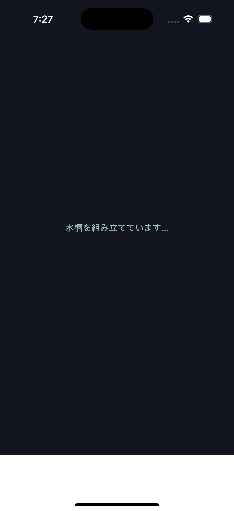
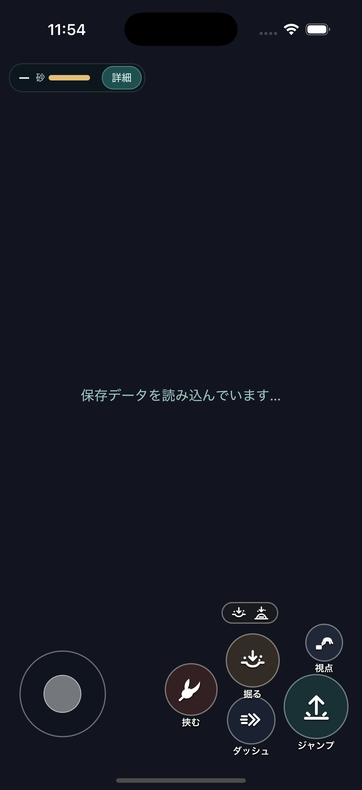
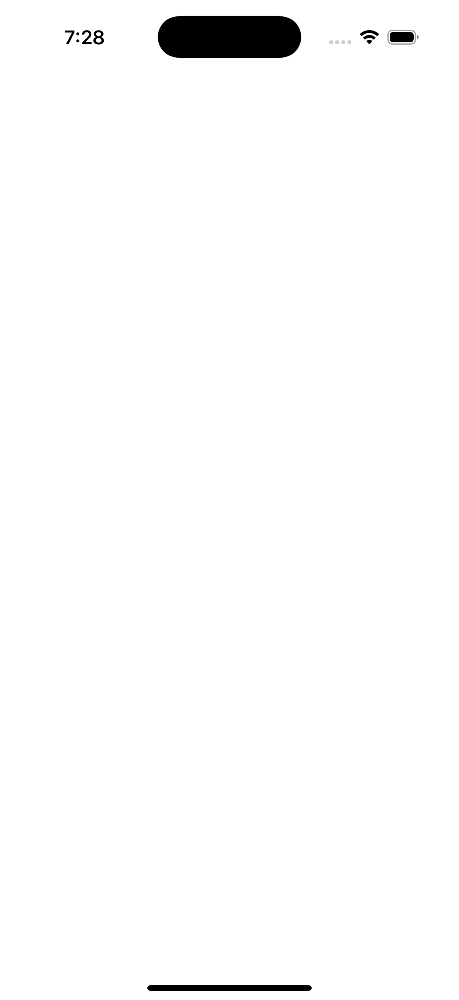
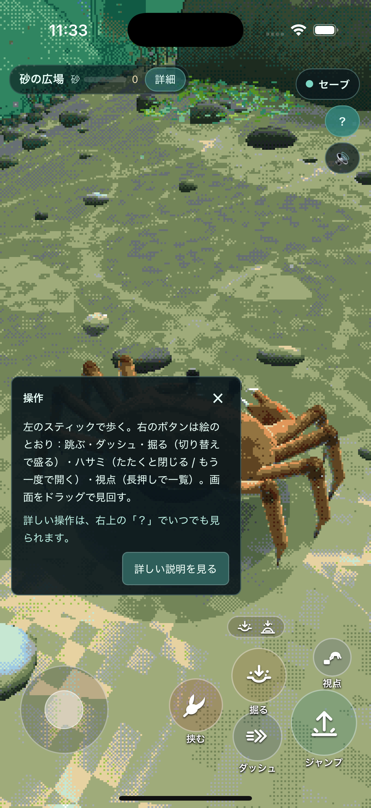
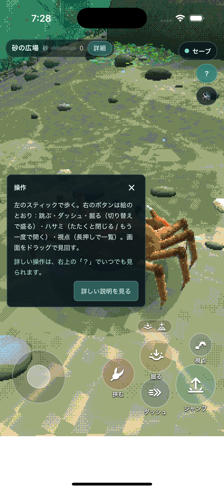
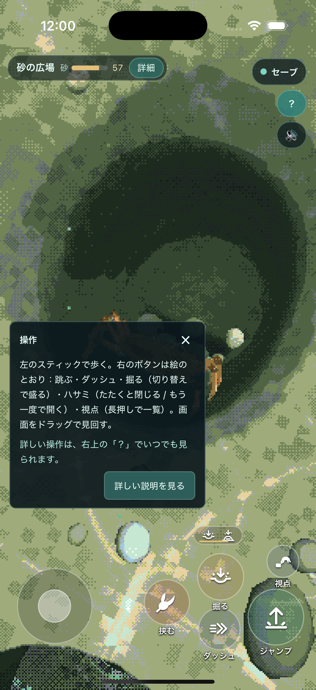

# iOS シミュレーター（CI）：初回起動の白い画面・画面の下の帯・描画の喪失と復旧（第 3 段、2026-11-27）

環境：GitHub Actions `macos-15`（macOS 15.8.2・Xcode 16.4）、シミュレーター iPhone 16 Pro・iOS 18.5（WKWebView `AppleWebKit/605.1.15`）、
`tauri ios build --target aarch64-sim`（リリース・署名なし）。手順は `docs/app-packaging/tools/ios-sim-run.sh`、まとめは `ios-sim-summary.py`。
すべて **シミュレーター**（実機ではない）。

| CI の回 | 中身 | ゲームの記録 |
| --- | --- | --- |
| [45957746240](https://github.com/kitamiya1/ParticlePixelPlayground/actions/runs/45957746240)（第 2 段・変更前） | 初回起動 1 回・再起動 1 回 | 無し（系統のログだけ：`../ios-simulator-ci/`） |
| [45980208608](https://github.com/kitamiya1/ParticlePixelPlayground/actions/runs/45980208608)（`run-45980208608/`） | 修正後の初回起動 3・対照 2・再起動 1・続けて起動 3・GPU 処理を止める | **取れなかった**（標準エラーが届かない。画面と系統のログだけで判定） |
| [45989742560](https://github.com/kitamiya1/ParticlePixelPlayground/actions/runs/45989742560)（`run-45989742560/`） | 同じ | `*.diag.log`（アプリの diag.log を取り出した） |

「初回起動」= 毎回シミュレーターを消去（`simctl erase`）→ 起動 → インストールしてから、まっさらの状態で起動。
「対照」= 同じく消去してから、描画の準備を飛ばして（`AQUA_SELFTEST=noprepare`）変更前と同じく最初のフレームでまとめてシェーダーを作る。

## 1. 起動の成功の数

成功の判定：ゲームの記録に `boot done … gpu=ready` と、5 秒ごとの記録でフレームが進んでいること、かつ最後の画面がゲーム（白でも読み込み中でもない）。
45980208608 は記録が無いので、画面（最後の画面がゲーム）と系統のログ（GPU 処理の停止が無い）だけで判定した。

| | 45957746240（変更前） | 45980208608 | 45989742560 | 合計 |
| --- | --- | --- | --- | --- |
| 修正後：初回起動 | — | 3 / 3（画面） | **3 / 3** | 6 / 6 |
| 修正後：終了後の再起動・続けて起動 | — | 4 / 4（画面） | **4 / 4** | 8 / 8 |
| 修正後：GPU 処理を止めた後に起動し直し | — | 1 / 1（画面） | **1 / 1** | 2 / 2 |
| 変更前の動き：初回起動（第 2 段・対照） | **0 / 1**（白い画面） | 2 / 2（画面） | 2 / 2 | 4 / 5 |
| 変更前の動き：再起動 | 1 / 1 | — | — | 1 / 1 |

- **白い画面は第 3 段の 10 回の初回起動（修正後 6・対照 4）で 1 回も再現しなかった**。対照（変更前の動き）でも出なかったので、
  「修正したから出なくなった」とは言えない。再現したのは第 2 段の 1 回だけ。
- 画面の下の白い帯（画面の高さの 92〜98.5% の範囲の白い画素の割合）：変更前は 3 枚とも 100%、変更後は **すべての画面写真（2 回の CI の計約 100 枚）で 0〜1.1%**
  （読み込み中・ゲーム・GPU 処理を止めた後とも。1% はゲームの白っぽい物が写ったもの）。

## 2. 原因の絞り込み（初回起動の白い画面）

第 2 段の失敗の回の系統のログ（`../ios-simulator-ci/sim-log-excerpt.txt`）：

1. GPU 処理・WebContent の起動に **24 秒**（第 3 段は 1〜3 秒。CI の仮想マシンがこの回は非常に遅かった）
2. ページの読み込みの後、`_didCommitLayerTree: finally received commit 21.69s after …`（ページの主スレッドが 21.7 秒止まっていた）。
   その間の WebContent の CPU は 0.7%（計算ではなく、**GPU 処理の返事を待っていた**）
3. 止まりが解けた 3 ms 後に `gpuProcessConnectionDidBecomeUnresponsive` → `GPUProcess … became unresponsive, terminating it`
4. その後の画面は白いまま（WKWebView の地の色が白だった）

第 3 段のゲームの記録（45989742560）で、主スレッドを止める処理を測った：

| 処理 | 初回起動（消去直後） | 2 回目以降 | 開発機（Windows・参考） |
| --- | --- | --- | --- |
| 世界の生成（JS・同期） | 7.0〜8.7 秒 | 7.2〜9.1 秒 | 3.1〜3.7 秒 |
| シェーダー 26 個（描画の準備、1 つずつ） | **5.6〜10.4 秒**（1 つで最大 **5.1 秒**：砂・地形の `mesh[PPP_WATER,USE_BEAMS,BLOB_UP,OCCLUDER_CUT]`） | 0.53〜0.78 秒（1 つで最大 0.2 秒） | 0.33〜2.1 秒 |
| 対照：最初のフレームでまとめて作る | **最初のフレーム 6.1〜6.5 秒**（その間ページは止まる） | — | — |
| 最初のフレーム（準備の後） | 0.16〜0.20 秒 | 0.10〜0.27 秒 | 0.05〜0.10 秒 |

- 初回起動のシェーダーの作成は 2 回目以降の **10〜20 倍** 遅い（Metal のシェーダーのキャッシュが空。消去するとキャッシュも消える）。
- 変更前は、この作成が最初のフレームの中で 1 回の長い待ちになる。第 2 段の失敗の回は仮想マシンが第 3 段より何倍も遅く（GPU 処理の起動 24 秒 対 1〜3 秒）、
  待ちが WebKit の見張りの時間を超えて GPU 処理が止められた、というのが最も筋の通る説明。
- **断定はできない**：失敗は 1 回しか起きておらず、第 3 段の 10 回では再現しなかった。CI の仮想マシンの遅さに強く左右される（同じ構成で起動の時間が 20 倍違った）。
  実機の iPhone では Metal のシェーダーの作成は速いはずだが、未確認。

修正後の動き：シェーダーを 1 つずつ作り、1 つごとにページへ制御を返す。1 回の待ちは「いちばん遅い 1 つ」（初回起動で最大 5.1 秒）までになり、
まとめて作るとき（6.1〜6.5 秒、遅い回はその何倍も）より短い。それでも 1 つが見張りの時間を超えたら、下の 3 の復旧で戻る。

## 3. GPU 処理を外から止めた（`kill -9`）ときの復旧

`gpu.diag.log`・`gpu-syslog-webkit.txt`（45989742560）：

| 時刻 | 出来事 |
| --- | --- |
| 11:59:54 | 自動検証が掘って保存（穴 6・砂 2.89） |
| 12:00:06.0 | `kill -9 com.apple.WebKit.GPU` → `gpuProcessExited: reason=Crash` |
| 12:00:11.5 | 作り直された GPU 処理も `became unresponsive, terminating it`（WebKit の動き）→ ゲームに `webglcontextlost` |
| 12:00:11.95 | `webglcontextrestored`（WebKit が復旧させた。ゲームが既定の動作を止めているので） |
| 12:00:12.15 | 保存（`save flush (lost) ok`） |
| 12:00:12.49 | シェーダー 26 個を作り直し（533 ms）→ 描画を再開 |
| 〜12:01:01 | 5 秒ごとの記録：穴 6・砂 2.89・位置そのまま、フレームが進む |
| 12:01:25 | 終了して起動し直し：`save loaded … prims=6 sand=2.89`（保存から元どおり） |

- kill から描画の再開まで約 6.5 秒。その間の画面は最後のフレームのまま（`gpu-after-kill-03s.png`）で、白くならなかった。
- 自動の読み込み直しは起きなかった（その場で復旧できたので）。

45980208608（記録なし）でも、kill の後の画面はすべてゲームで、起動し直しも成功した。

## 4. 画面の下の帯（安全領域）

- 原因：WKWebView のスクロールビューの `contentInsetAdjustmentBehavior` が既定（automatic）で、ホームインジケーターの分（34 pt）と上の分だけ中身の高さを縮めていた。
  縮んだ下の部分に WebView の地の色（`systemBackgroundColor` = 白）が見えていた（wry 0.57 の `wkwebview/mod.rs` は bounce を切るだけで、この設定はしない）。
- 修正：起動時に `never` にする（`src-tauri/src/lib.rs`）。地の色もゲームと同じ `#12151f` に（`tauri.conf.json` の `backgroundColor`）。
- 確かめたこと（記録の `layout` の行）：`inner=402x874 canvas=402x874@0 safe(t,r,b,l)=62,0,34,0 lowestControl=tb:833 limit=840`
  - ページと canvas が画面いっぱい（874 pt）。安全領域は上 62・下 34 pt
  - いちばん下の操作ボタンの下端は 833 pt で、ホームインジケーターの領域（840 pt より下）に掛からない
- 画面写真：読み込み中も含め、画面の下の帯は 0（白い画素 0%）

| 変更前（第 2 段） | 変更後（第 3 段） |
| --- | --- |
|  |  |
|  |  |
|  |  |

## 5. メモリ（シミュレーターの RSS。実機の上限の目安にはならない）

起動 30 秒の時点（`memory.txt`）：WebContent 107〜422 MB、GPU 処理 43〜118 MB、アプリ本体 25〜146 MB。2 回目以降の起動の方が大きい（シェーダーのキャッシュなど）。

## 6. 試験の作りの限界

- 消去直後のシミュレーターは非常に遅く、画面を撮るだけで 1 回 1 分かかったことがある（`run-45980208608/timeline.txt`）。画面写真の「秒」は目安で、実際の時刻は記録の行で見る。
- 起動の記録は、リリース版の標準エラーが `simctl launch --stderr` へ届かなかったので、アプリの `Library/Application Support/<id>/logs/diag.log` から取り出す。
- タッチ・音・ファイル App での書き出し / 読み込みは、この CI では試していない（入力を送る道具が無い）。掘る操作は自動検証（`AQUA_SELFTEST=gpu`）で行った。
- 系統のログ・すべての画面写真は Actions の Artifacts（30 日で消える）。ここには一部だけ置いた。
