# ハサミ操作の改善と「ハサミ集中モード」— 報告（2026-11-28）

水槽探検（`aquarium.html`）のハサミを、左右とも思いどおりに使えるようにし、カニがその場に留まって左右の腕を別々に動かす
**ハサミ集中モード**を加えた。積み木・平たい石・棒・石の台を置いた**物理の検証エリア**（石の床の上）で、積む・並べる・渡す・
両方のハサミで持つ・引き伸ばす・引き裂く、を試せる。物の置いた所は保存する（保存の版 4）。

- ブランチ：`feat/claw-focus`（main `c29ac16` から）
- 主なファイル：`AquaClawFocus.ts`（新規：集中モード・印・スマホの操作）・`AquaBlocks.ts`（新規：検証エリア）・`AquaGrab.ts`（箱の剛体・
  2 本で持つ・握る強さ・狙い）・`CrabRig.ts`（左右の腕の目標・手首）・`AquaWorm.ts`（2 か所目のつかみ）・`AquaCatch.ts`（水草の引き裂き）・
  `AquaSave.ts`（版 4）・`main.ts`・`AquaGamepad.ts`・`Input.ts`・`TouchControls.ts`・`AquaCamera.ts`・`aquarium.css`
- 検証の道具：`docs/aquarium/tools/` の `focus_helpers.js`・`claw_focus_test.js`・`claw_scheme_compare.js`・`blocks_test.js`・
  `claw_focus_shots.js`（実際の入力）・`claw_focus_scenes.js`（場面の画像）・`claw_focus_perf.js`（重さ）

---

## 1. 遊び方（操作）

### 通常のモード（いままでどおり歩きながら挟む）

| 端末 | 右のハサミ | 左のハサミ（新規） | 腕の向き |
| --- | --- | --- | --- |
| PC | <kbd>E</kbd> 押している間 | <kbd>Q</kbd> 押している間（以前の <kbd>Q</kbd> = 仲間は <kbd>B</kbd> へ） | 押したままマウス（右・左の腕それぞれ） |
| スマホ | 「挟む」（たたくと閉じる / もう一度で開く） | スティックの上の小さい「挟む」（同じ） | — |
| パッド | RT / R2（押し込むほど強く握る） | LT / L2（同じ） | 右スティック |

左右で別々の物も、1 つの物の 2 か所も挟める。印（設定の「ハサミの印」）は、いま閉じると挟む所・挟んでいる所を小さな点で出す。

### ハサミ集中モード

| | PC（仮の割り当て） | ゲームパッド | スマホ |
| --- | --- | --- | --- |
| 入る / 戻る | <kbd>Tab</kbd>（戻るは <kbd>Tab</kbd> / <kbd>Esc</kbd>）・右上の「集中」 | 左右のスティックの同時押し（戻るは B / ○ も） | 右上の「集中」・下の「通常へ」 |
| 左の腕 | <kbd>W</kbd><kbd>A</kbd><kbd>S</kbd><kbd>D</kbd>・高さ <kbd>Q</kbd> / <kbd>E</kbd>・手首 <kbd>Z</kbd> / <kbd>X</kbd> | 左スティック（LB を押したまま = 高さ・手首） | 左のスティック・内側のつまみ（高さ） |
| 右の腕 | マウス（方向キーでも）・右ボタンを押したまま上下 = 高さ・左右 = 手首 | 右スティック（RB を押したまま = 高さ・手首） | 右のスティック・内側のつまみ |
| 左を閉じる | 左 <kbd>Shift</kbd> 押している間 | LT（押し込んだ分だけ閉じる。触れた後は握る強さ） | 左のスティックの上の外側のボタン（押している間 / 設定でたたいて切り替え） |
| 右を閉じる | 左ボタン押している間（<kbd>Enter</kbd> でも） | RT（同じ） | 右のスティックの上の外側のボタン |
| 視点 | 中ボタンのドラッグ・ホイール | 十字キー | 画面のドラッグ・2 本指 |
| 腕の動かし方 | <kbd>M</kbd> | Y / △ | 「動かし方」 |
| 食べる | — | X / □ | — |

- カニはその場に留まる（腕を伸ばしきっても届かない向きへ押し続けたときだけ、少しずつ寄る。寄る先に物があれば寄らない）。
- 腕の移動と開閉は別の入力。左右の腕・左右の開閉もそれぞれ独立（4 つを同時に操作できる）。
- 切り替えても挟んでいる物は落とさない（押し直すまで持ったまま）。切り替えた直後の「何も押していない」で離さない。
- 戻るときは、入る前のカメラの距離・角度へ戻す。腕は約 0.25 秒でいつもの構えへ戻る（瞬間移動しない）。

### 既存のカメラとの関係

集中モードは**冒険のカメラ（三人称・肩越し・自由追従）の上**で働く：注視点を作業している所（両方の鋏の間）へ寄せ、
近く（ズーム 2.0 以下）・少し上から（ピッチ 0.85 以上）に寄せる。プレイヤーが視点を動かしたら、それ以降は触らない。
ガラス越し・箱庭のカメラでは、ズーム・角度は変えない（腕は集中モードになる）。

## 2. 腕の動かし方 3 種と比較（`claw_scheme_compare.js`）

| 方式 | スティック | 高さ |
| --- | --- | --- |
| **面に沿う（既定）** | カメラから見た床の前後左右 | 鋏の下の面（地形・箱。挟んだ物の下の広がりも見る）の上に自動で保つ。物の横に当たって押し続けると（0.3 秒）越える。手で足した高さ（つまみ・Q / E・バンパー）も使える |
| 床に沿う＋高さ | 同じ | 手で上げ下げするだけ（面より下へは行かない） |
| 画面に沿う | 画面の上下左右 | 奥行きを手で（同じ入力） |

同じ課題を、人の代わりの操作（行きたい点への差をその方式の入力へ直す。床に沿う・画面に沿うでは、進む先 6 cm の面を見て先に上げる
上手な人を想定）で比べた。数字は 60 フレーム = 1 秒。「3 軸」は前後・左右・高さの 3 つの入力を同時に使ったフレーム数（多いほど
人には難しい）。

| 課題 | 面に沿う | 床に沿う＋高さ | 画面に沿う |
| --- | --- | --- | --- |
| 積み木 1 個を越えて向こうの床へ | ✅ 1.07 秒・3 軸 0 | ✅ 2.10 秒・3 軸 95 | ✅ 2.32 秒・3 軸 96 |
| 積み木を挟んで隣の積み木の上へ置く | ✅ 23.0 秒・3 軸 195 | ✅ 21.9 秒・3 軸 1036 | ✅ 22.0 秒・3 軸 1028 |
| 左右の鋏で床の 8 点を順に触る | ✅ 4.15 秒・3 軸 0 | ✅ 9.38 秒・3 軸 419 | ✅ 10.47 秒・3 軸 476 |
| 移動中の面からの高さ（平均 / 最大） | 5.5 / 13.9 cm | 5.9 / 24 cm | 6.3 / 24.5 cm |

- 置く課題は 3 方式とも 22 秒前後（細かい位置合わせの時間が大半）。**面に沿う**は高さを自動で保つので 3 軸の操作が約 1/5、
  越える・触るは約 2 倍速い。床に沿う・画面に沿うは、入ったときの構えの高さ（地面から 24 cm）から下ろす手間がある。
- 画面に沿うは、スティックの上下が「高さと奥行きの混ざった向き」になり、狙った所へ行くのに 3 つを同時に合わせる必要がある。
- 既定は**面に沿う**。設定（「🔊」の欄）・「動かし方」ボタン・<kbd>M</kbd>・Y / △ でいつでも切り替えて比べられる（選んだ方式は保存）。

## 3. 物理

### 箱の剛体（積み木・平たい石・棒・石の台・石の床）

| 種類 | 大きさ（半分の長さ） | 重さ | 数 |
| --- | --- | --- | --- |
| 積み木 | 5 cm の立方体 | 0.3 | 6 |
| 平たい石 | 15 × 2.4 × 10 cm | 0.5 | 2 |
| 棒 | 21 × 1.7 × 1.7 cm | 0.12 | 2 |
| 石の台 | 7.5 × 9 × 7.5 cm | 2.2（1 本の鋏では持ち上がらない） | 2 |
| 石の床 | 80 × 12 × 120 cm | 動かない | 1 |

- 面ごとに縁から 8 mm 内側・5 cm 間隔の点で接触を取り、接触の力は押すだけ（λ ≥ 0）の繰り返し解法（8 回）で解く。静止摩擦は
  位置で、位置の補正で生まれた離れる速さだけを消す（もともと離れていく速さ・倒れる速さは残す＝はみ出した積み木は倒れる）。
- 上の箱からの接触は下の箱を動かさない（積んだ山が押し出されて崩れない）。動いている箱のまわりだけ起こし、止まれば眠る。
- 地形・岩・流木・ガラスとの当たりは、そのまま `AquariumWorld` の当たり判定。箱は `AquariumWorld.dyn` で当たり判定に入るので、
  カニは平たい石・石の床・積んだ箱の上を歩ける（足場になる）。

### 挟む・握る・押す

- 閉じる量（アナログ）：触れるまでは閉じ具合 = 押し込み（速さに上限）。触れた所（閉じ具合 c0：物の厚みで決まる。積み木は 0.537）
  から先の押し込みは**握る強さ** `(押し込み − c0) / (1 − c0)`。摩擦の上限は `0.12 + 1.1 × 強さ^1.4`。
- 握る強さ（摩擦）と腕の力（ばねの上限）は別：腕の力が摩擦を越えると、物はつかみ点で滑る（弱く握った平たい石は揺らすと 3.5 cm 滑り、
  強く握れば滑らない）。物は鋏に貼り付かず、ばね + 減衰 + 摩擦の上限でつながる（瞬間移動しない）。
- 集中モードでは、挟んだ物は**世界の向きのまま**（腕を動かしても水平を保つ）。手首（ロール）で縦の軸まわりに回す。
- 2 本の鋏で 1 つの物を持てる（重さの分担・回転の減衰・2 本のつかみ点の間を保つ `keepSpan`）。石の台は 1 本では 2 cm しか浮かないが、
  2 本なら 14 cm 持ち上がる。
- 開いた鋏の先（小さな球）は物を押せる（1 刻み 3 mm まで・重い物ほど動かない）。閉じていく途中の物・離した直後の物・挟んでいる物は押さない。
  集中モードに入り切っている間だけ（戻る途中の腕が物を払わない）。

### 両方のハサミの遊び

| 遊び | 結果（`claw_focus_test.js`） |
| --- | --- |
| 左右で別々の積み木を持ち上げる | 両方とも 18 cm 持ち上がる |
| 1 本の棒を両端で持ち上げて左右へ振る | 32 cm 持ち上がり、止めた後の回転 0.04 rad/s（振っている間の最大 4 rad/s は急に止めた瞬間だけ） |
| ゴカイの頭の側を右・尾の側を左で挟んで引き伸ばす | つかみ点の間 0.21 → 0.47 m。発散なし。右を離すと左が 1 本目を引き継ぐ |
| 水草の下を右・上を左で挟んで上下に離す | 7 cm 離したところでちぎれ、上のかけらは上の鋏（左）が持つ。下の鋏は茎を持ち続ける |
| 弱く / 強く握る | 弱（10%）：揺らすと 3.5 cm 滑る・持ち上げ 2.6 cm。強（100%）：滑らず 21 cm |
| 挟んだまま 通常 ↔ 集中 | 落とさない。切り替えの後の物の速さ 0.005 m/s |

### 積み木の安定（`blocks_test.js`）

| 試験 | 結果 |
| --- | --- |
| 並べたまま 8 秒 | 動き 0・全部眠る |
| 1 段ずつ積む（ハサミで積むときと同じ順）6 段・ずらして回した 5 段 | 立ったまま・最大の速さ 0.02 m/s |
| 全部の段を同時に置く 3〜5 段 | 立ったまま（6 段・回した 5 段は崩れる：同時に落ちる衝撃。既知の限界） |
| 2 段目を 3 cm / 7 cm ずらす | 3 cm は載ったまま・7 cm は倒れる（重心の外） |
| 石の台 2 つの上に棒を渡す | 載ったまま・台は動かない |
| 平たい石の上にカニ | 乗る（石は動かない） |
| めり込み | どの試験も 0 |

## 4. 実際の入力での検証（`claw_focus_shots.js`。Playwright の本物のキー・マウス・CDP のタッチ・模擬のゲームパッド）

| 端末 | 確かめたこと | 結果 |
| --- | --- | --- |
| PC | <kbd>D</kbd> → 左の腕だけ 7.5 cm・マウス → 右だけ 9 cm（左 0.6 mm）。左 Shift → 左だけ閉じる・左クリック → 右だけ閉じて積み木を挟む。E で左が 11.6 cm 上がる・右ドラッグで右が 6.6 cm 上がる・中ボタンで視点 | すべて期待どおり。エラー 0 |
| PC | 挟んで 7.4 cm 持ち上げて離す → <kbd>Tab</kbd> で通常へ → <kbd>Q</kbd> で左が小石を挟む | ✅ |
| パッド | 同時押しで集中・左スティックで左だけ・RB + スティックで 9.9 cm 上げる | ✅ |
| パッド | RT 0.3 / 0.6 / 0.8 / 1.0 / 0.75 → 閉じ具合 0.3 / 挟む・握る 0.14 / 0.57 / 1 / 0.46。デジタルのトリガー（0 か 1）でも握る 1 | ✅ |
| スマホ縦・横 | 4 本の指（両方のスティック + 両方の閉じる）を同時に：4 つとも効く・離すと全部 0。高さのつまみ・たたいて切り替える方式・「通常へ」 | ✅（縦 390×844・横 844×390） |
| 保存 | 積み木を動かす → 保存 → 読み込み直し | 12 個が戻る（位置のずれ 0） |

画像（`docs/aquarium/claw-focus/`）：

| | |
| --- | --- |
| 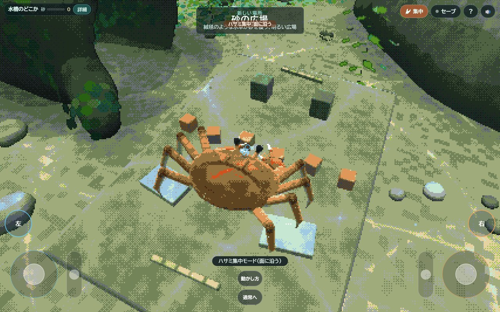 PC：集中モード | 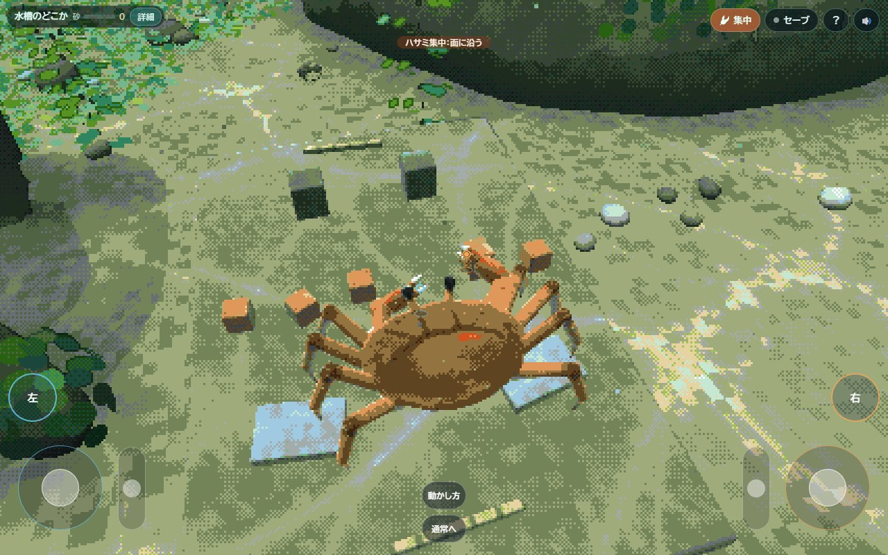 PC：右で挟んで持ち上げる |
| 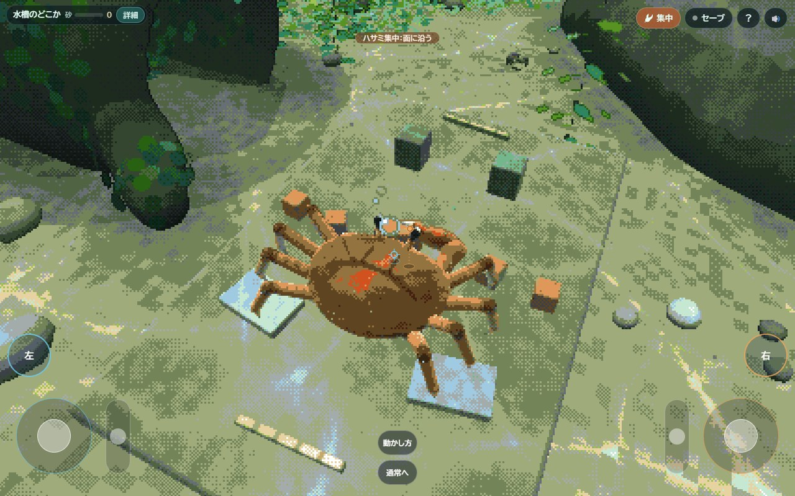 パッド：RT の押し込みで握る | 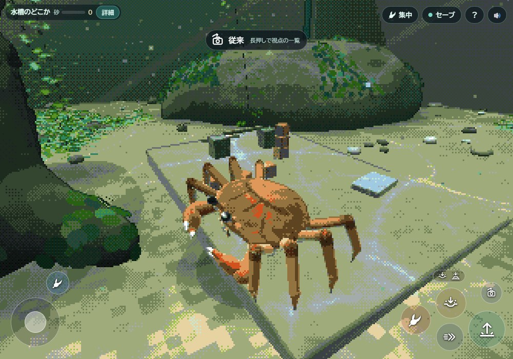 読み込み直した後の積み木 |
| 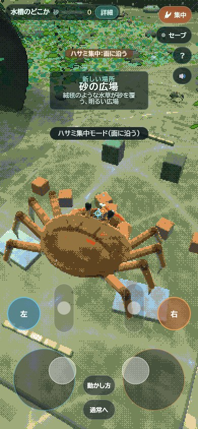 スマホ縦：4 本の指 | 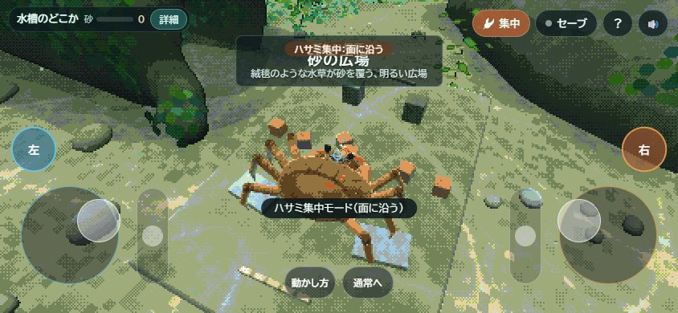 スマホ横：4 本の指 |
| 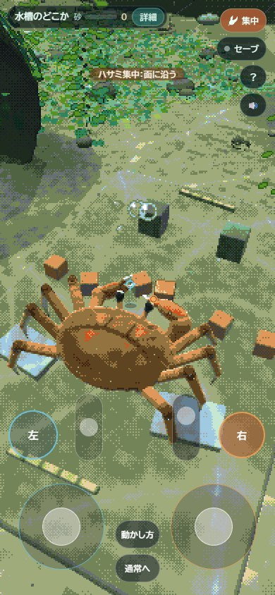 スマホ縦：閉じたまま高さを上げる | 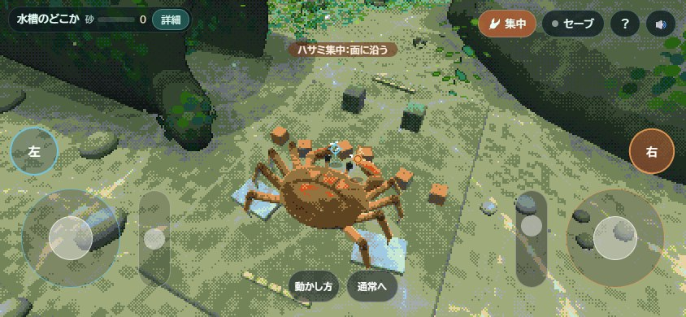 スマホ横 |
| 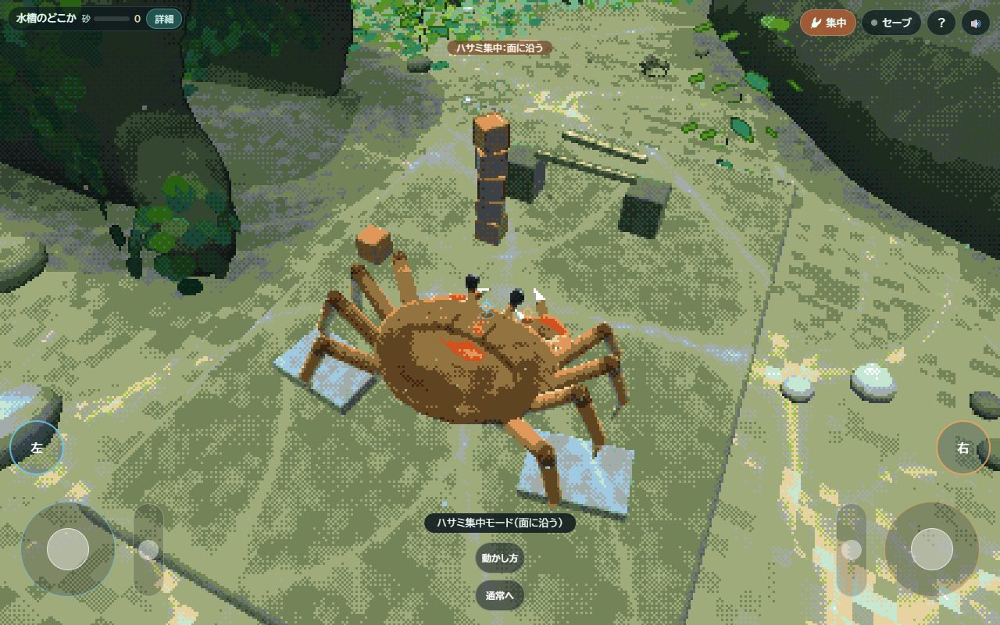 積み木 5 段と石の台に渡した棒 | 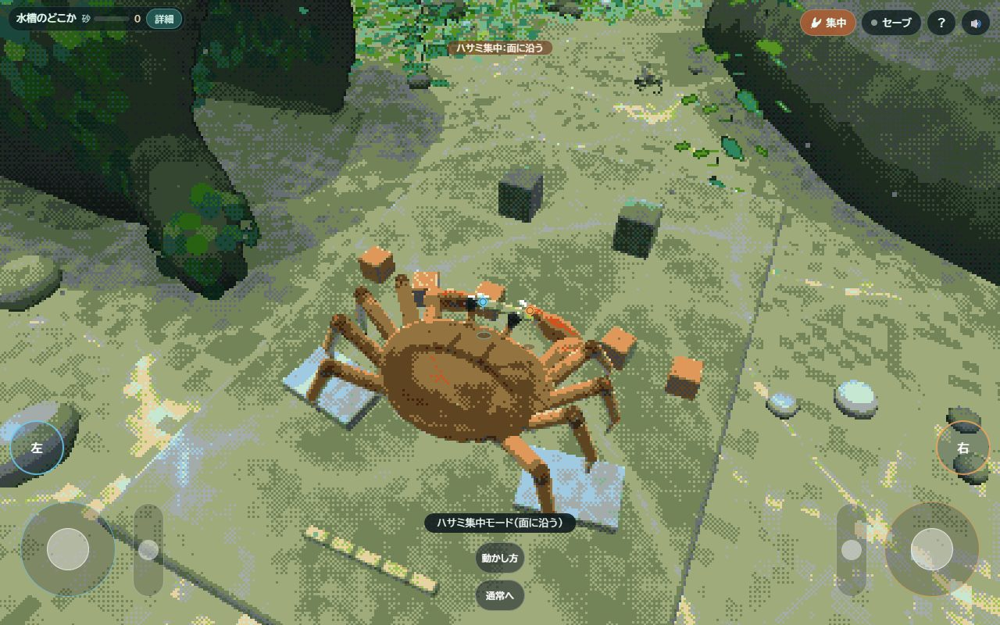 両方の鋏で棒を持ち上げる |
| 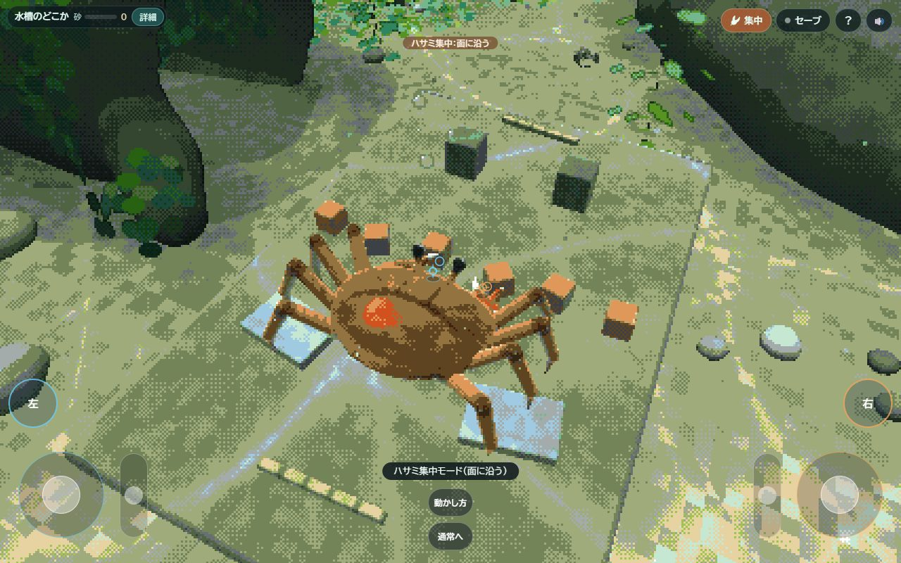 印：いま閉じると挟む物の点 | 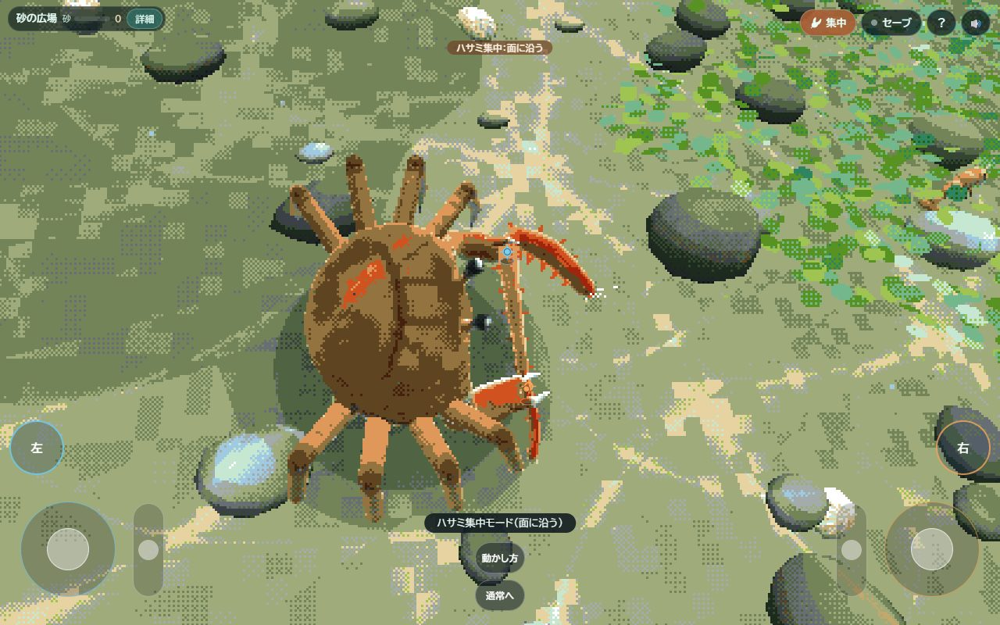 ゴカイを左右の鋏で引き伸ばす |
| 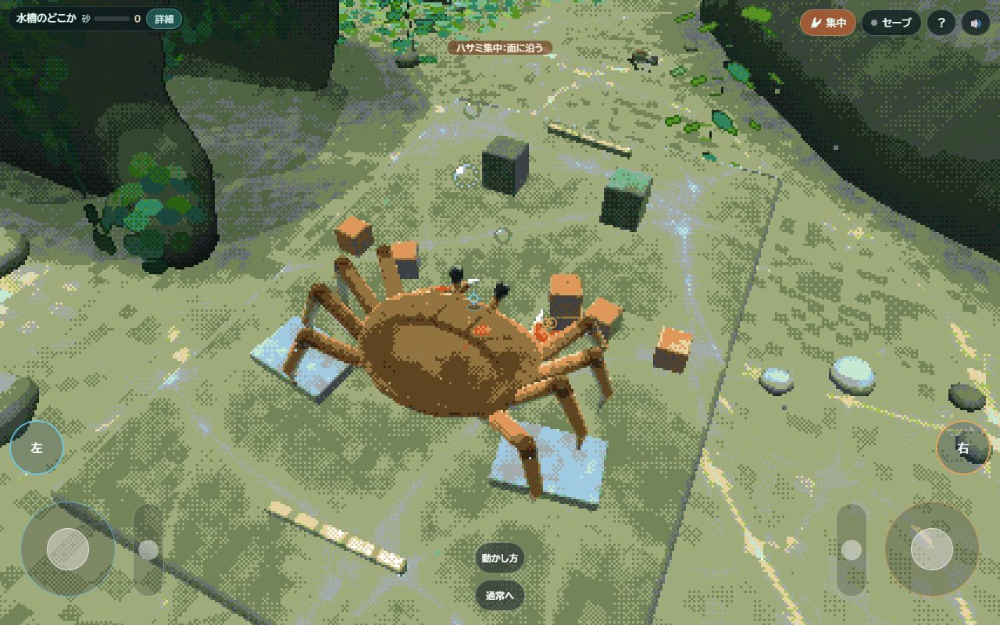 鋏で積み木を隣の積み木の上へ | |

## 5. 通常のモードの改善

| 項目 | 内容・確認 |
| --- | --- |
| 左のハサミ | PC <kbd>Q</kbd>・スマホの小さい「挟む」・パッド LT。左右で別々に・同時に挟める（`pad_audio_test` twoClaws：左右で小石を挟んで運ぶ） |
| 取り違えの防止 | 選ぶ点数に、腕の向き・前に狙っていた物・すぐ前に離した物・近さを足す。9 cm 離れた 2 個の小石で、腕を右へ向ければ右の小石、左なら左の小石を挟んだ |
| 挟み直し | 離して 1.2 秒以内に押し直すと、同じ物を少し遠くまで届く範囲で選ぶ（`tug_test` releaseRegrab：0.28 秒で挟み直し） |
| 開く幅 | 物の厚みに合わせて開く（積み木は大きく、棒は小さく）。閉じ具合が触れた所 c0 で止まる |
| つかみ点 | 物の表面の、鋏の口に近い点（鋏の先が物の中に入らない） |
| 瞬間移動しない | 鋏の目標は速さの上限（2.4 m/s）つきで追う。狙いの補助で鋏の先が動く速さの最大 2.6〜3.0 m/s（カニの向き直りを含む。1 フレーム 5 cm 以下） |

## 6. 性能（`claw_focus_perf.js`。1 フレームの処理の時間 / 実際のフレームの間隔の平均）

| 場面 | PC | スマホ相当（CPU 4 倍遅く） |
| --- | --- | --- |
| 出発点（通常・比べる基準） | 3.6 ms / 13.1 ms | 29.1 ms / 28.1 ms |
| 検証エリアで集中モード | 4.5 ms / 13.1 ms | 19.2 ms / 27.4 ms |
| 左右で積み木を持って振る | 2.9 ms / 13.1 ms | 17.5 ms / 21.3 ms |
| 積み木 5 段を同時に置いた直後 | 3.6 ms / 13.0 ms | 19.8 ms / 17.6 ms |

- 途中で見つけた重さ：検証エリアの出発点でカニの横に立つ平たい石 2 枚が、外接球の近さで毎フレーム起こされていた（約 3.7 ms）。
  箱は面までの距離で起こすように直し、集中モードの処理は出発点と同じ程度になった（集中モードそのものの処理は 0.14 ms）。

## 7. 回帰テスト（このブランチ。main と比べたものは main を 5174 番に立てて同じ道具で）

| 道具 | 結果 |
| --- | --- |
| `npx tsc --noEmit`・`npm run build`・`npm run build:app` | ✅ |
| `eat_test` matrix（左右 × 藻・水草・エビ・小魚・ゴカイ・小石）・resume | ✅ すべて食べ終える・小石は押し戻す・中断から再開 |
| `tug_test`（引っこ抜き 8 種） | ✅ 抜ける遊び方は抜け、holdOnly は抜けない。カニ・仲間のめり込み 0 |
| `worm_test`（still / walk / regrab） | ✅ main と同じ（regrab の 1 回目が挟み直せないのは main でも同じ） |
| `pad_audio_test` pad / twoClaws / leftTug | ✅ |
| `catch_test` carry | ✅ |
| `claw_aim_test` aim / fixed | ✅ |
| `claw_aim_test` assist | 向き直って 7 フレームで挟む（turned 0.555。main は 0.098 で不合格）。ただし検証の場所（-11.38, 3.36）が検証エリアの石の床になったため、エリアを一時的に退けて測る。退けた後も、置いた小石が転がって最初から届く所に来るので「何もしなくても届かない」の条件が外れる（検証の場所の問題） |
| `claw_aim_test` decor | ✗（main でも同じ：景色の小石の頂点が置いた所に残る条件。今回の変更とは無関係） |
| `help_test`（スマホ縦横・PC） | ✅ 18 項目 |
| `touch_test`（スマホの指の取りこぼし 14 場面） | ✅ |
| `save_migrate3_run`（版 3 → 4） | ✅（[save-format.md](../save-format.md) の 12 章） |
| `blocks_test`・`claw_focus_test`・`claw_scheme_compare` | ✅（3 章・2 章） |

## 8. 残っている課題

- **左の腕が短い**（届く距離 0.27 m。右は 0.33 m）。左で遠くの物を取るには、押し続けてカニを寄せる必要がある。
- **積み木の限界**：はみ出しは約 4 cm まで（理屈では 5 cm）。6 段を同時に落とすと崩れる（1 段ずつなら立つ）。
- 2 本で 1 つを持って急に止めると、一瞬だけ回転が 4〜6 rad/s 出る（すぐ止まる）。
- 操作の自動検証（人の代わりの操作）は、高い所の 3 段目を積むのがまだ不安定。人が遊んで確かめてほしい（手応え・積みやすさ）。
- 水草の引き裂きの自動の操作は、背の高い水草が揺れるので不安定（引き裂きの仕組みそのものは `tearLogic` で確認）。
- PC の割り当ては仮（左 Shift は通常のモードの「走る」と同じキー。集中モードでは走らないので衝突しないが、慣れの確認が必要）。
- iPhone・Android 実機は未確認（Chromium のスマホの模擬で確認）。
- 集中モードの PC のマウス：タッチもできる PC（ヘッドレスの Chromium もタッチ可と報告する）でもマウスで腕を動かせるよう、
  集中モードのマウスの割り当てはいつも有効にした。マウスの左ボタンで右を閉じる・中ボタンで視点は、タッチの画面のドラッグとは別。

## 9. 資料とコードの食い違い（コードを正とした）

| 資料 | 食い違い | 対応 |
| --- | --- | --- |
| roadmap.md 2 章「ハサミで挟む（MVP）」 | 「右の大きなハサミで…保存はしない」。左のハサミ・検証エリアの物の保存（版 4）が増えた | 更新 |
| roadmap.md 2 章の見出し | 「main = `e25be37` + この PR」。実際の main は `c29ac16` | 更新 |
| roadmap.md 10 章・save-format.md 4 章のゴカイ | 「保存の版は 2 のまま」。食事で版 3、今回 版 4 | 更新 |
| 通常の操作の説明（以前） | <kbd>Q</kbd> = 仲間を呼ぶ。今回 <kbd>Q</kbd> は左のハサミ、仲間は <kbd>B</kbd> | 説明を更新（説明の中にも書いた） |
| `aquarium.css` の 207・208 行目のコメント | 文字化け（`c61a42a` からあるもの。表示には影響しない） | 触らない（別の変更で直す） |
| `claw_aim_test.js` assist の検証の場所 | 平らな砂が検証エリアの床になった | エリアを一時的に退けるよう道具を直した |
| `save_migrate_test.js` の `makeV1` | 版 3 のページでは `version: 3` で `food` の無い書き出しを作る（main でも読み込みを拒否） | 道具の制限として記録。版 3 の本物の書き出しで確認した |
| `isTouchDevice` | ヘッドレスの Chromium（PC）でも真 | 集中モードのマウスはいつも有効に |
