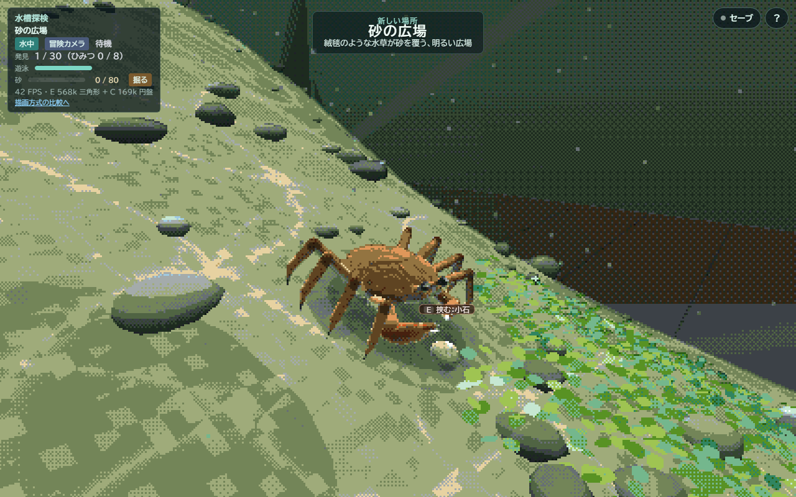
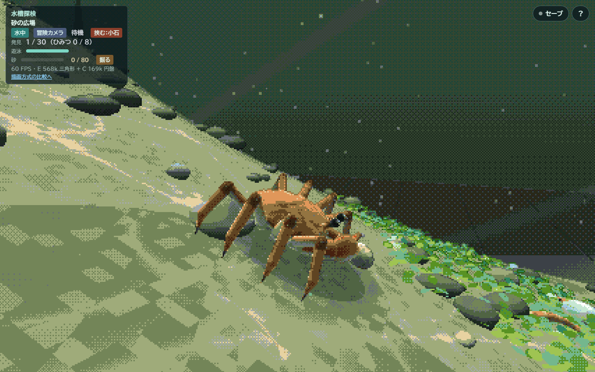
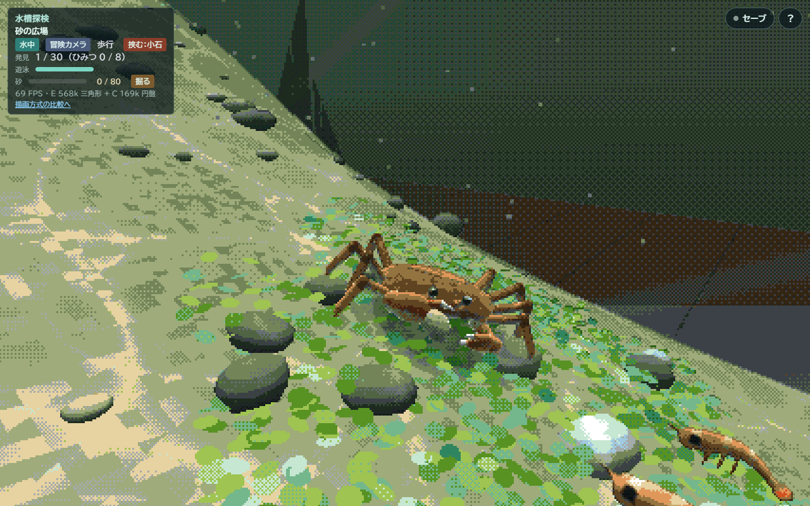
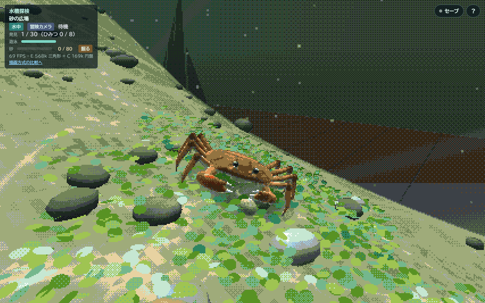
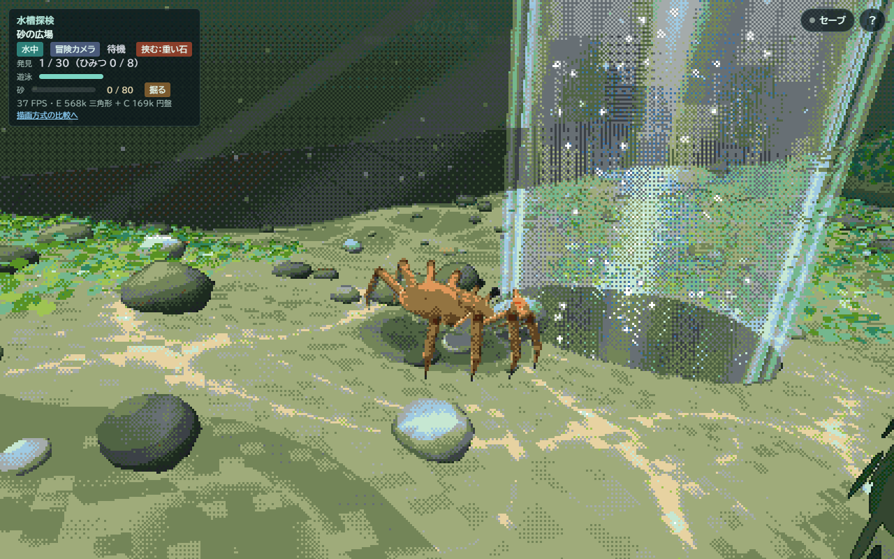
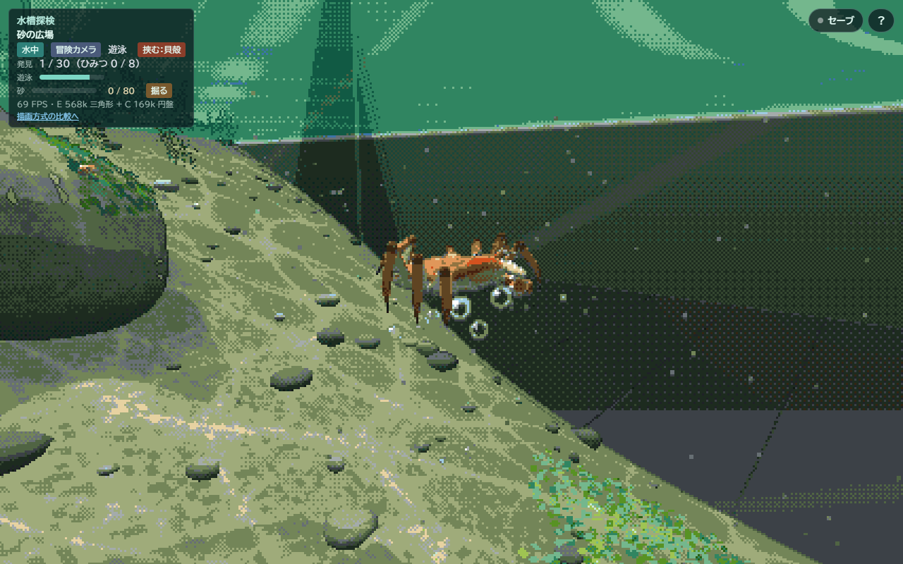
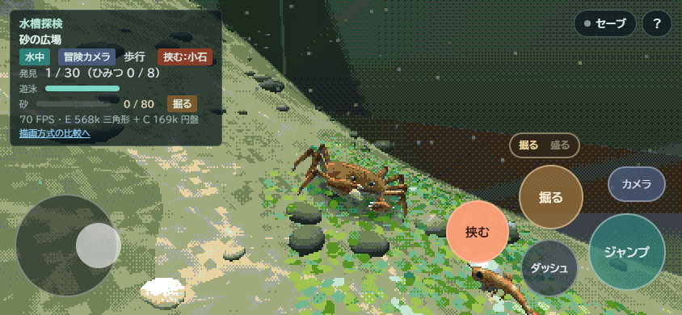
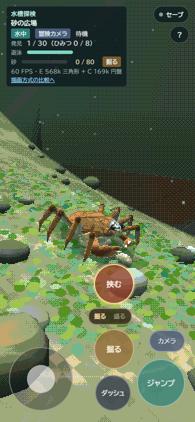

# 水槽探検：ハサミで挟むアクション（MVP）

ブランチ `feat/aquarium-claw-grab`（`feat/aquarium-ceiling-sand` = PR #6 の上）。

## 1. 遊び方

| | PC | スマホ |
| --- | --- | --- |
| 挟む | <kbd>E</kbd> を押している間（離すと放す） | 「挟む」ボタンを押している間（離すと放す） |
| 届く物の案内 | 物の上に「E 挟む：小石」 | 「挟む」ボタンの縁が明るくなる |
| 挟んだまま | <kbd>W</kbd><kbd>A</kbd><kbd>S</kbd><kbd>D</kbd> で歩く・<kbd>Space</kbd> で跳ぶ / 泳ぐ・ドラッグで視点 | 左のスティックで歩く・ボタンを押したまま指をずらすと視点が回る |
| 表示 | 左上に「挟む：小石」「（ずっしり）」「（重い！）」、空振りは「挟む：空振り」 | 同じ |

- 挟める物：スタート地点のまわりと砂の広場に **小石 4・貝殻 3・重い石 1**（`main.ts` の `PROPS`）。景色の暗い小石とは別の、明るい黄土色の小石。
- 押したまま歩いて物が届く所へ来ても挟む（押し直さなくてよい）。
- 重い石：水の中では砂の上を引きずれる（持ち上がらない）。陸の上では動かない（「重くて動かない（水の中なら少し軽くなる）」）。
- 引っ張りすぎ・ハサミが届かない状態が続くと滑り落ちる（「〜がハサミから滑り落ちた」）。
- 挟んでいる間は掘れない（掘るのもハサミを使うため）。体の向きの変わり方がゆっくりになる（速く回ると物が振り落とされるため）。

### 「調べる」との競合の解消
- PC：<kbd>E</kbd> を押した瞬間に持ち主を決める。巣穴の「調べる / 引っこ抜く」の案内が出ていれば調べる、それ以外は挟む。離すまで持ち主は変えない。
- 物を挟んでいる間は巣穴の案内を出さない（E は挟むのまま。スマホの「調べる」ボタンも隠す）。放すと案内が戻る。
- スマホ：別々のボタン（「調べる / 引っこ抜く」は巣穴のそばだけ、「挟む」は常に）。

### スマホのボタンの位置
- 横画面・幅の広い画面：ダッシュと掘るの左（スティックの右）。
- 幅 460px 以下の縦画面：スティックと重なるので、「掘る ↔ 盛る」の切り替えの上。
- 390×844 縦・844×390 横で、スティック・ダッシュ・ジャンプ・掘る・カメラ・切り替え・調べる・挟むの矩形が **どれも重ならない** ことを確認。

## 2. 作り（物理エンジンは入れない）

`src/aquarium/AquaGrab.ts`（ゲームロジック。Three.js に依存しない）

- **物**：楕円体。当たり判定はカニと同じ `AquariumWorld.contactSolid`（砂・掘った穴・盛った砂・岩・流木・ガラス・管）。
  楕円体の支点（面へ向かう最も奥の点）を距離関数で調べて押し戻す。地面の近くでは真下・横・斜め下の支点も調べ、いちばん深い所の
  面の向きで押し戻す（坂・傾いた物でも埋まらない）。1/120 秒の刻み・1 刻みの移動を物の大きさ未満に制限（すり抜けない）。
- 重力・浮力（種類ごとの沈む強さ）・水の抵抗・摩擦（押し付けに比例する静止摩擦のしきい値）・軽いはね返り。止まったら眠らせ、
  カニが触れる・掘る・盛る・挟むと起こす。水槽の外・固体の中に 1.5 秒いたら置いた所へ戻す。物どうしは球で押し分ける。
- **挟む**：物の表面の 1 点（つかみ点。物の座標）と、構えたハサミの先（anchor）をばね（k = 140）+ 減衰（ζ = 0.55）でつなぐ。
  力は握る力（8。軽い物は最大 2.5 倍）で頭打ち。その反作用をカニの速度へ返し（重い物ほど遅い・止まると引き戻される）、
  重さの割合で歩く速さの上限も下げる。縦の反作用は接地していないときだけ（重い物を挟んで泳ぐと沈む）。
- 向き：挟んでいる間はつかみ点が力の向きへ来るよう回す（ぶら下がる・引きずると傾く）。床に置かれた物は底を面へ向けて落ち着く。
- **ハサミ**（`CrabRig.ts`）：右の大きなハサミを口の前の少し上へ構え、つかみ点へ鋏の先が来るよう、腕の 3 つの角を減衰付き最小二乗の
  IK で解く（毎フレーム続けて解く。行き詰まったら構えから解き直す）。物を動かした後にもう一度解く（物とハサミが 1 フレームずれない）。
  閉じ具合で可動指を開閉し、挟んでいる間は少し開いたまま。
- カニ（`CrabController.ts`）：`CrabInput.tow`（反作用の加速度・速さの上限の割合）を足しただけ。挟んでいないときは従来と同じ。

| 種類 | 重さ（カニ = 1） | 水中 | 陸上 |
| --- | ---: | --- | --- |
| 貝殻 | 0.07〜0.16 | 持ち上がる。泳いでも落とさない | 持ち上がる |
| 小石 | 0.25〜0.53 | 持ち上がる（地面から 13〜23 cm）。少し遅れてついてくる | 持ち上がる（たわむ） |
| 重い石 | 1.2 | 持ち上がらず引きずる。歩く速さ 1.58 → 0.90 /秒 | 動かない |

## 3. 検証

開発サーバー（`?nosave`）。道具：`docs/aquarium/tools/grab_helpers.js`（`__gr`。ページ内で挟む・歩く・測る）、
`docs/aquarium/tools/grab_shots.js`（Playwright。PC は本物のキー入力、スマホは CDP のタッチ入力）。

### 挟む・引く・運ぶ・離す
| 確かめたこと | 結果 |
| --- | --- |
| PC（1280×800）：E 押す → D / A で運ぶ → 離す を 3 回 | 3 回とも挟む → 運ぶ（地面から 13〜18 cm 持ち上げ）→ 離して置ける。案内「E 挟む：小石」が出る |
| スマホ縦 390×844・横 844×390：挟むボタン → スティックで歩く → ボタン上で指をずらす → 離す を各 3 回 | 3 回とも挟んだまま歩け、視点が回り（0.43 rad）、離すと入力が残らない（スティック 0・押している指 0） |
| 届く物の案内と、実際に挟めるか（3 種 × 前後 6 × 左右 3 = 54 か所） | 案内あり 32 か所はすべて挟めた。案内なし 22 か所はどれも届かない。食い違い 0 |
| 押したまま歩いて物へ寄る（小石・貝殻・重い石） | 4 回とも 0.35〜0.57 秒で挟んだ |
| ハサミと物の表面の距離（挟んでいる間の最大） | 6〜7 mm（歩く・走る・泳ぐ・壁登り） |
| 挟んだまま止まったときのぶれ | 1 フレームの移動の最大 1〜4 mm（ガラスへ押し付けているとき 4 mm） |
| 離したあと | その場の真下へ落ち、0.8〜2.5 秒で止まって眠る。めり込み 0 |
| 地形・ガラスへのめり込み（全場面の最小のすき間） | +2 mm（当たり判定の皮）。固体の中に入った回数 0・戻した回数 0 |
| ガラスへ押し付ける・走ってぶつける | 物は水槽の中のまま（ガラスとのすき間 2 mm）。カニもガラスで止まる |
| 走る・横歩き・後ろへ引く・泳ぐ | 小石・貝殻は落とさない。重い石は泳ぐと滑り落ちる（持ち上がらないため。意図どおり） |
| 壁登り | 小石を挟んだまま岩を登り切った（高さ 5.4 → 6.0）。岩の上から後ろ向きに飛び降りると縁に引っかかって滑り落ちる |
| 処理の重さ（デスクトップ） | 重い石を引きずっている間 0.2 ms / フレーム（95% 0.4）、全部眠っているとき ≒ 0 |

### 既存の操作が壊れていないか
| 確かめたこと | 結果 |
| --- | --- |
| 穴掘り | 掘れる（挟んでいる間だけ掘れない）。掘った穴のそばの小石は穴へ落ちて止まる（めり込み 0） |
| 盛り土（`sand_test.js`） | PR #6 の報告と同じ値（その場で 1.45、容量で止まり 5.07 捨てる、砂山 0.375 で高さ 0.81、登れる 0.58、掘り直して 0.375 戻る、トンネルへ 6 個中 5 個、ガラス・管・仲間のそばに盛らない、見た目と当たり判定の不一致 0） |
| 天井歩き（`ceiling_test.js`） | PR #6 の報告と同じ値（天井まで 0.82 / 1.17 / 0.82 / 0.88 / 0.73 秒、離して止まる、前後 1.05 / 1.05 など、落下 0、カメラが固体の中 0、ガラス・管に張り付かない） |
| 壁登り（`climb_test.js`） | 登り直し：掘り抜けた 7 地点すべてで登り直せた（残り 3 地点は岩・岩・流木で、従来どおり）。岩・流木を登る、ガラス・管・アクリルに張り付かない |
| カメラ・スマホの指（`touch_test.js`） | 14 場面すべて OK（指の取りこぼし・取り消し・ピンチ・隠れたときに入力が残らない）。エラー 0 |
| 操作の説明（`help_test.js`） | 18 項目すべて OK |
| 仲間（巣穴）と E | 巣穴のそばで E：調べる → 長押しで引っこ抜けた（ハサミは動かない）。離れた所の E は挟む。小石を挟んだまま巣穴へ行くと案内が消え、放すと戻って E で調べられる |
| 型・ビルド | `tsc --noEmit`・`npm run build` 通過 |

### 画面
| | |
| --- | --- |
|  届く物の案内 |  小石を挟んで持ち上げる |
|  運ぶ（歩行） |  離して置いた |
|  重い石を引きずる（ずっしり） |  貝殻を挟んで泳ぐ |
|  スマホ横：挟んだまま歩く |  スマホ縦：ボタンの配置 |

## 4. 残っていること・気づいたこと
- 挟める物の位置は保存しない（読み込み直すと置いた所へ戻る）。保存するなら保存形式の版を上げる。
- 物は水槽の中だけ（排水口へ運ぶなどは想定していない。外へ出ると 1.5 秒で元の所へ戻る）。
- 体の速い回転・岩の上からの飛び降りでは、物が縁に引っかかって滑り落ちることがある（意図した手応えの範囲だが、遊んで調整したい）。
- 物どうしの当たりは球の近似（平たい貝殻どうしは少し離れて止まる）。
- 実機のスマホ（iPhone）ではまだ確かめていない（Playwright のタッチ入力で確認）。
