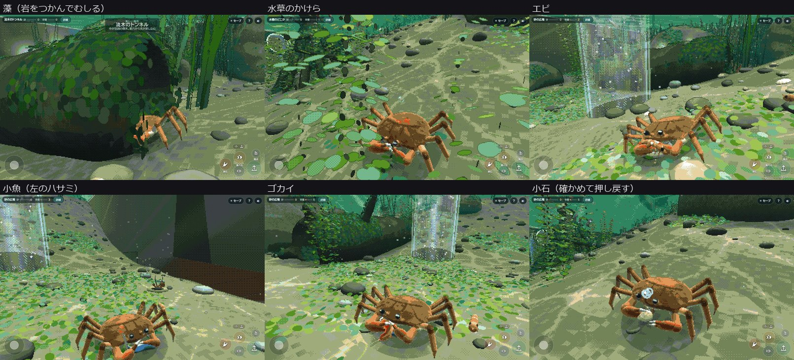
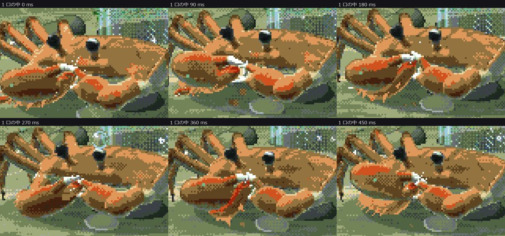
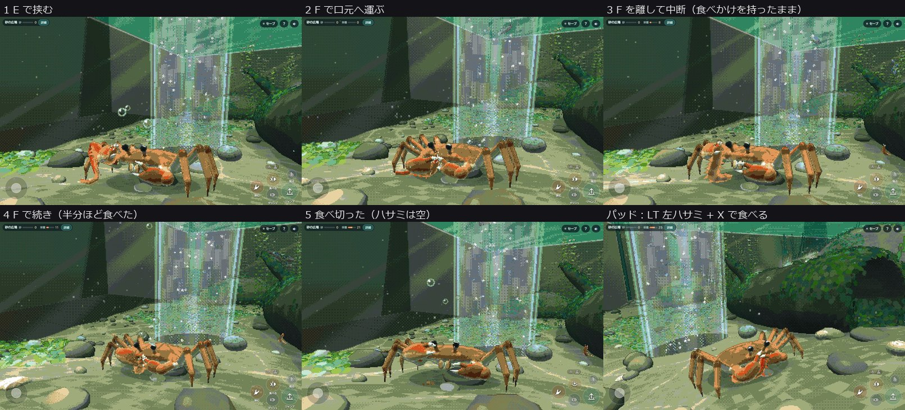
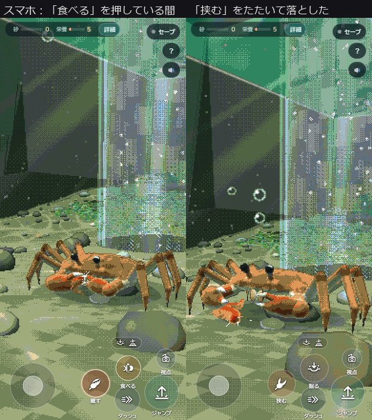

# 食事と栄養：ハサミで挟んで、口元へ運んで、少しずつ食べる

水槽探検の正式なゲーム設計方針（[roadmap.md](../roadmap.md) の 1 章「ゲームの基本方針」・12 章）を確定し、その最初の柱として
**食事のアクション**と**栄養（経験値に相当する蓄積型の成長資源）**を実装した。

カニは左右どちらのハサミで挟んだ食べ物も口元へ運び、口の前の第 3 顎脚を開閉して噛み取り、ハサミで引き離してちぎりながら少しずつ食べる。
空いている方のハサミは食べ物をつまんで口へ運ぶのを手伝う。食べ物は 1 口ごとに小さく（ゴカイは短く）なり、食べかすと泡がこぼれ、
種類ごとの噛む音が顎脚の動きに合わせて鳴る。途中でやめても食べかけはそのまま残り、続きから食べられる。

## 1. 操作方法

いまの操作体系（PC・スマホ・ゲームパッド）を調べた結果、**何かを挟んでいる間は「掘る」ボタンが空いている**（掘るのもハサミを使うので、
挟んでいる間は掘れない：`main.ts` の `dig: digNow && !grab.busy && !grabL.busy`）。根の付いた水草を挟んでいる間は、このボタンが既に
「ちぎる・抜く」に使われている（同じ考え方の前例）。そこで新しいボタンを足さず、**挟んだまま「掘る」ボタンを押している間 = 食べる**とした。
キー・ボタンの追加が無いので、既存の操作とぶつからない（ゲームパッドは標準の 16 ボタンをすべて使っていて空きが無かった）。

| | PC | スマホ | ゲームパッド |
| --- | --- | --- | --- |
| 挟む | <kbd>E</kbd> を押している間（右のハサミ） | 「挟む」スイッチ（右のハサミ） | RT / R2（右）・LT / L2（左） |
| 食べる | 挟んだまま <kbd>F</kbd> またはマウスの右ボタンを押している間 | 挟んでいる間、「掘る」ボタンが「食べる」の絵と名前になる。押している間 | 挟んだまま X / □ を押している間 |
| 中断 | <kbd>F</kbd> を離す（食べかけを挟んだまま構えへ戻る。もう一度押すと続きから） | 「食べる」を離す | X / □ を離す |
| 食べかけを落とす・生き物を逃がす | <kbd>E</kbd> を離す | 「挟む」をもう一度たたく | トリガーを離す |
| 食べながら | 歩ける（速さは約 0.55 倍）・走る・跳ぶも可。掘ることはできない（ボタンを食べるに使うため） | 同じ | 同じ |

- 左のハサミは、いまの操作体系どおりゲームパッドの LT だけで使える（PC・スマホは右のハサミだけ）。どちらのハサミの食べ物も同じ操作で食べられる。
  両方のハサミが物を挟んでいるときは、食べられる物の方を先に（両方なら右から）食べる。
- 根の付いた水草を挟んでいる間は、従来どおり「掘る」= ちぎる / 抜く。ちぎった・抜いた直後の押し下げのまま食べ始めない（一度離してから押す）。
- 食べ終えた後も、押したままでは次の物を食べ始めない（一度離してから）。
- 「案内を出す」設定のときだけ、食べた量・中断・食べない理由を短い文字で出す（ふだんは動き・音・左上の栄養で分かる）。
- 説明の欄（「？」）の PC・スマホ・ゲームパッドの説明に食べる操作を足した。

## 2. 食べる動き（`AquaEat.ts`・`CrabRig.ts`・`crabModel.ts`）

実際のカニの食べ方（ハサミで食べ物をちぎり、口元へ運び、口の前の第 3 顎脚で押さえ、中の小顎・大顎で細かくしてのみ込む。片方のハサミで持ち、
もう片方でつまんで口へ運ぶことも多い）を、次の段階で表した。

| 段階 | 動き |
| --- | --- |
| 運ぶ（bring、約 0.38 秒） | 食べている側のハサミの構え（物・生き物をつなぐばねの目標 `anchor`）を口元へ寄せる。挟んだ物・エビ・小魚・ゴカイは**既存のばねの物理のまま**口元へ来て、ハサミの IK はいつもつかみ点を挟んで見える（ずれは最大 1 mm）。顎脚が少し開き、小刻みに震え始める |
| 噛む（chew、1 口 0.48〜0.6 秒） | 押し込む（構えが口へ 3.6 cm 近づく・顎脚が大きく開く）→ 噛み取る（顎脚が閉じる。ここで 1 口ぶん減り、噛む音・食べかす・泡）→ ハサミで引き離しながら手首をひねってちぎる（左右交互にひねる）。体は少し低く、頭を下げ、1 口ごとに小さくうなずく |
| 手伝う | 空いている方のハサミが、食べ物の横をつまむ → 口元へ運ぶ → 口の前で開く → 戻る、を 1 口と半周ずらして繰り返す（そのハサミが何も挟んでいないときだけ） |
| 確かめる（taste） | 食べられない物（小石・貝殻）は口元へ運んで顎脚でさわり、押し戻す（「ぷっ」と泡）。仲間・まだ隙間に踏ん張っている生き物・何も無い岩は運ばず、顎脚が動くだけ |
| 戻す（back、約 0.3 秒） | 中断・食べ終えたとき、構えへ戻る |

- **第 3 顎脚**：口の前の扉のような 1 対の板（幅 4.2 cm・高さ 6 cm、上の外側に小さな触鬚）。新しいボーン 2 本（`CRAB_BONE.mxpL / mxpR`、ボーンの数 23 → 25）。
  外側の縁を軸に前へ開き、閉じて噛み取る。食べていないときも呼吸の水流のように小さく震える。
- 口元に食べ物がある間は、物をカニの体から押し出さない（口に入っている）。ハサミは届かない・ばねが伸びたことでは滑らない（`GrabSystem.feeding`）。
- 冒険カメラ（三人称など）では、食べている間だけ注視点を口元へ少し寄せる（引っこ抜きと同じ `camera.focus`）。

## 3. 食べられるもの

| 食べ物 | 手に入れ方 | 栄養（1 個） | 食べ切るまで | 噛む音 | 減り方・消え方 |
| --- | --- | ---: | ---: | --- | --- |
| 藻 | 苔の付いた水中の岩・流木をハサミでつかんだまま「食べる」：つかんだ所のまわり 14 cm の苔（最大 36 枚）をむしり取り、そのまま挟んだかけらにする。跡は 90〜150 秒後から 20 秒かけて生え戻る | 2 × 大きさ（むしった量 / 18、0.5〜2） | 約 2.4 秒 × 大きさ^0.7 | しゃくっ（細かい繊維） | かけらが小さくなり、消える |
| 水草 | 茎・葉を挟んで「掘る」でちぎる / 抜く（従来）→ かけら | 5 × 大きさ（重さ / 0.05、0.4〜2.5） | 4.0 秒 × 大きさ^0.7 | しゃくっ | 同上 |
| エビ | 捕まえる（従来） | 12 | 6.0 秒（10 口） | こりっ（殻） | 1 口目から動かない。体積に合わせて小さく、食べ終えると消える |
| 小魚 | 捕まえる（従来） | 15 | 7.0 秒（12 口） | もぐっ | 同上（横に倒れる） |
| ゴカイ | 石の隙間から引き抜く（従来）→ 体を挟む | 20 × 大きさ（体長 / 0.87 × 太さ） | 8.0 秒 × 大きさ^0.7（14〜16 口） | むにゅ（湿った） | 1 口目から動かない。体が短く・少し細くなり、食べ終えると消える |
| 小石・貝殻 | 挟む | — | — | ぷっ（押し戻す） | 食べない |

- 部分的に食べた分も、食べた割合 × 1 個分の栄養が入る（1 口ごと）。
- **捕まえた生き物は、食べるか逃がすかを選べる**：食べずに挟むのをやめれば、従来どおり逃げる。口元へ運んでいる間は暴れないが、1 口目の前にやめて離せば
  生きたまま逃げる（1 口目から動かなくなる）。
- **仲間は食べない**：仲間（いまはスナモグリ）は口元へ運ばず、顎脚が動くだけ。将来の仲間は `GrabCreature` に `companion: true` を持たせれば同じく守られる
  （`main.ts` の `isCompanion`）。仲間になる前の巣穴のスナモグリ・まだ石の隙間に体が残っているゴカイも「踏ん張っている」ので食べない（引き抜いてから）。
- 食べ終えた個体は消える（試作）。エビ・小魚・ゴカイは増えないので、食べた分だけ水槽から減る（12 章：繁殖・環境整備で戻す予定）。

## 4. 栄養

- 経験値に相当する蓄積型の成長資源（`AquaEat.Nutrition`）：合計・種類ごとに得た量・種類ごとの食べ終えた数。**時間では減らない**（空腹・餓死は無い）。
- 左上の表示（砂の右）に「栄養」と数（切り捨て）、次の脱皮の目安までの帯。一度も食べていない間は出さない。増えると数が少し光る。
  「詳細」の欄に、合計・段階・種類ごとの量と数。
- 脱皮への接続：`GROWTH.moltAt = [40, 100, 180, 300, 460]`（段階・次の段階・割合は `Nutrition.stage / next / progress`）。脱皮そのものはまだ作っていない。
  保存は合計と種類ごとの量なので、「経験値のように減らさない」「脱皮に使う」のどちらにも移れる。

## 5. 保存（版 3。[save-format.md](../save-format.md) の「版 3」・11 章）

| 保存するもの | 置き場所 |
| --- | --- |
| 栄養（合計・種類ごとの量・食べ終えた数） | `player.nutrition` |
| 食べられたエビ・小魚（番号・残り・消えたか・横たわっている位置） | `tanks.home.food.critters` |
| ゴカイの食べかけ（残り・動かない）・食べ終えて消えた | `buddies[]` の traits の `eat`・`left` |

- 版 2 → 3 は読み込むときに `migrate` で直す（栄養 0・食べられた生き物なし）。版 2 のページ・古いアプリは版 3 を「新しい版」として拒否し、上書きしない。
- 水草・藻のかけら（食べかけを含む）と、ちぎった水草・むしった藻の跡は、従来どおり保存しない（読み込み直すと元に戻る）。

## 6. 検証

道具：`docs/aquarium/tools/eat_helpers.js`（`__eat`：種類ごとに左右どちらかのハサミへ食べ物を持たせる・食べる・中断・離す）、`eat_test.js`（`__eatTest`）、
`eat_shots.js`（本物の入力：PC のキー・仮想のゲームパッド・スマホのタッチ・保存と再起動・撮影）、`eat_perf.js`（処理の重さ）、
`save_migrate3_run.js`（版 2 → 3）。自動検証は 1/60 秒刻み・`?nosave`。数値は [results.json](results.json)。

### 6.1 左右のハサミ × 食べ物（`__eatTest.matrix`、各 10 秒まで「食べる」を押し続ける）

| | 右：口数 / 栄養 / 食べ切った | 左：口数 / 栄養 / 食べ切った |
| --- | --- | --- |
| 藻（流木の苔） | 5 / 1.89 / ○ | 4 / 1.33 / ○ |
| 水草のかけら（有茎草） | 6 / 3.00 / ○ | 5 / 2.28 / ○（右でちぎって落としたかけらを左で拾う） |
| エビ | 10 / 12 / ○ | 10 / 12 / ○ |
| 小魚 | 12 / 15 / ○ | 12 / 15 / ○ |
| ゴカイ | 16 / 21.71 / ○ | 14 / 17.74 / ○（別の個体。体長が違う） |
| 小石 | 確かめて押し戻した / 0 | 確かめて押し戻した / 0 |

- どの組み合わせでも：噛んでいる間のハサミとつかみ点のずれ（IK が届かない距離）の最大 1 mm、食べ物と口の距離の最小 1〜2 cm（水草のかけらは 2〜11 cm：かけらの原点がつかみ点のため）、
  滑り 0、手伝う鋏の重み 1（小石を除く）、顎脚の開きの最大 0.88〜0.92。
- 当初、右のハサミでエビを食べ始めた直後にハサミとエビが最大 32 cm 離れて見えた（1 口目の前に、生きているエビが暴れたため）。口元へ運んでいる間は暴れない
  （`LifeGrab.subdued`）ようにして解消した。

### 6.2 場面（`__eatTest`）

| 場面 | 結果 |
| --- | --- |
| 中断と再開：エビを 2 秒食べて中断 → 0.5 秒 → 続き | 中断した時点の残り 0.70、待っている間も 0.70・挟んだまま。再開 1 回で食べ切り、合計 10 口・栄養 12（1 匹分ちょうど） |
| 食べかけを落として拾い直す：小魚を左で 4 口 → 離す | 底へ沈んで止まる（底から 3 cm・残り 0.657・動かない）→ 左で拾い直して 8 口で食べ切り、消えた（捕まえられた 2 回とも。残りの回は小魚が逃げて捕まえられなかった） |
| 捕まえて食べずに離す | 食べられていない・逃げた（dart） |
| 口元へ運び始めて（0.25 秒）1 口目の前にやめて離す | 0 口・食べられていない・逃げた |
| 巣穴のスナモグリ（仲間になる前）を挟んで「食べる」 | 運ばない（運ぶ重み 0）・0 口・挟んだまま（引っこ抜きはそのまま続けられる） |
| 仲間になったスナモグリ（判定） | 食べない（`companion`）・運ばない |
| `companion` の印を付けたゴカイ | 食べない・運ばない・残り 1 のまま・暮らしもそのまま |
| ゴカイを食べながら歩く / 走る / 跳ぶ | 歩く 0.81 m/s（何も持たない歩き 1.45 の 0.56 倍）・走る 1.54・跳びながら 0.97。滑り 0・落とさない・食べ続けた |
| 藻の生え戻り（待ちを 0 にして 25 秒） | つかんだ所の藻 16 枚 → むしった後 4 → 生え戻って 16 |

### 6.3 本物の入力（`eat_shots.js`）

| | 結果 |
| --- | --- |
| PC（1280×800、キー） | E で挟む → F で 0.45 秒後に噛み始めた → 2 秒で 6 口（残り 0.61）→ F を離すと中断（挟んだまま）→ F で続きから → 食べ切り（栄養 21.71 = 1 匹分、ハサミは空、左上の栄養 21）。ページのエラー 0 |
| ゲームパッド（仮想のパッド） | LT で左のハサミに挟む → X で食べる（左のハサミで噛んでいる）→ X を離して中断 → LT を離して落とした |
| スマホ縦（390×844、タッチ） | 「挟む」をたたく → 「掘る」ボタンが「食べる」（class `eat`）に変わる → 押している間食べた（2.5 秒で 4 口）→ 離して中断 → 「挟む」で落とすとボタンは「掘る」に戻った。エラー 0 |
| 保存と再起動（`?nosave` なし） | 栄養 31.943・食べ終えた数・エビの食べかけ（残り 0.7、底に横たわったまま）・消えたゴカイ・食べかけのゴカイ（残り 0.626・動かない・挟める）が戻った。続きを 9 口で食べ切れた |
| 版 2 → 3 の移行（`save_migrate3_run.js`、版 2 = main を 5174 番） | IndexedDB の版 2 のデータ・版 2 の書き出しファイルとも、掘った地形（空洞 30・区画 41・三角形・当たり判定）・仲間・場所・カニの位置が版 2 の指紋と完全に一致。栄養 0。版 3 の書き出し → 読み込みで栄養・食べかけ・消えた個体が一致 |

### 6.4 処理の重さ（`eat_perf.js`。1 フレームの処理 = ゲームの更新 + 描画の命令）

| 端末 | 何もしていない | ゴカイを食べている | 藻を 3 か所むしった後でエビを食べている |
| --- | --- | --- | --- |
| PC（1280×800） | 3.6 ms（フレーム間隔 13.1 ms） | 3.2 ms（13.2） | 2.7 ms（13.1） |
| スマホ相当（390×844・CPU 4 倍遅く） | 14.3 ms（14.5 / 95% 26.7） | 14.4 ms（14.7 / 26.7） | 10.7 ms（15.8 / 26.7） |

食べている間に増える処理は無視できる（ばらつきの範囲）。藻の生え戻りは 1 秒に 1 回だけ円盤の大きさを書く。起動時に藻の円盤 22,055 枚を 25 cm の格子に分ける。

### 6.5 回帰（既存の機能）

| 検証 | 結果 |
| --- | --- |
| 引っこ抜き（スナモグリ、`tug_test.js` 各 2 回） | 挟むだけ 0/2、歩いて下がる 1/2・4.6 秒、走る 0/2（滑り 2）、斜め 2/2・5.9 秒、止まりながら 2/2・5.9 秒、上手な人 2/2・5.0 秒、離して挟み直し 1/2。ゴカイの報告の値と同じ傾向。めり込み 0 |
| ゴカイ（`worm_test.js` 標準、1 回ずつ） | このブランチ：歩く 5.7 秒・斜め 4.4 秒・止まりながら 7.8 秒・横と動かないは抜けない。main：5.5・4.5・7.3・抜けない。固体の中のフレーム 0・発散 0。運ぶ → 離す：めり込み 0 |
| 挟む・水草・捕まえる（`catch_test.js`） | main と同じ（小石・貝殻を持って跳ぶ・泳ぐ、重い石は跳ぶと落とす＝main も同じ、水草は引くだけでは抜けない、エビ・小魚のめり込み 0） |
| ゲームパッド・左右のハサミ（`pad_audio_test.js`） | 接続・遊び・移動・走る・跳ぶ・RT / LT・腕・カメラ・十字キー・道具・切断、2 本のハサミで別々の小石、左で巣穴の触角：すべて ok |
| 砂の回収・再配置（`sand_test.js`） | 盛る・登る・掘り直す・トンネルに盛る・ガラス / 管・見た目と当たりのずれ（光線 8,007 本で bad 0） |
| 型チェック・本番ビルド・アプリ用のビルド（`build:app`） | 通る |
| ブラウザのコンソール | エラー 0。通信は localhost だけ（外部のサービス・資源を使わない） |

## 7. アプリ版（Tauri 2）との互換

- ゲームのコード（`src/aquarium/`）と、共有の `TouchControls.ts`（印を 1 つ追加）・`SurfelRenderer.ts`（円盤の大きさを読む・書く関数を 2 つ追加）だけを変えた。
  `AquaPlatform.ts`・`src-tauri/` は変えていない。外部への通信・外部の資源・新しい権限は増やしていない（CSP・capabilities はそのまま）。
- 効果音は Web Audio の合成（音のファイルを足していない）。保存は既存の IndexedDB / localStorage の枠（版 3）。
- `npm run build:app` が通る。Windows のアプリ（`npm run app:win` = `tauri build`）も通った（NSIS 3.16 MiB・MSI 3.83 MiB）。
- リリース版の exe を起動し、CDP（WebView2 の `--remote-debugging-port`）で `eat_helpers.js` を読み込んで確かめた：既存のアプリの保存データ（版 2）を版 3 として
  読み込めた（`ok`）。エビ 10 口・栄養 12、ゴカイ 16 口・21.71、藻 5 口・1.89、IK のずれ 1 mm・滑り 0、60 FPS。試験の前にアプリのデータフォルダ
  （`%LOCALAPPDATA%\io.github.kitamiya1.aquariumexplore`）を控え、試験中は自動保存を止め、終わってから控えで元に戻した（画像：[app-windows-eating.png](app-windows-eating.png)。
  カメラが遠いが、左上に栄養 37）。Android・iOS のビルドは CI（app-build.yml・app-ios.yml）で確かめる。

## 8. 残っている問題・気づいたこと

- **実機（iPhone・Android）では未確認**（タッチはブラウザのタッチ入力、性能は CPU を 4 倍遅くした見積もり）。
- **顎脚は小さい**：ドット絵の画面では、ふつうの三人称の後ろからはほとんど見えない（甲羅の前の下にある）。斜め前・横から寄ると開閉が見える。
  食べている感じは主に、口元へ運ぶハサミ・食べ物の縮み・手伝うハサミ・食べかす・音で伝わる。もっと見せたい場合は、食べている間だけカメラを横へ回す案がある（未実装）。
- 左のハサミは PC・スマホでは使えない（いまの操作体系どおり、ゲームパッドの LT だけ）。PC・スマホで左のハサミを使うキー・ボタンを足すかは別に決めたい。
- 左のハサミは小さく構えが低いので、高い所の茎には届きにくい（水草を左でちぎるのは難しい。拾うのはできる）。
- 食べ終えたエビ・小魚・ゴカイは戻らない（試作の仕様）。全部食べると水槽からいなくなる。繁殖・環境整備（M4）で増やす予定。
- 水草・藻のかけら（食べかけを含む）は保存しない。読み込み直すと、ちぎった水草・むしった藻は元に戻り、手に持っていたかけらは消える（栄養は保存済み）。
- 藻はむしった跡が生え戻るので、時間をかければいくらでも栄養を得られる（急かさない方針には合うが、脱皮の段階の調整のときに見直す）。
- 落としたかけらが生え戻った藻と重なって 2 つあるように見えることがある（かけらは古い物から 12 個を超えると片づく）。
- 食べている間の注視点の寄せは冒険カメラだけ（肩越し・ガラス越し・箱庭は変えない）。
- この画面（ブラウザの検証環境）では PC の大きさでもスマホのボタンが出ている（既存の `isTouchDevice` の判定。今回の変更とは関係ない）。

## 9. 文書とコードの食い違い（見つけたもの）

| 場所 | 食い違い | 対応 |
| --- | --- | --- |
| `docs/aquarium/roadmap.md` 2 章の見出し | 「main = `2759275` + この PR」のまま | `e25be37` に直した |
| `docs/aquarium/roadmap.md` 2 章「操作ボタンと案内の表示」の行 | 主なファイルの `aquarium.css` の前に制御文字（ベル 0x07）が入り、`quarium.css` と見えていた（PowerShell の `` `a `` が化けたもの） | 直した |
| `docs/aquarium/save-format.md` 4 章 | `sand` の範囲が「0〜SAND.capacity = 4」のまま（第 10 段階で上限を無くした。同じ文書の「版 2」の節は正しい） | 直した |
| `docs/aquarium/roadmap.md` 2 章「ハサミで挟む（MVP）」 | 「右の大きなハサミで…（PC：E、スマホ：挟む）」とあり、左のハサミ（ゲームパッドの LT）に触れていない。コードは左右の 2 本（`main.ts` の `grabL`） | そのまま（食事の行に左右を書いた） |
| `src/aquarium/AquaGrab.ts` の先頭・`CrabRig.ts` の先頭の説明 | 「右の大きな鋏」だけの説明。コードは左の鋏も同じ仕組み | そのまま（既存の説明） |
| `docs/aquarium/burrow-pull/report.md` 1 章・`src/aquarium/AquaUiPrefs.ts` の先頭 | ゴカイの報告で挙げた食い違い（スマホの挟むは押している間ではなくスイッチ・歩き方の `ik` の説明）は残っている | そのまま |
| `src/game/Input.ts` の `touchGrab` の説明 | 「押している間 true。いまは切り替え式の touchGrabLatch を使う」（コードと合っている。参考） | — |
