# 第 6 段階：iPhone 実機の確認から — 操作感の改善

ブランチ `feat/aquarium-feel-iphone`（main `fdc8c97` = PR #16 から）。検証は開発版（5173）と変更前の main（`../PPP-base`、5174）を
同じ手順で交互に動かして比べた。検証の道具は [`tools/feel_test.js`](../tools/feel_test.js)（`window.__ft`）。

## 1. 視点（カメラ）

**変更前の問題**：カメラのボタンの短押し = 冒険 / ガラス越し / 箱庭、長押し = 肩越し ↔ 三人称 と、2 つの切り替えが別々で、
いまどちらの方式なのか画面から分からなかった。

**変更後**：冒険カメラの方式とカメラの種類を 1 列の「視点」にまとめた（`AquaCamera.view` / `setView`、`AquaCamPicker.ts`）。

| 操作 | スマホ | PC | ゲームパッド |
| --- | --- | --- | --- |
| 次の視点（三人称 → 肩越し → 自由追従 → ガラス越し → 箱庭 → 三人称） | カメラのボタンを短く押す | `V`（離したとき） | RB / R1 |
| 視点の一覧（いまの視点に ✓） | カメラのボタンを長押し → 指を滑らせて離す / たたく。外をたたくと閉じる | `V` 長押し → `1`〜`6` かクリック・`Esc` | — |
| 肩越し ↔ 三人称 | （一覧から） | `C` | 左スティック押し込み |

- 切り替えたときだけ、画面の上に視点の絵と名前を約 1.3 秒出す（最初の 3 回は「長押しで視点の一覧」を添える）。ふだんは出さない。
- カメラのボタンの絵が、いまの視点の絵に替わる。「従来」は一覧からだけ選べる（短押しの順には入れない）。三人称が標準のまま。
- 切り替えた瞬間にスティック・キーを倒していたら、離すか大きく倒し直すまで前の視点の向きで進む（カニが急に向きを変えない）。

**確認**：6 視点 × 6 視点の 36 通りすべて（視点の一致・姿勢の値が有限・切り替えた時だけ表示が出る）OK。短押しの順・一覧の ✓・
数字キー・`Esc`・`C`・実際のタッチ（CDP：短押し・長押し → 滑らせて離す・長押し → たたく・外をたたいて閉じる）OK。
ガラス越し・箱庭・肩越しへ切り替えても、倒したままの移動の向きは変わらない（`moveLatch`）。

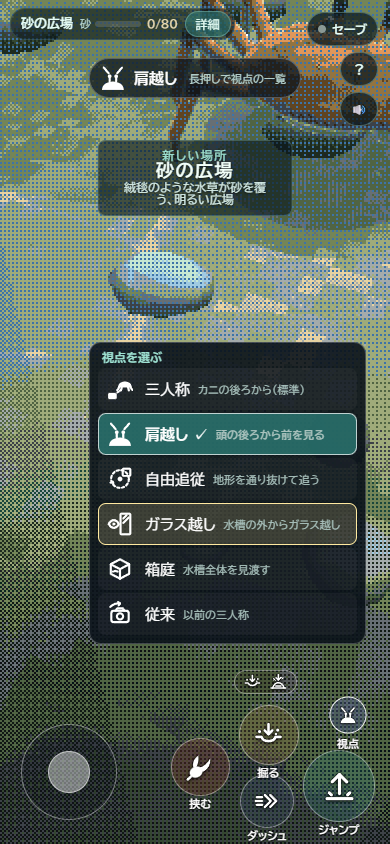

## 2. 水草を引っ張って遊ぶ

**変更前**：張力が種類ごとの強さを 0.35 秒越えると切れる・抜ける（`BREAK_T`）。実機では普通に引くだけですぐ切れた。

**変更後**（`AquaCatch.ts` の `PlantGrab`、`AquaPlants.ts`）：

- 引くほど大きくしなる（種類ごとの上限 `cap`。8 割までは鋏について曲がり、その先はなめらかに頭打ち）。
- 張力 = 引いた距離 × 硬さ ×（1 + (距離 / soft)²）+ 上限を越えた分（とても硬い）+ 急に引いた分。根元の近くを挟むほど硬い。
  反作用でカニが引き戻され、張るほど歩みが重くなる（`slow`）。ふつうに歩いて引くと握る力の手前で釣り合って止まる。
- 離すと曲がっていた分だけ跳ね返り、しばらく減衰を弱くして何度か揺れ戻る（`fling`）。強く張るほど・上へ引くほど葉が震える。
- 引くだけでは抜けない・切れない。ダッシュで強く引き続けると、先にハサミが震えて（`warn`）滑る。
- **抜く・ちぎるは意図した操作**：挟んだまま「掘る」（スマホのボタン・`F`・X / □）。高い所を挟んだテープ状の葉・有茎草はちぎれ、
  それ以外は種類ごとの強さ以上に引いている間だけ根元から抜ける（足りなければ草が震えるだけ）。挟んでいる間、スマホの「掘る」
  ボタンは「ちぎる」/「抜く」の絵（緑）になる。
- 切れた部分は消さない：つかんだ所の近くは挟んだまま運べるかけら、その先（長い葉の先）は離れたかけらとして漂って沈む。
  多すぎるかけらは古いものから小さくしてから片づける。
- 太い株（シダ）が体・見通しの線に押されて鋏の届かない所へ逃げ、挟めなかった（PR #16 からの問題）→ 狙っている植物は押さない。
- 挟んでいる間は正面（鋏の側）を挟んだ所へ向けたまま下がる（背を向けて鋏が届かなくなっていた）。

**引っ張りの試験**（`__ft.plantPull(kind, {cycles: 3})`：1 秒引く → 0.6 秒止まる → 離して 2.5 秒。3 回くり返し）

| 種類 | 張り（握る力比） | 歩く速さ | 止まると引き戻される | 離した後の反対側への振れ | 揺れ | 滑り・切断 |
| --- | ---: | ---: | ---: | ---: | ---: | :---: |
| テープ状の葉 | 0.86〜0.87 | 56% | 0.29 | 48〜51% | 2 | 0 / 0 |
| 有茎草 | 0.99 | 32% | 0.36 | 52% | 1 | 0 / 0 |
| シダ | 1.07〜1.10 | 9% | 0.31 | 39% | 2 | 0 / 0 |
| 汀線の草 | 1.02 | 36〜37% | 0.22 | 54% | 2 | 0 / 0 |

（葉の広い草は水中にまわりの空いた株が無く、自動の試験で置けなかった。数値はシダの近く：cap 0.4・k 6.8）

**ダッシュで強く引く**（`plantYank`、2.5 秒）：テープ状の葉 = 滑らない（張り 1.06・ハサミの震え 0.65）、有茎草 = 2.0 秒で滑る、
シダ = 1.35 秒、汀線の草 = 0.63 秒。**どれも切れ・抜けは 0**。

**意図した操作**（`plantTwist`）：シダを引かずに押す → 「引きが足りない」（抜けない）。シダを引きながら → 抜けた（円盤 896 →
かけら 896）。汀線の草 → 抜けた（13 → 13）。有茎草・テープ状の葉の高い所 → ちぎれた（120 = 根元側 10 + かけら 110、
160 = 10 + 150）。**消えた円盤は 0**。

連続画面（テープ状の葉：挟む → 引く → 離して 0.27 秒 → 0.6 秒で反対側へ振れる。曲がり x：0.89 → 0.37 → −0.50）：

| 挟む | 引く | 離して 0.27 秒 | 0.6 秒 |
| --- | --- | --- | --- |
| 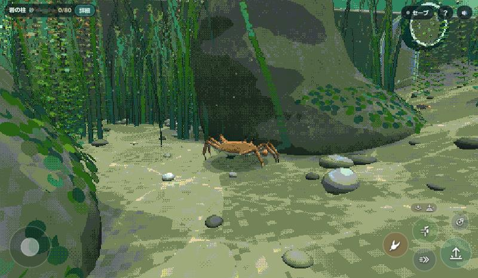 | 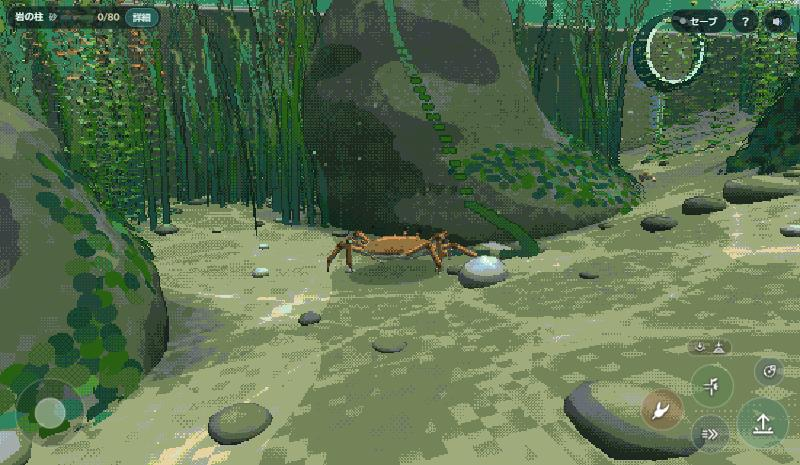 | 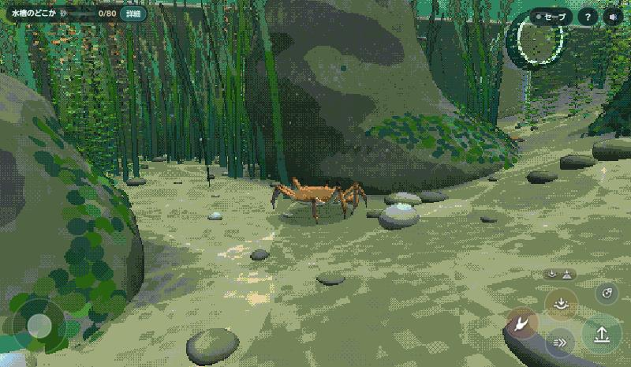 | 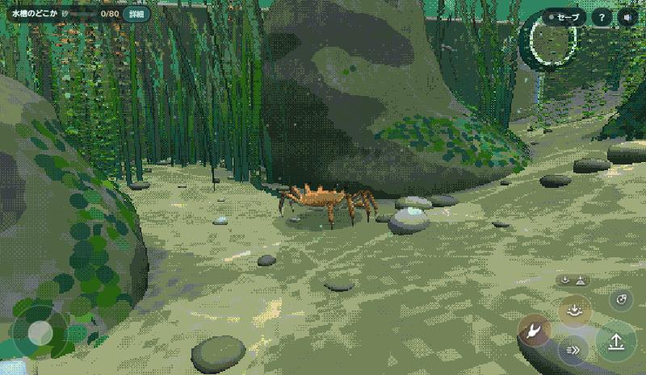 |

## 3. 接地 IK の安定化

**原因**（`CrabFeet.ts`）：
1. 踏み替えの時間が `0.12 / (速さ + 0.25)` で、歩き 2.3 / 秒で 0.047 秒（速すぎる）。
2. 止まっている間、足場の点が理想の位置から 0.035 より離れていると 0.35 秒ごとに踏み直し、探した足場が毎回わずかに違うと永久に続いた。
3. 足場が見つからない脚は毎フレーム「急ぎ」になり、同じ無効な所（理想の位置の宙）へ何度も運ばれた。

**変更**：
- 歩行の周期：左右交互の 4 本ずつ（右 1・左 2・右 3・左 4 と、その逆）を位相で半周期ごとに踏み替える。歩幅を速さで伸ばし、
  踏み替えの時間 = 歩幅 / 速さ。先読みは「踏み替えの間 + 接地の半分」だけ前（接地の間、足先が理想の位置の前後に振れる）。
  体を回すときも回る速さで周期を進める。
- 止まった直後に 1 回だけ踏ん張り直し（理想から 0.06 以上ずれた脚。踏み替えた直後で待っている脚は待ちが明けてから）、その後は
  0.13 以上（ヒステリシス）ずれる・伸びきる・足場が消えるまで踏み替えない。踏み替えの後は 0.35 秒待つ。
- 足場が見つからない：0.3 秒から倍々（最大 1.6 秒）で待つ。足場のある脚はそのまま立ち、無い脚は理想の位置の少し下で宙に構える
  （構えている所の近くなら運ばない）。待っていても伸びきりを越えた脚・体から離れた脚は待たない（置いていかれない）。
- 接地している足先は毎フレーム面へ寄せる（浮き・めり込みを直す）。

**静止（微妙な足場）**：`feetSpots({n: 30, sec: 4, jitter: true, seed: 11})` — 斜面・岩や段差の縁の 30 か所へ 0.9 歩いて来て止まり、
1.5 秒後から 4 秒。フレームの時間を iPhone のように 1/60〜1/30 秒で揺らす。

| | 踏み替え | 1 秒あたり | 緊急の踏み替え | 足場の探索の失敗 | 宙に浮いた足先 | 足先と面の距離（最大） |
| --- | ---: | ---: | ---: | ---: | ---: | ---: |
| 変更前 | 438 | 3.65 | 397 | 396 | 0.7% | 0.001 |
| 変更後 | **0** | **0** | **0** | 47 | 0.4% | 0.001 |

変更前は 30 か所中 10 か所で踏み替えが止まらず、最も多い所は 4 秒で 130 回（フレームの時間を揺らさない 12 か所の試験では
変更前 5 回・変更後 0 回）。変更後の探索の失敗 47 回は、宙で構えた脚が待ち時間を倍にしながら探し直した数。

**歩く → 止まる 3 秒 × 3 回**（`feetStill`）：止まっている間の踏ん張り直し以外の踏み替えは、平地・砂山の縁・細い岩・崖の上・
掘ったトンネルで 0〜1 回（踏ん張り直しは 1 回の停止で各脚最大 1 回）。トンネルでは変更前が 踏み替え 17・緊急 24・探索の失敗 20、
変更後が 踏ん張り直し 4・緊急 1・失敗 6。

**歩く・ダッシュ・方向転換**（`feetWalk`、変更前 → 変更後）

| 場所 | 踏み替えの時間（歩き） | 同（ダッシュ） | 1 秒の踏み替え（歩き） | 緊急（ダッシュ） | 脚の伸びの最大 |
| --- | ---: | ---: | ---: | ---: | ---: |
| 平地 | 0.062 → 0.106 秒 | 0.049 → 0.108 | 42 → 36.5 | 15 → 12 | 1.24 → 1.12 |
| 砂山の縁 | 0.067 → 0.116 | 0.037 → 0.076 | 48.5 → 33 | 23 → 11 | 1.67 → 1.44 |
| 細い岩 | 0.064 → 0.111 | 0.039 → 0.081 | 55 → 36 | 9 → 5 | 1.15 → 1.13 |
| 崖の上 | 0.049 → 0.091 | 0.035 → 0.076 | 36.5 → 30 | 58 → 39 | 1.37 → 1.15 |
| 洞窟の天井 | 0.076 → 0.148 | 0.050 → 0.106 | 39 → 27.5 | 53 → 20 | 1.25 → 1.09 |
| 掘ったトンネル | 0.069 → 0.134 | 0.052 → 0.098 | 42 → 28.5 | 15 → 14 | 1.11 → 1.09 |

（脚の伸びの最大 = 歩き・ダッシュ・方向転換・停止のうち最大。届く長さに対する割合）足先の滑り（接地中の移動）はどれも 0。天井・壁で支えを失って落ちた回数 0。

| 従来方式（歩行周期） | 接地 IK（変更前） | 接地 IK（変更後） |
| --- | --- | --- |
| 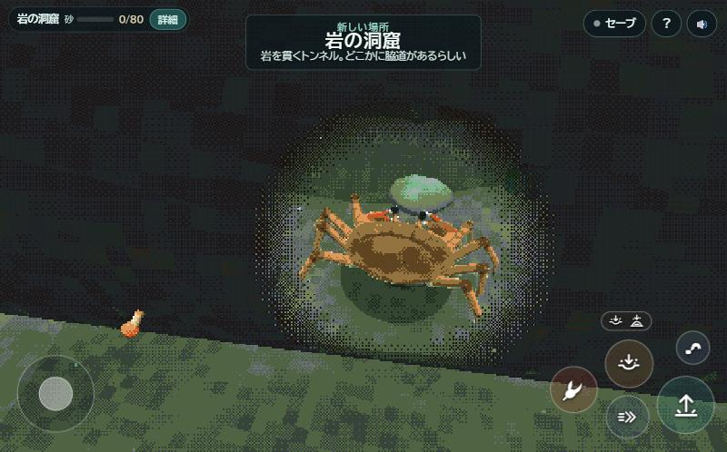 | 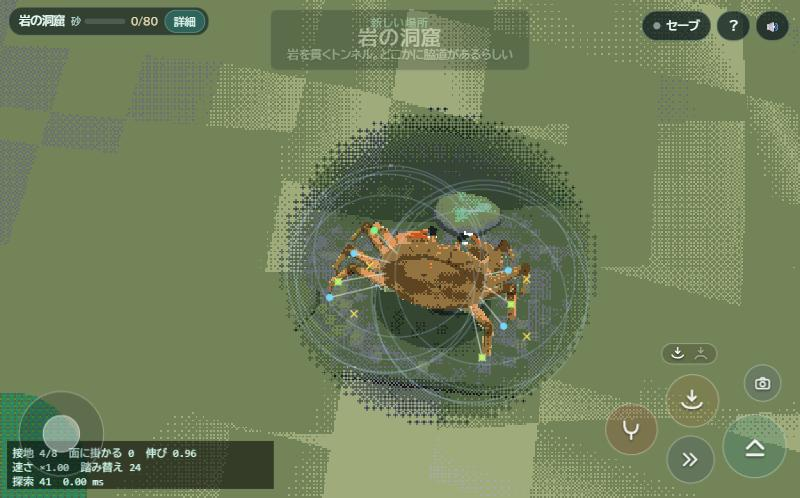 | 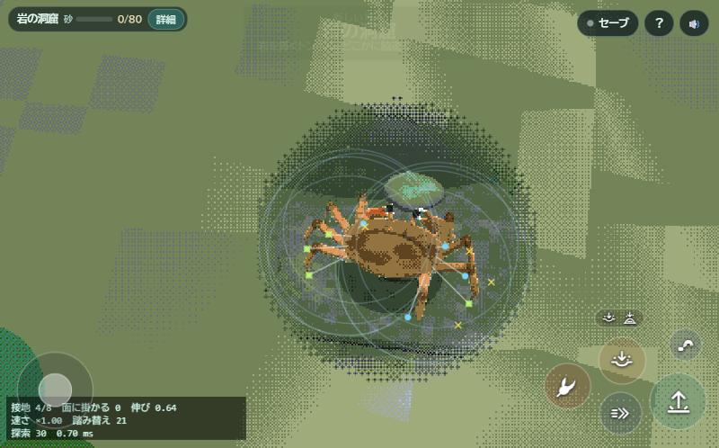 |

（同じ場所・同じ入力で 32 フレーム歩いたところ。接地の診断：変更前 伸び 0.96・踏み替え 24、変更後 伸び 0.64・踏み替え 21）

## 4. 操作の絵

- ジャンプ = 地面から真上への矢印、ダッシュ = 横へ流れる線と二重の矢印、掘る = 地面のくぼみへ下がる矢印と飛び散る砂粒、
  盛る = 砂山へ降り積もる矢印、ハサミ = 開いた / 閉じたカニのハサミ（塗りのシルエット）、ちぎる・抜く、視点 = いまの視点の絵。
- 背景は以前どおり半透明。絵の線を白く、暗い縁取り 2 重で明るい砂の上でも読めるように。押した瞬間に円が縮んで明るくなり、
  輪が広がって消える。
- 設定（🔊 の欄）に「ボタンの名前を表示」（既定は絵だけ）。初回（説明を閉じたことが無い）は説明を閉じてから 12 秒まで名前を出す。
- 初回の説明は PC も短い案内に（以前は PC は詳しい説明）。

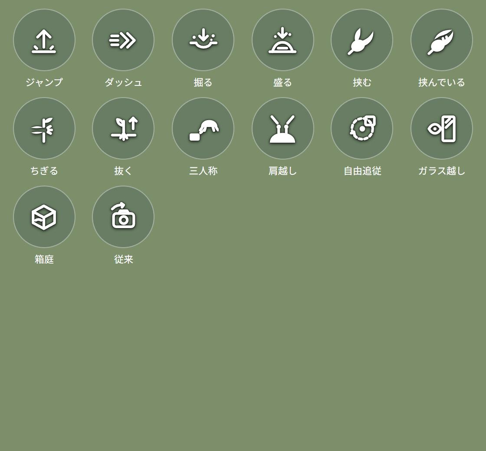

| 変更前 | 変更後 | 初回（名前・短い説明） | 横画面（水草を挟んでいる：「ちぎる」） |
| --- | --- | --- | --- |
| 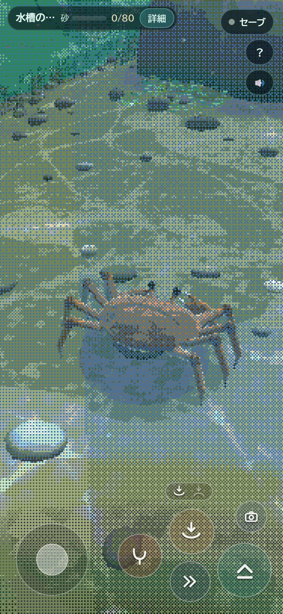 | 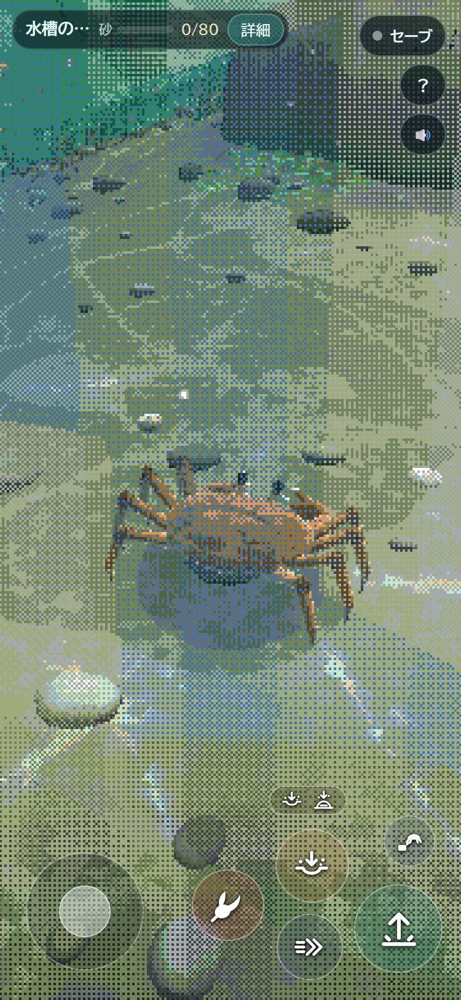 | 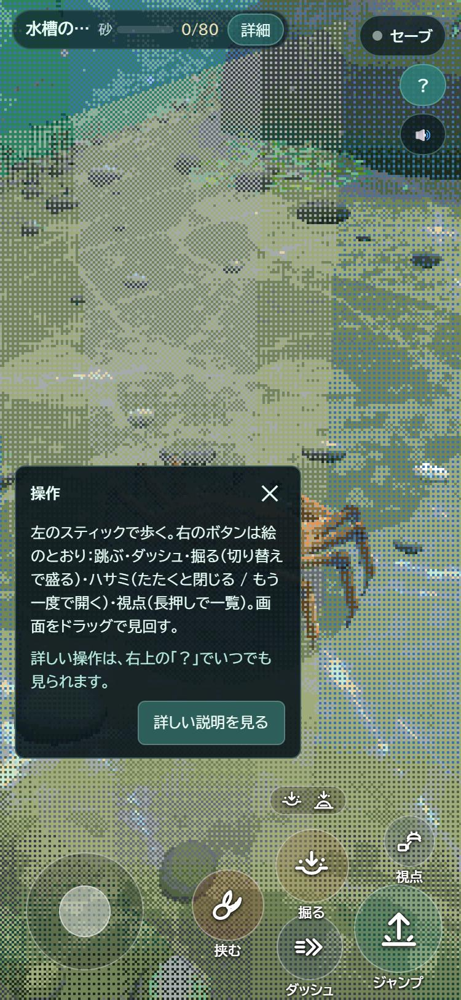 | 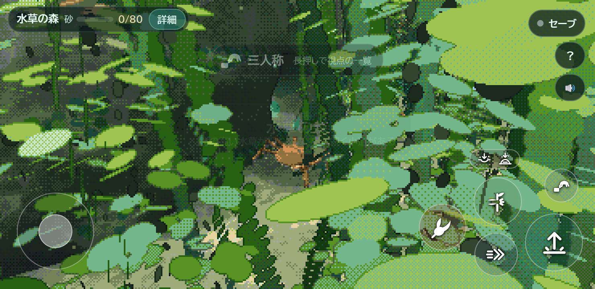 |

## 5. 回帰・保存・性能

- 運搬（小石・貝殻・重い石）・掘る・盛る：変更前と同じ値（歩きの速さの比 0.74〜0.78 / 0.68、かき出し 7・盛り 6）。エビ・小魚：
  捕まえる・逃れる・めり込み 0（乱数の差の範囲で変更前と同等）。巣穴の引っこ抜き（`__tugTest(2, ['smart'])`）2/2。
- 保存・復元（`save_roundtrip_quick.js`）：位置・穴・砂・カメラ・表示の設定（新しい `labels` を含む）が戻る。ページのエラー 0。
- 型チェック・本番ビルド OK。
- 性能（`perf_quick.js`、変更前と交互、1280 × 800）：更新の CPU 時間 spawn 1.70 → 1.85 ms・log 1.76 → 1.73 ms・水草の森
  2.08 → 2.27 ms（4 回）。フレーム時間はどこも約 16 ms（60 fps の上限）で差なし。森の差は、狙いの補助で水草を探す範囲を広げた分。

## 6. 残る問題

- iPhone 実機・実際のゲームパッドでは未確認（ブラウザのタッチの再現・自動の試験まで）。
- 葉の広い草は水中に試験で置ける株が無く、引っ張りは自動で試していない（数値はシダと同じ作り）。
- テープ状の葉はとても柔らかく、ダッシュで 2.5 秒引いても滑らない（ハサミは震える）。強く引いて滑らせたい場合は硬さの調整が要る。
- 静止画では細い水草のしなりが見えにくい（数値で確認した）。動画は撮っていない。
- 胴体の向き（壁・天井へ移るとき）は以前どおり CrabController が決める。歩行の周期で天井の探索の失敗はダッシュで増えた（37 回 / 1.5 秒。
  緊急の踏み替えは 53 → 20 に減った）。
- 閉じたハサミの絵は、付け根の切れ込みと歯で開いた絵と区別できるが、小さいと葉の形にも見える。
- 視点の絵（三人称・肩越し）は小さいと形が読みにくい。切り替えたときの名前と一覧の説明で補っている。
- `aquarium.css` のコメントの一部が文字化けしている（PR #12 の時点から。CSS の動作には影響なし。今回は直していない）。
