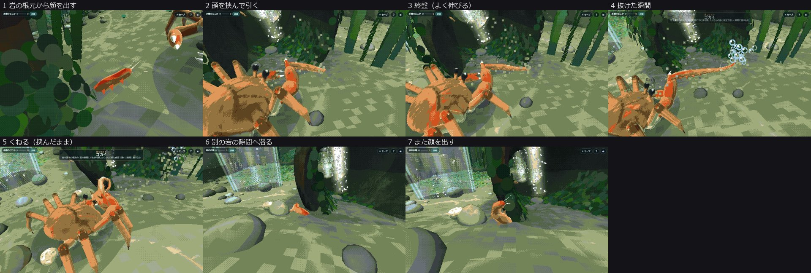
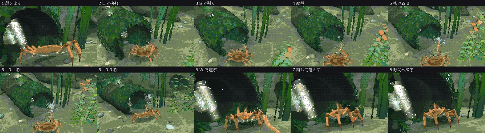

# ゴカイ：石の隙間にすむ、柔らかい体の生き物と引っこ抜き

水槽に新しい生き物としてゴカイ（多毛類）を 3 匹加えた。岩や流木が砂に接している根元の **石の隙間** にすみ、頭と触手を出して周りを探る。
隙間から出ている体のどこでもカニのハサミで挟め、引くと節ごとに伸びながら少しずつ出てきて、最後の節が抜けた瞬間に抵抗が消えて飛び出す。
抜けた後も水槽の中で暮らし（這う・近くの石の隙間を探して潜り直す）、何度でも挟んで遊べる。

- 第 1 版（PR #22、2026-11-28）：砂に巣穴を掘ってすむ形で作った。
- 第 2 版（この版、同日）：遊んだ感想「砂より石の隙間にいる方がいい」から、すみかを **岩・流木の根元の隙間だけ** にした。砂には潜らない。
  引っこ抜きの手応えは石らしく（隙間の開いている向きに沿って引くと抜けやすく、斜め・横に引くと強く引っかかる）、まわりの砂を掘っても巣は壊れない。

## 1. 遊び方

| | PC | スマホ |
| --- | --- | --- |
| 挟む | <kbd>E</kbd> を押している間（小石・スナモグリと同じ） | 「挟む」スイッチ |
| 引っ張る | 挟んだまま <kbd>S</kbd> などで隙間から離れる | 挟んだまま左のスティックで下がる |
| 運ぶ・離す | 抜けた後も挟んだまま歩ける。<kbd>E</kbd> を離すと落ちる | 同じ（もう一度「挟む」で離す） |
| 手応えの設定 | 右上「🔊」の欄の「ゴカイの引っこ抜きの手応え」：柔らかめ・標準（既定）・硬め | 同じ |

- 3 匹の隙間は、水の中で岩・流木の面のそば（根元の砂の上で面から 3〜11 cm）、体が収まる隙間を作れる所から選ぶ。1 匹はスタート地点の近く（2.6 m）。
- 岩の側からは近づけないので、隙間の開いている側（岩と反対）から近づく。速く近づく（速さ 0.9 以上で 1.6 以内）・すぐそば（0.3 以内）へ来る・
  近くに跳んで着地する・近くで掘ると、すばやく引っ込む。しばらく（2.5〜5 秒）してから、カニが止まっていれば頭をカニの方へ向けて、震えながら様子をうかがう（ここで挟める）。
- 引く向きのこつ：**岩から離れる向き（隙間の開いている向き）へまっすぐ** 引くと抜けやすい。岩の面に沿って横・斜めに引くと隙間の縁に引っかかって抜けにくい。
- 初めて抜いたときに「見つけた！ ゴカイ」と出る（それまでの名前は「細長い何か」）。抜けた瞬間は文字を出さず衝撃の輪だけ（体の飛び出し・音・泡・根元の砂で伝える）。

## 2. 柔らかい体の物理（`AquaWorm.ts`）

- 体は頭から尾まで 13〜19 個の質点（体長で決まる）。節の間を **距離の制約（XPBD）** でつなぐ。挟まれている間は 1/240 秒、それ以外は 1/120 秒の刻みで、刻みごとに 2 回解く。
- 節ごとに伸びのやわらかさがあり、制約の乗数から **節ごとの張力** が分かる。伸びの上限（標準 1.7 倍）を越えると硬い制約、縮みの下限 0.55 倍。体の中の減衰で震えを抑える。
- 曲げ（まっすぐに戻る弱い制約・折れ曲がりの限界）、筋肉（加速度の組：這うときの横のうねり・身をよじる回るうねり・節ごとの伸び縮み）、水の中でゆっくり沈む、
  地面では横に滑りにくく前後に滑りやすい（うねりと疣足で前へ進む）。
- 当たり：外に出ている節を `contactSolid`（砂・岩・流木・ガラス・管）から押し出す。距離と法線は節ごとにフレームで 1 回だけ正確に測り、同じフレームの刻みの間は
  1.5 cm 動くまで面を平らと見なす（スマホ相当で 3 匹が這うときの処理が約 1/3 になった）。
- 発散・水槽の外への抜けを見張り、起きたら住みかの隙間へ戻す（検証では一度も起きていない）。

### 石の隙間（第 2 版）

- 口は、岩・流木が砂に接している根元の砂の上の点（`Worm.creviceAt`：近くの点から岩・流木の面の方へ寄せ、面から 3〜11 cm の所。岩・流木の上に乗っていても、
  その横の砂の面を探す）。
- 隙間は口から **岩・流木の面に沿って** 下・奥へ続く折れ線（`tunOk`・`extendTunnel`：面から体の半径 + 17 cm の幅の中で、面からの距離を一定に保つ向きを選ぶ。
  作るときは砂に覆われていること）。隙間の形は口の位置と岩の向きで決まる（毎回同じ形）。
- 隙間の中の節は「動かせない節」として隙間に沿って置き、口から出た節は自由な質点になる（第 1 版と同じ）。
- **掘っても巣は壊れない**：まわりの砂を掘っても体は岩の面に沿う隙間に収まったまま（第 1 版は砂が無くなると体が出てきた）。砂を盛って口が埋まると、隙間を上へ延ばす。
  （掘れない範囲を作る「保護」は使っていない。保護は掘った穴の形の計算に毎回効くので、後から動かすと保存した地形の形が変わってしまうため）

### 引っ張りの抵抗（スナモグリの仕組みを流用）

- 口の所の節の張力が踏ん張りを越えた分だけ滑り出て、下回れば引き戻す（`AquaTug.BurrowTug` と同じ考え方）。抵抗の段階（最初・中盤・終盤）・引き戻し・力が抜ける間・疲れ、
  最後の約 2 節から踏ん張りが急に抜け、最後の節が口を出た瞬間に抵抗が消える。暴れている間は外の体が縮む。頭を挟むと少し強く、胴体の途中は少し弱く暴れる。
- **石らしい引っかかり（第 2 版）**：口の所の体の水平の向きが、隙間の開いている向き（口で岩から離れる向き）から外れている割合 `side`（横へ = 1、岩の方へ = 1、
  真上・開いている向き = 0）で踏ん張りを `1 + rimMu × side` 倍にする（標準 0.55・柔らかめ 0.45・硬め 0.65）。
  - 最初は張力に比例する摩擦（第 1 版の砂の縁と同じ形）にしたが、石の隙間では引く向きが 60° 以上ずれると、引けば引くほど強く引っかかって **決して抜けなくなった**。
    また隙間の 3 次元の傾きで結果がばらついた（同じ引き方で 2.4 秒の回と抜けない回）。水平の向きのずれで、踏ん張りの倍率にして解決した。
- 抜けた瞬間：最後の数節に隙間の外向きの勢いを足し、伸びていた体が縮んで飛び出し、くねる。カニは張っていた力に応じて押し戻されて少し跳ねる（目いっぱい張っていたら転ぶ）。
  根元の砂は少しだけこぼれ（第 1 版より少なく）、泡・「ちゅぽん」に石にこすれる「カチッ」を重ねる。
- ハサミの側は既存の `GrabSystem` のまま（ばね・握る力・反作用・滑り）。暴れによる滑りはスナモグリの 0.8 倍（伸びる体が一部を吸う）。
- 引っ張っている間、カニは口へ向き、口から 0.4 より近づかない。カメラは挟んだ点と口の中ほどを上から見下ろす。離すと最初の 2 秒はゆっくり戻る（挟み直せる）。

### 暮らし

hidden（隙間の中）→ peek（頭と触手を出して探る）⇄ alert（カニが近いと頭をカニへ向けて震える）→ hide（すばやく引っ込む）→ hidden。
まれに（カニが遠いとき）自分で這い出て（forage）しばらく這い、**近くの石の隙間を探して** 潜る（seek → dig）。抜けた・離された後は writhe（くねる）→ seek → dig → hidden。
探すときは近い所から（0.4〜12 m）体が収まる隙間を作れる口を選び、這っている途中で頭が岩・流木に触れたら、そこの隙間に入れないかも確かめる（行き先が岩の向こう側でも、
ぶつかった所の隙間に潜り込む）。

## 3. 見た目（`AquaWormView.ts`・`AquariumRenderer.ts` の `WORM`）

節ごとの 6 角の輪の管（暴れている間はねじる）、体節の明暗、背の暗い赤の筋、伸びた所は細く淡く（透けて見える）、節ごとの疣足、頭の触角・触鬚・触手、尾の糸。顔は描かない。
体色は個体ごとに赤褐色〜淡いピンク、体長 0.72〜1.02 m・太さ 0.85〜1.15 倍。縁を体の色で明るくして柔らかさ・半透明に見せる。3 匹で約 600 頂点・650 三角形。
最初の隙間の口のまわりだけ絨毯の水草を消す。

## 4. 調整できる値

`AquaWorm.ts` の `WORM_SPEC_BASE`（体・動き・引っ張り）と、手応えの設定の上書き `FEEL_OVERRIDE`。石の隙間の形は `HUG`（面に沿う幅）・`CREVICE_EDGE`（口にする縁の範囲）。

| | 柔らかめ | 標準（既定） | 硬め |
| --- | --- | --- | --- |
| 伸び（1 / ばね）・上限 | 1/190・2.0 倍 | 1/300・1.7 倍 | 1/520・1.45 倍 |
| 踏ん張り（最初 → give） | 2.6 → 4.0 | 3.0 → 4.7 | 3.5 → 5.6 |
| 隙間の縁の引っかかり（rimMu） | 0.45 | 0.55 | 0.65 |
| 滑り出す速さ | 0.6 | 0.5 | 0.42 |
| 最後の抜け（give 後の倍率）・飛び出す速さ | 0.3・1.1 m/s | 0.18・1.5 m/s | 0.1・2.1 m/s |

## 5. 検証（第 2 版）

道具：`docs/aquarium/tools/worm_helpers.js`（`__worm`。`approach` は隙間の開いている側から近づく）・`worm_test.js`（`__wormTest`・`__wormCases`）・`worm_shots.js`。
自動検証は 1/60 秒刻み、`?nosave`。生の結果は [feel_results.json](feel_results.json)。

### 手応えの比較（各 3 回。抜けるまでの秒の平均。近づくのは開いている向きから 0.4 rad ずれた所）

| 遊び方 | 柔らかめ | 標準 | 硬め |
| --- | --- | --- | --- |
| 挟んだまま動かない（5 秒） | 0/3 | 0/3 | 0/3 |
| まっすぐ歩いて下がる | 3/3・2.0 秒 | 3/3・3.4 秒 | 3/3・6.9 秒 |
| 斜め 50° 後ろへ（岩の面に沿う向きへ寄る） | 3/3・3.2 秒 | 3/3・4.1 秒 | 3/3・6.8 秒 |
| 口のまわりを横へ回る（8 秒） | 0/3 | 0/3 | 0/3 |
| 走って引く | 3/3・1.4 秒（滑り 3） | 3/3・1.2 秒（滑り 4） | 1/3（滑り 2） |
| 暴れている・滑りそうな間は止まる | 3/3・2.7 秒 | 3/3・7.4 秒 | 3/3・9.1 秒 |
| 下がる / 止まるを繰り返す | 3/3・2.3 秒 | 3/3・9.7 秒 | 3/3・11.0 秒 |
| 途中で離して挟み直す | 挟み直し 1/3 | 1/3 | 1/3 |
| 胴体の途中（口に近い節）を挟んで引く | 3/3・2.9 秒 | 3/3・3.7 秒 | 3/3・3.6 秒 |
| 外の節の最大の伸び | 2.0 倍 | 1.71 倍 | 1.99 倍（胴体の途中を挟んだとき） |

- どの遊び方・設定でも：外の節が固体の中に入ったフレーム 0、発散 0、カニのめり込み 0。節の 1 フレームの移動の最大は抜けた瞬間の縮みで約 0.1、それ以外は 0.05 以下。
- 走って引くと滑る（握る力を越える）。ボタンを押したままなら空の鋏が近くの体を挟み直すので、滑りながらも抜けることがある（`GrabSystem` の既存の動き）。
- 止まりながら引くと、止まっている間に引き戻されるので、まっすぐ引き続けるより時間がかかる（第 1 版と同じ傾向）。
- 標準を既定のままにした。石の隙間では斜めに引くと抜けにくくなる差が、砂のとき（3.4 → 4.5 秒）と同じくらいはっきり出るように調整した。
  最終的な気持ちよさは公開版で設定を切り替えて確かめてほしい。

### 場面

| 場面 | 結果 |
| --- | --- |
| 隙間から引き抜く前に口のまわりを 3 秒横へ回し（体が岩の縁にこすれる）、引き抜き、抜いた体を岩の方へ 3 秒引きずる | 2.5 秒で抜けた。固体の中のフレーム 0 |
| 隠れている隙間の口のまわりを 3 秒掘り続ける（穴 3 個） | 巣は壊れず、隠れたまま。固体の中 0 |
| 口の上に砂を盛る | 口が 0.47 上がり、隙間が上へ延び、また顔を出した |
| 抜いた後に運ぶ → 離す | ずれ 0、滑り 0、固体の中 0。離すと沈んで着地（16 節が接地）し、隙間を探し始めた |
| 抜いて離した 1 匹（カニは 1.5 m 離れる） | 2.4 秒で近くの石の隙間を見つけて潜り始め、4.9 秒で隠れた（口は岩の面から 9 cm） |
| 3 匹を同時に外へ（60 秒） | 2 匹は 40 秒以内に別の石の隙間へ潜り直した。高い所の住みかから坂を滑り下りた 1 匹は約 85 秒かかった。固体の中 0、発散 0 |
| 保存 → 読み込み直し | 抜いて外に置いた個体は同じ位置（−4.04, 2.17, 3.18）・見つけた・同じ体長 / 体色。隙間の中の 2 匹は同じ口の隙間に戻った |

### 本物の入力（`worm_shots.js`）

| | 結果 |
| --- | --- |
| PC（1280×800、キー） | E で挟む → E だけ 2 秒は抜けない → S（暴れている・滑りそうな間は離す）で 2.4 秒で抜けた → W で運ぶ → E を離す → すぐそばの隙間へ潜った。ページのエラー 0 |
| スマホ縦（390×844、タッチ） | 「挟む」と左スティックの 2 本の指で 3.2 秒で抜けた → 運ぶ → 離す。エラー 0 |
| スマホ横（844×390） | 3.1 秒で抜けた・運ぶ・離す。エラー 0 |

画像：[sheet-pc.jpg](sheet-pc.jpg)（抜ける瞬間の連続：`pc-5-pop-0`〜`5`）、[sheet-sp.jpg](sheet-sp.jpg)・[sheet-sp-landscape.jpg](sheet-sp-landscape.jpg)、[sheet-close.jpg](sheet-close.jpg)。

### 性能

| 端末 | 場面 | 1 フレームの処理 | うちゴカイ | フレーム間隔（平均 / 95%） |
| --- | --- | --- | --- | --- |
| PC | 3 匹とも隙間の中 | 2.5 ms | 0 ms | 14.6 / 15.3 ms |
| PC | 3 匹とも外で這う | 2.3 ms | 0.60 ms | 14.4 / 15.1 ms |
| PC | 1 匹を挟んで引く | 2.1 ms | 0.15 ms | 14.5 / 15.2 ms |
| スマホ相当（390×844・CPU 4 倍遅く） | 3 匹とも隙間の中 | 14.0 ms | 0 ms | 14.3 / 15.1 ms |
| スマホ相当 | 3 匹とも外で這う | 14.6 ms | 3.5 ms | 16.3 / 29.6 ms |
| スマホ相当 | 1 匹を挟んで引く | 13.2 ms | 0.91 ms | 15.0 / 15.4 ms |

隙間の口を探す処理は、起動時（3 匹の置き場所）と、外に出た個体が探し始めたとき・岩に触れたとき（0.5 秒ごと）だけ。

### 回帰

- スナモグリの引っこ抜き（`tug_test.js`、各 2 回）：挟むだけ 0/2、歩いて下がる 1/2・4.6 秒、走る 0/2（滑り 2）、斜め 2/2・5.9 秒、止まりながら 2/2・6.5 秒、
  上手な人 2/2・5.1 秒、離して挟み直し 1/2（いつものばらつきの範囲。めり込み 0）。
- 掘る・盛るの検証（`sand_test.js`）は第 1 版で通した（第 2 版は地形の処理を変えていない）。
- 型チェック・本番ビルド・アプリ用のビルド：通る。
- WebGL の描画の喪失と復旧は第 1 版で確かめた（第 2 版は描画の処理を変えていない）。

## 6. アプリ版との互換

ゲームのコード（`src/aquarium/`）だけを変え、`AquaPlatform.ts`・`src-tauri/` は変えていない。外部への通信・外部の資源は増やしていない。保存は `buddies` の枠（版 2 のまま）。

## 7. 残っている問題・気づいたこと

- **実機（iPhone・Android）では未確認**（性能は CPU を 4 倍遅くしたブラウザでの見積もり）。
- 標準でも、隙間から離れる向きによっては引き抜きが 2 秒台と速い。もっと粘る方がよければ「硬め」か、`WORM_SPEC_BASE.hold` を上げる。
- 高い所の隙間から這い出た個体は坂を滑り下り、次の隙間まで時間がかかることがある（這う力が坂に負ける）。
- 途中で離して挟み直すのは、自動検証では 1/3（空の鋏の開き直しを待つ 0.6 秒の間に、体が隙間へ戻る）。
- ゴカイの体どうし・カニの体との当たりは無い。左右の鋏で同じ個体の 2 か所を同時には挟めない。抜けた瞬間の縮みは速い（速さの上限 6 m/s）。
- 隙間の口を決める岩・流木の面との距離は、岩・流木の形の関数（`hardSolid`）だけで判断している。水草・小石の陰になる口もある。
- 潜り直した先の絨毯の水草は消さないので、頭が草に隠れることがある。

## 8. 文書とコードの食い違い（見つけたもの）

| 場所 | 食い違い |
| --- | --- |
| `docs/aquarium/roadmap.md` の 2 章の見出し | 「main = `2759275` + この PR」のまま（いまの main はもっと先） |
| `docs/aquarium/roadmap.md` の 2 章「操作ボタンと案内の表示」の行 | 主なファイルが `TouchControls.ts・AquaUiPrefs.ts・quarium.css`（` が抜け、aquarium.css の a が欠けている） |
| `docs/aquarium/burrow-pull/report.md` の 1 章 | スマホの挟むは「「挟む」ボタンを押している間」とあるが、いまのコード（`main.ts`）は「たたくと閉じ、もう一度で開く」スイッチ |
| `src/aquarium/AquaUiPrefs.ts` の先頭の説明 | 歩き方の説明に `ik`（接地 IK）があるが、設定の欄のボタンはハイブリッド・接地主導・従来の 3 つ（第 10 段階で意図して隠した。説明の方が古い） |
