# M1：セーブと最初の仲間（スナモグリ）— 作業報告

ブランチ：`feat/aquarium-save-first-buddy`（基準：main `e3301d9`）／ 2026-11-25

- 構想・ロードマップ：[../roadmap.md](../roadmap.md)
- セーブの方式と保存データの仕様：[../save-format.md](../save-format.md)

## 1. 引っこ抜きの操作

| 段 | PC | スマホ |
| --- | --- | --- |
| 見つける | 巣穴（砂の広場の手前、スタート地点の西 約 6）に 4.5 以内まで近づくと、穴から触角と鋏の先が出て動く | 同じ |
| 調べる | 穴のそば（1.15 以内）で <kbd>E</kbd> | 右下（カメラの上）に出る「調べる」ボタン |
| 引っこ抜く | 調べた後、<kbd>E</kbd> を長押し（約 0.6 秒で抜ける）。離すと中断し、抜けかけた体が穴へ戻る | 「引っこ抜く」ボタンを長押し（外周の輪が進み具合）。離すと中断 |

- 調べた押しのまま引っ張り始めない（一度離してから長押し）。正体は抜けるまで「？？？」。
- 引っ張っている間：カニは穴へ向いて少し離れた所に踏ん張り、両方の鋏を穴へ伸ばして閉じ、体を後ろへ反らして小刻みに揺れる。
  進み具合の速さは波打つ（生き物が引き戻す抵抗）が、平均すると 0.6 秒で抜ける。
- 抜けた瞬間：体が宙へ弧を描いて跳び、砂煙と泡が舞い、カニは反動で後ろへ跳ねる。着地すると「仲間になった！ スナモグリ」と出る。
- 穴掘りとの競合：別のボタン（E / 「調べる」）。穴のまわり 0.75 は掘れない（掘ると巣穴ごと崩れるため。発見物と同じ扱い）。
  引っ張っている間は移動・ジャンプ・穴掘りの入力を使わない。泳ぎ・壁登り・穴掘り中は案内を出さない。

## 2. 仲間の AI と切り替え

| モード | 動き |
| --- | --- |
| 自由生活（free） | 住みかのまわり 1.8 を歩いては止まり、ときどき 5〜10 秒休む。カニが近くで止まっていると向く。カニと重ならない |
| 同行（follow） | カニの斜め後ろ 0.85 の点へ歩く（遠いほど速く、最大 3.6 = 走るカニより少し速い）。近づいたら止まってカニを向く |
| 待つ（wait） | 同行中にカニが水槽の外・水の外（陸地）にいる間は、追える所で待つ |

- 切り替え：PC は <kbd>Q</kbd> または右上の「スナモグリ：自由 / 同行中」ボタン。スマホは右上の「仲間：自由 / 同行中」ボタン。
  同行を解くと、その場所を新しい住みかにして暮らす。
- 歩き方（`canStep`）：底（掘った穴も含む砂・岩・流木の上面）を歩く。一歩ごとに、急な上り（約 56° 以上・壁）・頭の上の隙間
  （トンネルの天井・張り出し）・水の外・ガラスから 0.3 以内・縦の管を調べ、進めなければ左右へ ±35° / ±70° ずらした向きを試す。
  自由生活では 0.35 より深い下り（掘った穴）へ降りない。同行では穴へ下りてついていく（重力で落ちる）。
- 復帰：同行で目標の向きへほとんど進めない状態が 1.8 秒続いた（壁の向こう・段の上）か、9 以上離れた（カニが管を通った・
  スタート地点へ戻った）ら、カニのそばでカニと同じ高さの床の安全な所へ移る（消えた所と現れた所に砂煙＝砂に潜って追いかけた見た目）。
  足元の砂を掘られて体が砂の中に入った場合は上へ出す。
- 保存：見つけた・モード・位置・住みか・調べたか（flags）。読み込みで位置が固体の中・水の外なら住みかへ。見つけた後は巣穴は空になり、
  再読み込みしても二度と引っこ抜けない。

## 3. 確認したこと

開発サーバー（Vite）、Claude アプリ内ブラウザ（タッチ扱い 1024×768）と Playwright（Chromium、PC 960×600 / スマホ 390×844 タッチ）。
基準（main `e3301d9`）は別の作業ツリーで 5174 番に立て、同じ道具で比べた。

| # | 項目 | 結果 |
| ---: | --- | --- |
| 1 | 掘った穴を保存 → 再読み込みで復元 | 岸辺のトンネル + ガラス際の巣穴 2 か所（空洞 34・区画 49）：空洞の値・区画ごとの三角形の数と頂点・当たり判定の値・隠した植物/小石・カニの位置・発見が**完全に一致** |
| 2 | ガラス際の巣穴の復元 | 上と同じく一致。`glassCheck`（断面の光線検査）も保存前と同じ値。ガラス越しカメラの検査は基準と同じ |
| 3 | 再読み込み後にトンネルを歩く・壁を登る | 復元したトンネルの中を歩いて入口から地表へ出られた。洞窟の岩に張り付いて登れた |
| 4 | 大量の掘削 | 空洞 2955・区画 610（水槽の 85%）：保存 166 KB・書き込み 1.6 ms。再読み込みで完全に一致。復元の作り直しは約 5.5 秒（読み込み画面に進み具合） |
| 5 | 不正・破損データ | 文字列・NaN・版 99・水槽の外の空洞・current と backup の両方が壊れている、のすべてで起動でき、隔離のうえ backup から再開 / 初期状態。正常な backup は残る。書き出しファイルの破損も拒否 |
| 6 | 引っこ抜き（PC / スマホ） | PC：E キーの実際のキー入力で 調べる → 押したままでは引かない → 長押し → 離して中断 → 長押しで 37 フレーム（0.62 秒）で抜けた。スマホ：「調べる / 引っこ抜く」ボタンへのタッチのポインター入力で同じ流れ（輪の進み具合・抜けた後にボタンが消える・押したままの指が残らない） |
| 7 | 引っこ抜きの見た目 | 下の画像（触角が見える → 調べる → 引っ張る途中 → 抜けた瞬間 → 仲間になった → 同行） |
| 8 | 自由生活 ↔ 同行の切り替え | Q キー・右上のボタン（クリック / タップ）で切り替わる |
| 9 | 地形・ガラスを抜けない | 毎フレーム検査（体の中心が固体の中 / ガラスから 0.2 以内の外 / 水の外）：広場を走る 22 秒・トンネルの中へ入って出る 16 秒・ガラス沿い 14 秒・陸地へ上がる 14 秒・自由生活 40 秒（掘った穴のそば）で**すべて 0 回**。走るカニに最大 2.25 まで離れず、ワープ 0 回。陸地では岸で待ち、遠くへのテレポートではカニのそばへ移った。公開前の再確認で、抜いた直後に排水管の縦の管の向こうへ走ったカニを追うと管で詰まって 1.8 秒後に移っていたので、回り込む角度を ±105° まで広げ、回り込めた側を覚えるようにした（同じ道で最大 2.55・ワープ 0 回） |
| 10 | 仲間の状態が再読み込み後も残る | 見つけた・自由 / 同行・位置が戻り、巣穴の案内は出ない |
| 11 | 既存機能の回帰 | 基準と同じ結果：壁登り（`climb_test`：地表まで掘れた 7 地点で 7 / 7 登り直し・岩の場面の結果が一致。7 章）、メッシュと当たり判定の検査（`mesh_check`：37,871 本中の不一致 3 本・同じ場所）、ガラス際の巣穴（`glass_burrow_test` 2 か所の値が一致）、自由方向の穴掘り・地下カメラ（`freedig_test` exit：差は実時間の揺れ 0.01〜0.07 の範囲） |
| 12 | スマホの既存操作 | `touch_test` 15 件すべて OK、`touch_dig_test` 13 件・`touch_climb_test` 6 件は基準と完全に同じ値 |
| 13 | 描画比較ページ A〜F | 6 方式とも**違う画素 0** |
| 14 | 型チェック・本番ビルド | `tsc --noEmit`・`npm run build` 成功 |
| 15 | 性能 | 下の表 |

### 性能（基準 → この版、同じ時間帯に交互に計測）

| 項目 | 基準 | この版 |
| --- | ---: | ---: |
| FPS（スマホ 390×844・5 場面、`perf_test`） | 66.9〜69.0 | 68.7〜69.4 |
| 1 フレームの CPU（中央値） | 3.6〜4.1 ms | 3.2〜3.8 ms |
| 掘っている間の作り直しの 1 フレームの最大 | 0.2〜0.3 ms | 0.2〜0.3 ms |
| 起動から遊べるまで（3 回、PC 960×600、保存データ無し） | 3425 / 3520 / 3539 ms | 3408 / 3418 / 3619 ms |
| 保存データの読み込み（IndexedDB を開いて検証） | — | 約 1〜10 ms（起動の非同期の待ちを含めて +30 ms ほど） |
| 復元の作り直し：空洞 34・区画 49 / 空洞 2955・区画 610 | — | 156〜286 ms / 約 5.5 秒 |
| 自動保存：集める・書く（空洞 2955） | — | 0.8 ms・1.6 ms（非同期） |
| 仲間の AI（1 フレーム） | — | 中央値 0.1 ms 未満・最大 0.9 ms |

FPS は画面の更新（約 69 Hz）で頭打ちで、差は測定の揺れの範囲。

### 画面

| | PC | スマホ |
| --- | --- | --- |
| 1. 近づくと触角と鋏の先が見える | 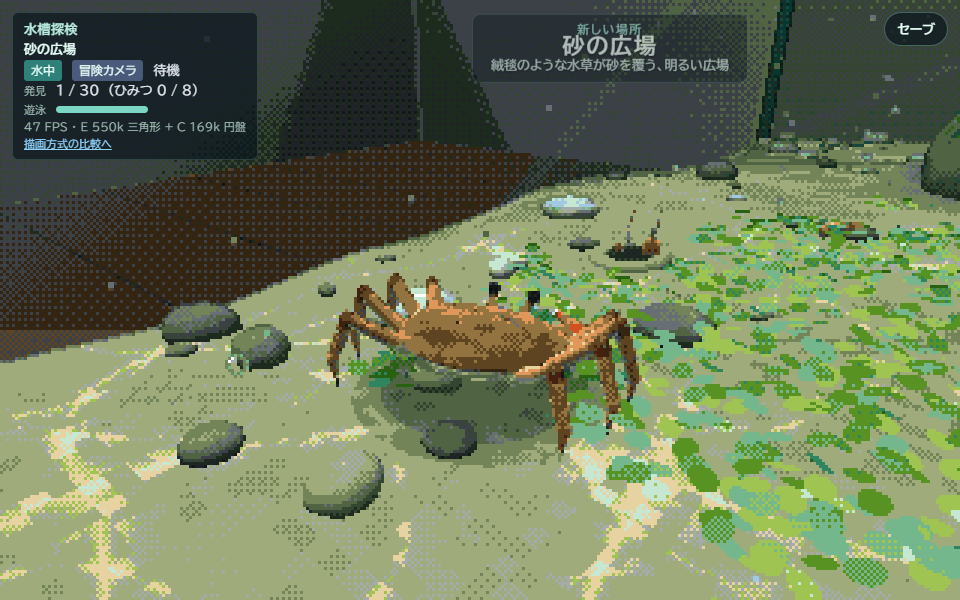 | 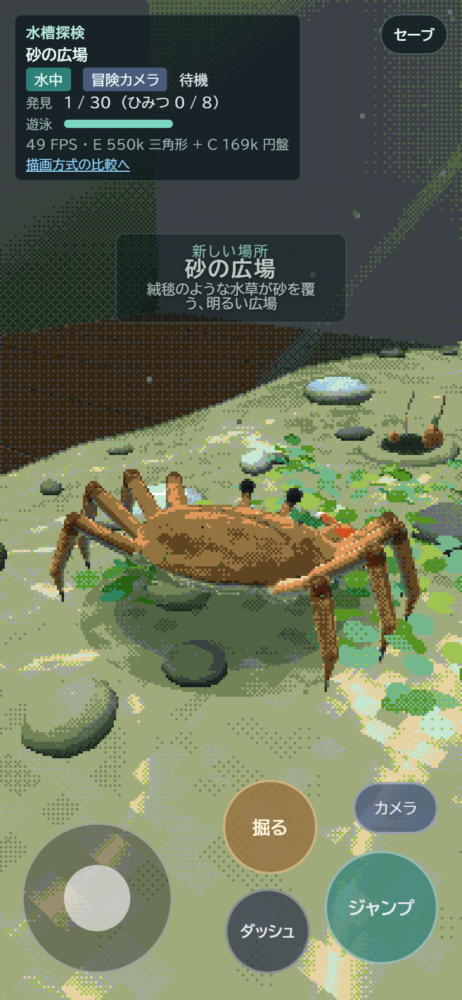 |
| 2. 調べる | 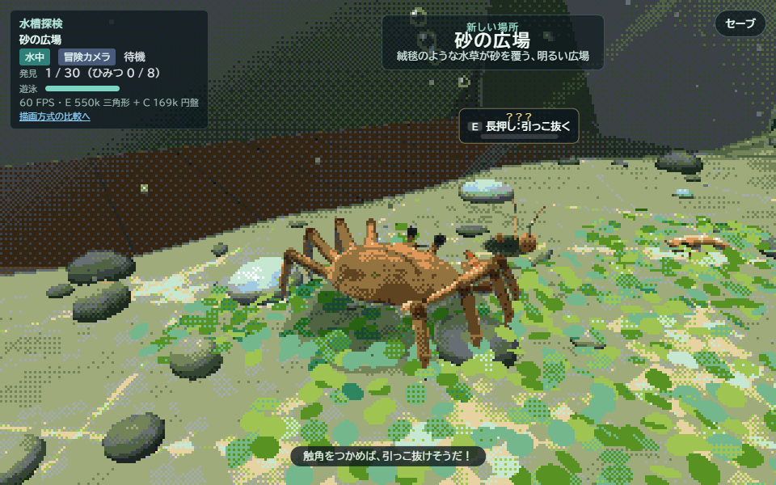 | 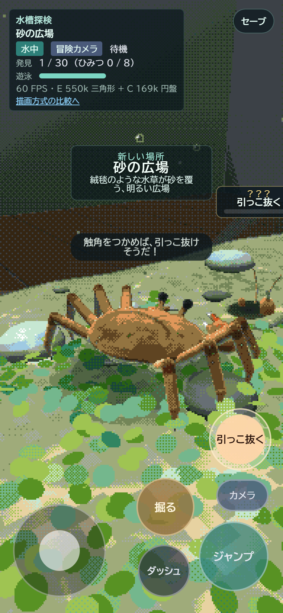 |
| 3. 引っ張っている途中（進み具合） | 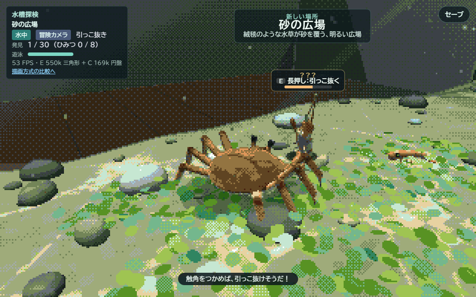 | 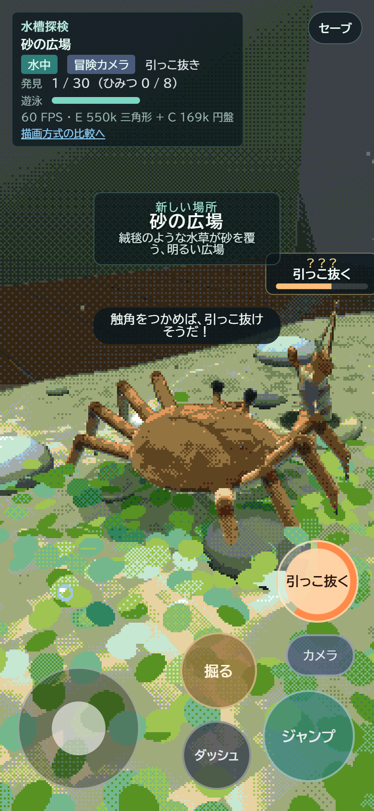 |
| 4. 抜けた瞬間 | 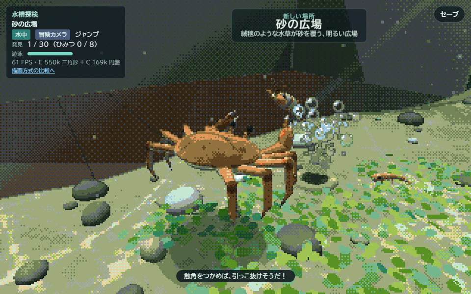 | 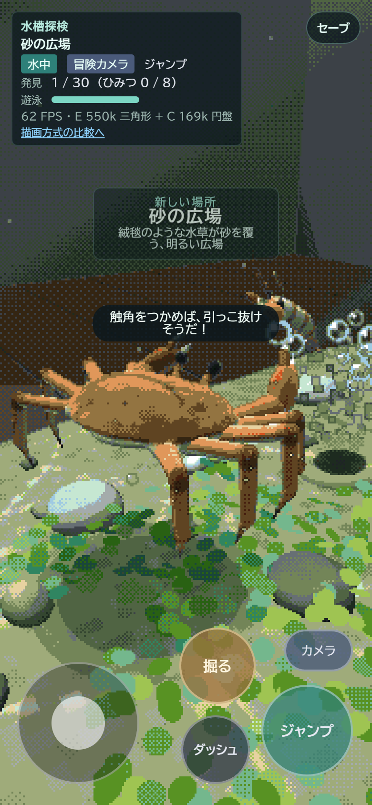 |
| 5. 仲間になった（全身が見える） | 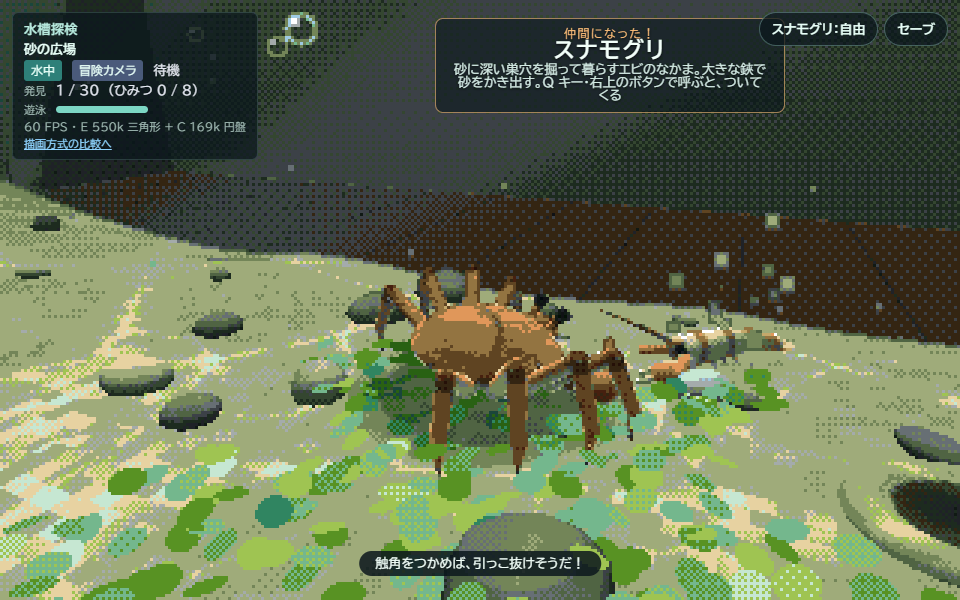 | 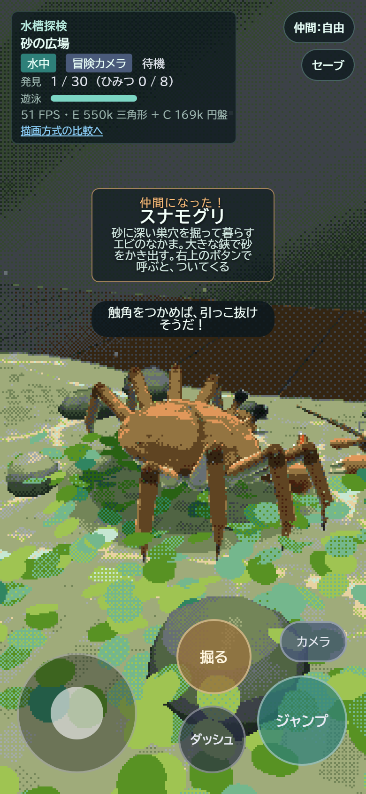 |
| 6. 同行 | 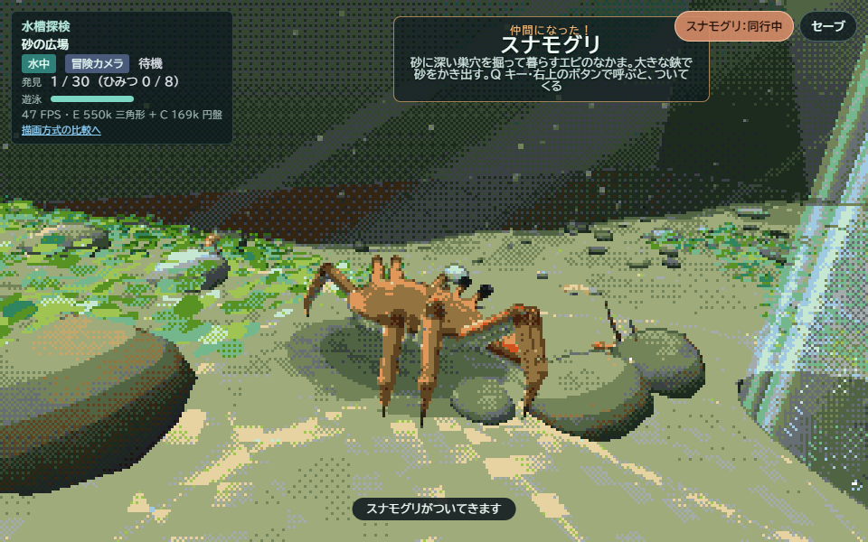 | 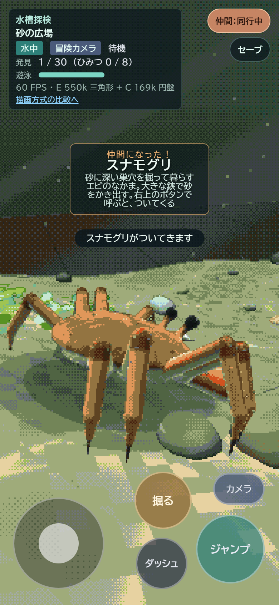 |

撮影：`docs/aquarium/tools/buddy_shots.js`（`globalThis.__over = { dir: 'docs/aquarium/<報告>' }`）。
道具：`save_helpers.js`（保存・復元・破損）、`buddy_helpers.js`（引っこ抜き・同行の毎フレーム検査）。

## 4. 残る問題

- **大量に掘った後の起動が遅い**：区画 610 個の作り直しに約 5.5 秒（進み具合は出る）。区画のメッシュを Web Worker で並行して作る、
  またはカニの近くだけ先に作って当たり判定を区画ごとに切り替える仕組み（いまの 2 つの版は全体で 1 回の切り替え）が要る。
- **ブラウザが保証しないこと**（6 章）：タブを閉じる・アプリを切り替える直前の数秒の進捗、Safari の 7 日の削除、プライベートブラウズ。
- **複数のタブ**：同時に開くと、後から保存しようとしたタブは保存しない（競合を知らせ、ファイルへの書き出しを勧める）。
  2 つのタブの進捗を 1 つにまとめる（掘った穴を合わせる等）ことはしない。
- **仲間は飾りの小石（当たり判定の無い見た目だけの石）と重なって見えることがある**（エビ・カニと同じ扱い）。
- 仲間は水の中だけを歩く（陸地・管の中・濾過槽へは来ない。待つ）。カニが壁や天井に張り付いている間は真下の床へ寄る。
- 引っこ抜いた生き物は 1 種・1 体。種ごとの差・個体の特徴（traits）は保存の場所だけ用意した。
- 既存の検査で基準と同じく残っているもの：`mesh_check` の不一致 3 本（基準の main と同じ光線・同じ場所）。

## 5. 資料とコードの食い違い（見つけたもの）

- 「最初の生き物は AquaLife.ts の仕組みを活用」：エビの見た目と動き（`buildShrimpMesh` の作り・`creatureVertex` の尾の動き・
  インスタンス描画）は使ったが、歩き方は `AquaLife` のエビ（住みかの円に閉じ込め・壁で止まるだけ）ではトンネル・掘った穴・
  ガラス際・追従の復帰が扱えないので、`AquaBuddy` に別に書いた。
- `AquariumDig.ts` の区画ごとの空洞の一覧は、掘る順（太らせた空洞があとから入る）によって並びが変わり、滑らかな min の値が
  わずかに（1e-6 程度）変わっていた（どの資料にも書かれていない）。保存から戻した形と一致させるため、番号順に並べるようにした。
- 検証の道具（`climb_test.js` など）は「場所ごとに新しいページを開き（前の穴が残らないように）」と書いてあるが、同じブラウザの
  文脈（同じ IndexedDB）で開くので、セーブを入れた後は前のページの穴・位置が読み込まれていた。道具が開くページに `?nosave` を付けた（7 章）。

## 6. 公開前の強化：保存の競合と iPhone での保存の信頼性

### 6.1 複数タブの保存の競合

- 書くたびに **世代 `rev`**（1 ずつ増える）と **更新の識別子 `saveId`**（毎回新しい値）を付ける。タブは「最後に読んだ / 書いた
  current の識別子」を覚えておく。
- 書くときは **1 つの IndexedDB の readwrite トランザクションの中で** current を読み、識別子が覚えている値と同じときだけ書く
  （違えば何も書かずに終える）。readwrite のトランザクションは同じストアに触れるものどうし順に実行されるので、
  読んでから書くまでの間にほかのタブの書き込みは入らない（localStorage の予備も同期の API なので同じ）。
- 競合したタブ：自動保存を止め、画面の上に知らせを出したままにする（「別のタブ（ウィンドウ）で新しい進捗が保存されました…
  このタブからは保存しません」）。ボタン：**このタブの進捗を書き出す**（`aquarium-save-このタブ-….json`）・**最新の進捗を読み込む**。
  セーブのボタンの印が赤くなり、メニューの「今すぐ保存」は押せない。
- 早めに気付く：保存したタブは BroadcastChannel で知らせる。タブへ戻ったとき（`visibilitychange`）にも current を確かめる。
  知らせが届かない環境でも、書くときの比較で上書きしない。
- 初期状態に戻す・ファイルの読み込みは、利用者が明示した置き換えなので比べずに書く（いまの current は検証を通るときだけ backup へ）。
  ほかのタブは知らせ（または書くときの比較）で競合になり、古い進捗で current を作り直さない。
- 識別子の無い古い保存データ（このブランチの最初の版）も、内容から作った識別子で比べる。

### 6.2 iPhone（Safari）を前提にした保存の信頼性

調査：

| 場面 | 以前の動き | 影響 |
| --- | --- | --- |
| ページが隠れる・閉じる（`visibilitychange` / `pagehide`）ときの保存 | IndexedDB へ非同期で書き始めるだけ | 書き込みは「current を読む → 読めたら書く」の 2 段。ページが止められると後半が実行されず、**最後の数秒の進捗が失われる**。Chromium で再読み込みのたびに確かめたところ、閉じる直前の書き込みは 3 回中 3 回とも保存先に入っていなかった |
| ふだんの自動保存 | 変化から 2 秒・前回から 4 秒 | 大事な出来事（仲間になった等）も最大 4 秒待つ |
| 保存の失敗 | メニューの中の文字だけ | 気付けない。書き直しは次の変化まで行わない |
| 保存の状態 | メニューを開かないと分からない | — |

改善：

- **閉じる直前の控え（ジャーナル）**：ページが隠れる・閉じるときに未保存の変化があれば、同期の API（localStorage、タブごとの鍵
  `ppp-aquarium:journal:<タブ>`）へ控えを書いてから IndexedDB へ書く。書けたら控えを消す。次に開いたとき、控えが残っていて
  current がまだ控えの元の状態（控えを書いたときの識別子）なら、控えから再開して保存先へ書き直す。ほかのタブがその後に保存していたら
  使わずに「使わなかった進捗」として残し、メニューから書き出せる。
- IndexedDB のトランザクションを `durability: 'strict'`（完了の知らせはディスクへ書けてから。対応しないブラウザは無視）にした。
- 大事な出来事（仲間になった・調べた・モードの切り替え・初めての場所・控えから再開）は 0.3 秒で保存する。
- 保存に失敗したら「保存できませんでした（理由）。少しあとで自動でもう一度保存します」と知らせ（続けて失敗している間は 1 回）、
  間を 8〜30 秒に広げて書き直す。
- セーブのボタンに状態の印（緑 = 保存済み、黄 = 未保存・保存中、赤 = 保存できていない・競合、灰 = 保存しない）。メニューに状態・
  最後の保存・世代・失敗の理由。
- メニューに「消されにくくする」（`navigator.storage.persist()` をブラウザに頼む。押したときだけ。結果を知らせる）。
- セーブのメニューは背の低い画面でもはみ出さないよう、中でスクロールする（横持ちのスマホで「本当に戻す」へ届かなかった）。

**ブラウザ側で保証できないこと**（画面のメニューにも書いた）：

- 保存の直後（数秒以内）にタブを閉じる・アプリを切り替える・ブラウザが落ちる・電池が切れると、最後の数秒の進捗は残らないことがある
  （控えの同期の書き込みも、ブラウザがページを止める前に終わる保証は無い。終わりやすい、まで）。
- iPhone・iPad の Safari は、しばらく（目安 7 日）開かなかったサイトの保存データを消すことがある（ホーム画面に追加した場合は別の扱い）。
  「消されにくくする」もブラウザが断ることがある。
- プライベートブラウズでは、閉じると保存データが消える。
- 大事な進捗は「書き出す」でファイルに残す。

### 6.3 確認したこと（`docs/aquarium/tools/save_conflict_test.js`。同じブラウザの文脈で 2〜3 ページ = 同じ保存先を共有するタブ）

| 場面 | 結果 |
| --- | --- |
| A 通常の自動保存：タブ 1・2・3 が同じデータを読み、タブ 1 が保存 | タブ 2 は知らせで競合（知らせを出し、印が赤）。知らせを受けないタブ 3 は書くときの比較で競合し、書かない。current はタブ 1 の進捗（空洞 16）のまま。タブ 2 の「このタブの進捗を書き出す」でファイルが落ちる |
| B 保存データが無い状態で 2 つ開く | 先に保存したタブの進捗が残り、後のタブは書くときに競合 |
| C ファイルの読み込み（タブ 1） | current は読み込んだ内容、前の current は backup。タブ 2 は競合になり書けない |
| D 初期状態に戻す（タブ 1、画面のボタン） | current は消え、前の進捗は backup。タブ 2 は「初期状態に戻された」競合になり、古い進捗で current を作り直さない |
| E current が壊れた状態で 2 つのタブが backup から再開 | 先に保存したタブが壊れた current を置き換え（backup は残す）、後のタブは競合 |
| F IndexedDB への書き込みが終わらないままページが止まった | 次に開くと控えから再開（空洞 16 = 止まる直前の進捗）、すぐ保存先へ書き、控えを消す。もう一度開き直しても控えは残らない |
| G 控えの後に別のタブが保存した | 控えは使わず（current はそのタブの進捗）、「使わなかった進捗」として書き出せる |
| H 保存の失敗（書き込みが例外） | 状態「保存できていません」・赤い印・知らせ。書き込みが直ると自動で書き直して「保存済み」 |
| ふつうの再読み込み 3 回（掘った直後） | 3 回とも控えから欠けずに再開（閉じる直前の IndexedDB の書き込みはどれも入っていなかった）。競合・使わなかった進捗にならない |
| 以前の検証の再確認 | 保存 → 再読み込みの完全一致（空洞 34・区画 49）、破損データ（NaN・版 99・水槽の外の空洞・文字列）から backup で再開 |

画面：競合の知らせ（PC）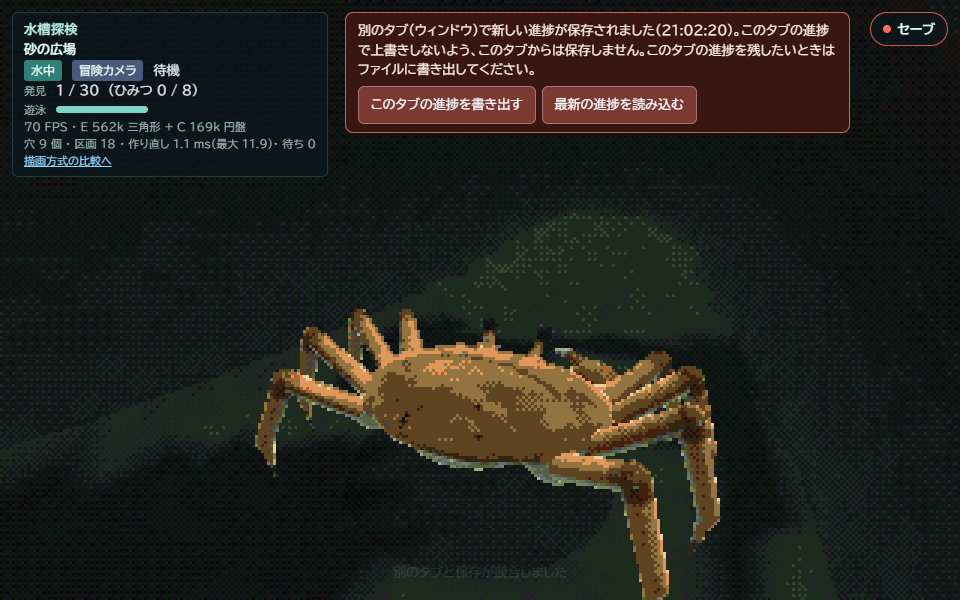 ／（スマホ）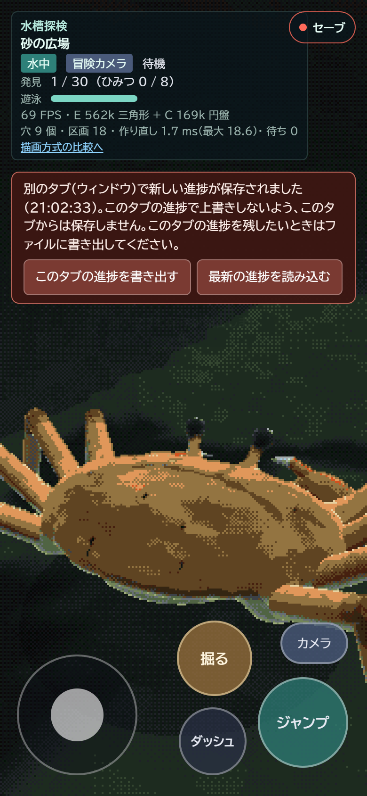 ／ セーブのメニュー（PC）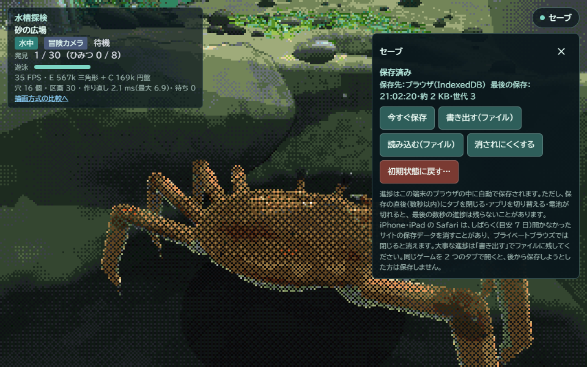 ／（スマホ）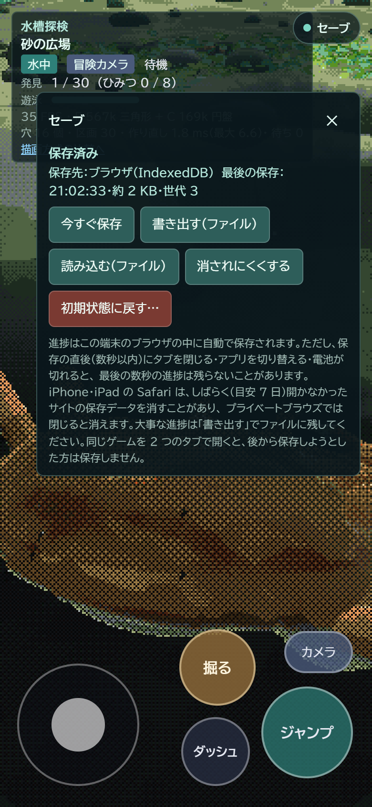

## 7. 壁登りの検証結果の整理

前の報告（PR #3 `docs/aquarium/wall-climb-glass-burrow/report.md`）：「掘った 60° のトンネルを掘らずに登り直す（10 地点。地表まで掘れた
7 地点）→ **7 / 7 で地表へ出る**」「地表まで掘れなかった 3 地点（岩・流木に当たる）は登り直しの検査の対象外」。
この報告の初版の「3 か所で抜け出せない」は、この **登り直しの対象外の 3 地点** のことで、誤解を招く書き方だった。

検査の中身（`climb_helpers.js` の `tunnelReclimb`）：その地点で水平に 5 秒掘る → 照準をいっぱいに上げて最大 14 秒掘り進む
（**地表まで掘れたか** = `digOutAt`）→ 掘ったトンネルの底へ戻り、掘らずにスティックだけで登る（**登り直せたか** = `reclimbOutAt`、
成功 = 地表より 0.15 上で接地 / 張り付き）。地表まで掘れなかった地点は、登り直す道が無いので対象外。

今回（`?nosave` で場所ごとにまっさらなページ）の結果と、掘り上がる途中で照準が当たった物の数（`digUpAim`。この版で記録を追加）：

| 地点 | 地表まで掘れた | 登り直し | 掘り上がる途中で照準が当たった物 |
| --- | --- | --- | --- |
| 岸の斜面 z8.3 | 3.23 秒 | 7.85 秒で地表へ | 砂 114 |
| 岸の斜面 z9.0 | 6.23 秒 | 9.80 秒 | 砂 132・土 13 |
| 奥の砂地 | 2.85 秒 | 4.73 秒 | 砂 7・土 34 |
| 手前の砂地（逆向き） | 1.68 秒 | 3.52 秒 | 砂 17 |
| 右の砂地（-x 向き） | 2.15 秒 | 2.37 秒 | 砂 3・土 15 |
| 奥の左（+z 向き） | 3.68 秒 | 7.57 秒 | 砂 57・流木 72（流木の脇を抜けた） |
| 左奥（+x 向き） | 2.55 秒 | 3.73 秒 | 砂 8 |
| 岸の斜面 z6.6 | 掘れない | 対象外 | **岩 823**・砂 17 |
| 水面近くの砂 | 掘れない | 対象外 | **岩 802**・土 21・砂 17 |
| 手前右（-z 向き） | 掘れない | 対象外 | **流木 824**・土 16 |

→ **地表まで掘れた 7 地点は 7 / 7 で登り直せる**（前の報告と同じ）。掘れない 3 地点は岩 2・流木 1 で、前の報告
（`free-dig-tunnel-cam/report.md` の表：z6.6 = 岩、水面近くの砂（照準 1.0）= 岩、手前右 = 流木）と同じ理由。

注意：この PR の初版の検証では、`climb_test` が場所ごとに開くページが同じ IndexedDB を共有していたため、前の場所の穴が読み込まれた
状態で測っていた（結果の組は同じだったが、条件が前の報告と違った）。道具が開くページに `?nosave` を付けて直した。
`?nosave` は保存せず保存データも読まないモードで、ゲームの動きは変わらない。
